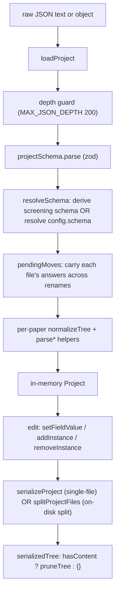

# Project Data Model

A SaiLoR project is, logically, one JSON document: a `config.schema` (the
annotation taxonomy), a list of `papers`, and each paper's annotation trees.
The interesting part of the data model is the **split** between what that one
document is on disk and what the app works with in memory. On disk it is a
meta-only `project.json` plus a family of small per-paper annotation files
under an annotations folder, designed so two reviewers never touch the same
file. In memory it is a single normalized `Project` object whose value trees
mirror the resolved schema, edited through one set of store actions and
serialized back through `pruneTree` + `splitProjectFiles`.

This page covers the on-disk layout, the in-memory types, the load → normalize
→ edit → prune → serialize lifecycle, the silent migration from the legacy
single-file shape, lazy file creation/deletion, the schema-version rename and
move machinery, and the five-state annotation vocabulary that the paper list,
its filter, and its finished counter all share.

The companion page [`annotation-schema.md`](annotation-schema.md) covers the schema types
(`AnnotationDef`/`ResolvedDef`), zod validation, and the completeness/validate
walks in detail; this page covers them only where they cross the project
lifecycle.

## On-disk layout

The serialized project is split into two layers:

- **`project.json`** — meta only. `version`, `title`, `provenance`,
  `protocol`, `schemaInfo`, `config` (the resolved `schema`, `ai`,
  `finishCheckbox`, `reviewers`, `aiSeat`, `screening`), the schema-version
  keys (`annotationsDir`, `schemaVersion`, `schemaHistory`), and a `papers`
  array carrying *paper metadata* (`id`, `title`, `authors`, `year`, `venue`,
  `doi`, `abstract`, `abstractFromPdf`, `pdf`) plus any preserved `extra`
  keys. No `annotations`, `reviews`, `aiUsage`, `equal`, `alignment`,
  `consolidationSync`, `marks`, or `finished` ever appear here.
- **`<annotationsDir>/<paperId>/…`** — one folder per paper, holding the
  per-paper-per-reviewer annotation files:

| File                                                         | Holds                                                                                                       | When it exists                       |
| ------------------------------------------------------------ | ----------------------------------------------------------------------------------------------------------- | ------------------------------------ |
| `consolidated.json`                                          | the consolidated/`annotations` tree, plus `aiUsage`, `equal`, `alignment`, `consolidationSync`, `finished`  | when the annotations tree has content or any of the others is non-empty |
| `reviewer-<n>.json`                                          | reviewer `n`'s own `annotations` tree and `finished` flag                                                  | when that tree has content or the flag is set |
| `marks-consolidated.json`                                    | the consolidated/Consolidation seat's `marks`                                                               | when `marks` is non-empty            |
| `marks-<n>.json`                                             | reviewer `n`'s own `reviewMarks`                                                                            | when that list is non-empty          |

A screening project swaps the `reviewer-`/`consolidated` prefixes for
`screening-<n>.json` / `screening-consolidated.json` — same layout, a different
prefix so screening decisions and full annotations are distinguishable at a
glance in the folder. PDF highlights get their own per-kind file family too:
`marks-*` for an annotation project, `screening-marks-*` for a screening
project (recognized, when a screening project still has an old `marks-*` file,
as `legacy` by `parseMarksFileName`, with the kind's own-named file winning for
the same seat). Since a highlight file carries its kind in its name, a
screening project and an annotation project over the same papers can share a
folder without ever writing the same file.

The split exists to keep two reviewers — or two reviewers of the same paper's
different slots — from ever editing the same file, which is what makes a git
merge of a multi-reviewer project survive without per-field conflicts.
`aiUsage`, `equal`, and `consolidationSync` are not split per reviewer even in
a multi-reviewer project: `aiUsage` is one array for the whole paper, `equal`
is inherently a consolidation-time concept, and `consolidationSync` describes
Consolidation's own automatic steps (which span every reviewer at once), so all
three ride in the consolidated file regardless of which tree they describe.
`alignment` rides there for the same reason — it is Consolidation's own
bookkeeping about *every* reviewer's entries and cannot be split into
per-reviewer pieces.

`splitProjectFiles` is the pure function that produces this split: given a
`Project`, it returns `{ meta, files }` where `files` is a list of
`ProjectFileEntry { relPath, text }`. A `text` of `null` means "this file
should not exist" — the caller (the platform adapter's `saveProject`, or the
git layer's `toSplitProject`) deletes it if present on disk. The function is
side-effect-free so it stays unit-testable without a filesystem; the Rust
shell does the actual writes/deletes (see
[`tauri-shell.md`](../operations/tauri-shell.md)).

## The annotations folder (shared-folder rules)

Where a project keeps its annotation files is itself data. `Project.annotationsDir`
is a folder *name* — never a path — of one folder sitting directly next to the
project file; `null` means the default `annotations`. A project file can arrive
by zip, USB, or a shared drive, so nothing it names may reach anywhere else:
`annotationsDirProblem` refuses a name with separators, `.`/`..`, `:` (drive
letters), control characters, a trailing dot or space, reserved Windows device
names, hidden names starting with a dot, or (case-insensitively) `feedback`,
which is the reserved subfolder for AI schema-feedback files inside the
annotations folder (`FEEDBACK_DIR`, see
[`llm-annotation.md`](../workflows/llm-annotation.md)). A refused
name degrades to the default with `refusedAnnotationsDir` kept in memory for a
load-time warning, and is never written back.

The desktop shell re-checks every rule on the far side of the IPC boundary:
`annotations_dir_for` (`src-tauri/src/project.rs`) resolves the folder, insists
its parent really is the project's directory (also after `canonicalize`, so a
`..` or a symlink cannot smuggle it out), and refuses a folder that is itself a
symbolic link. `safe_read` reads a paper's file only when it stays `within` the
base both before and after canonicalization. `write_project_files` refuses to
write outside the folder, refuses a `feedback/…` path as a paper file, and
deletes only when `isDeletableAnnotationText`'s Rust twin says the existing text
is safe to lose (empty or parseable JSON — an unparseable file such as one with
git conflict markers must survive, because the loader reads it as absent and a
delete would unlink the only copy).

Several project files can sit *next to each other* and share one folder — that
is exactly what a "save the annotation project next to the screening project"
flow produces. Two such projects collide only when they are of the same kind
(`filesCollide`: screening-ness must match) *and* list a paper id in common,
compared the way a case-insensitive disk would (`paperIdKey`: NFC-normalized,
lowercased — so an NFD "Über" from a macOS checkout meets an NFC "Über"). That
check gates three flows:

- **Save / save-as** — the editor's save and the store's `saveAs` call
  `annotationsDirUsers` to name the sibling files that would collide, and
  refuse (or fall back to a folder named after the file, `defaultSplitDirName`)
  before anything is written.
- **Moving the folder** (`moveAnnotationsDir`) — the Rust side renames the
  folder *first* and records the new name in the project file, restoring the
  old name if the project file cannot be written. It refuses when another
  same-kind sibling already uses the target name, or when the target folder
  exists and is not empty.
- **Splitting the folder** — when `sharedAnnotations` reports that sibling
  projects really are using the same folder, `planSplit` (`annotationSplit.ts`)
  works out which file belongs to which project, and the reviewer confirms
  before the split runs. Planning stays in TypeScript: by paper id and file
  kind first; where that leaves more than one candidate, the schema version
  the file was written under decides, then which project's schema describes
  more of its answers (`fit`/`linkFit`); an unresolvable tie is *copied* to
  each, since losing a file is worse than duplicating one. The Rust
  `project:splitAnnotations` command performs it: it re-validates the plan
  against the listing it remembered (every project got a folder, folders
  unique case-insensitively and not the shared one, rows only name listed
  files and known projects, nothing changed on disk since listing), then
  carries out `applySplit`'s order — copy everything first, point each
  project file at its new folder, delete last, remove emptied folders — so a
  stop at any point still leaves every answer in at least one place a project
  reads from.

## In-memory types

### `Project`

```ts
interface Project {
  version: number
  title?: string
  provenance: ProjectProvenance | null
  protocol: ProjectProtocol | null
  schemaInfo: string | null
  schema: ResolvedDef[]
  schemaVersion: string | null
  schemaHistory: SchemaHistoryEntry[]
  annotationsDir: string | null
  aiEnabled: boolean
  finishCheckbox: boolean
  reviewers: number
  aiSeat: boolean
  papers: Paper[]
  screening: ScreeningConfig | null
  extra: Record<string, unknown>
}
```

A few invariants worth knowing:

- `provenance`, `protocol`, and `schemaInfo` are **required-not-optional**
  (`T | null`, not `T?`). Constructing a `Project` without deciding what to do
  with each is a type error, not a silent drop — this matters at
  `mergeProjects`, where an accidental `undefined` would lose the field.
- `protocol` and `schemaInfo` live at the **root**, not under `config`.
  `config` is a strict zod object rebuilt from scratch on every save, so
  anything hand-added under it (`config.protocol`,
  `config.researchQuestions`) is silently dropped the first time the file is
  saved. Root-level fields round-trip.
- `aiEnabled` defaults to `false` (only an explicit `config.ai: true` opts
  in); `finishCheckbox` defaults to `true` (only an explicit
  `config.finishCheckbox: false` opts out).
- `reviewers` defaults to `1` (single-reviewer). More than `1` means each
  reviewer `1..N` annotates independently into `Paper.reviews[N]`, plus a
  built-in Consolidation seat that reconciles them into `Paper.annotations`.
- `aiSeat`, when effective (`aiSeatId`: `aiSeat && aiEnabled &&
  reviewers >= 2`), dedicates the *last* reviewer seat to the AI —
  `String(project.reviewers)`, never a separately stored id, so there is
  nothing to merge-conflict over which number it is. `seatLabel` is the one
  place every "Reviewer N" label routes through, so the AI seat is never
  accidentally shown as an ordinary human reviewer.
- `screening`, when set, is the single source of truth for the schema: the
  `schema` field is *derived* from `config.screening.reasons`
  (`screeningSchemaDefs`) on every load, and whatever `config.schema` the file
  held is ignored. The derived schema is written back on save so the file stays
  self-describing, but the two can never drift.
- `extra` holds any unknown top-level keys, preserved verbatim on save.

### `Paper`

```ts
interface Paper {
  id: string; title: string; authors: string[]; doi?: string
  year?: number; venue?: string; abstract?: string; abstractFromPdf?: boolean
  pdf: string
  annotations: AnnotationValueTree      // the single/consolidated tree
  reviews: Record<string, AnnotationValueTree>   // keyed "1".."N"
  aiUsage: AiUsageRecord[]
  equal: string[]                        // canonical field paths marked "same answer"
  alignment: StoredAlignment             // Consolidation's entry-matching record
  consolidationSync?: string             // what its automatic steps last ran against
  marks: PdfMark[]                       // consolidated seat's PDF highlights
  reviewMarks: Record<string, PdfMark[]> // per-reviewer highlights
  finished: boolean                      // consolidated seat's sign-off
  reviewsFinished: Record<string, boolean>  // per-reviewer sign-off
  unknownSchemaFiles?: string[]          // per-file keys read under an unknown version
  extra: Record<string, unknown>
}
```

The single-tree-vs-per-reviewer split repeats three times — `annotations`/
`reviews`, `marks`/`reviewMarks`, `finished`/`reviewsFinished` — for the same
reason each time: each reviewer owns their own reading independently, and the
consolidated/Consolidation seat owns the reconciled record that ships. In a
single-reviewer project the per-reviewer maps stay empty and `annotations`/
`marks`/`finished` alone carry the data, exactly as before multi-reviewer
support existed.

`finished` is deliberately **not derived** from the data: a full tree means
every field has something in it, which is a fact about the form, not a
judgement that the extraction is right. Only a human can make the second claim,
so it is stored rather than computed. It is not re-derived on load either, so a
later edit that empties a field leaves the flag standing while the dot stops
being green (the paper list requires both) — nothing silently un-declares what
a reviewer declared.

A paper id is also a *folder name*: `splitProjectFiles` writes a paper's
annotations to `<paperId>/…` verbatim, and `paperIdProblem` refuses an id with
Windows-illegal characters, a trailing dot or space, reserved device names, or
case/normalization collisions with another id (`paperIdKey`) — the mistakes
that only surface on a teammate's machine. `feedback` (in any case) is
reserved. The editor's live warning and the save-blocking gate share the same
check, and the Rust side has its own twin (`paper_id_ok`).

### Annotation value tree

```ts
type FieldValue = string | number | boolean | null
interface InstanceNode { value?: FieldValue; children?: AnnotationValueTree }
interface AnnotationValueTree { [nodeName: string]: InstanceNode[] }
```

The tree mirrors the resolved schema: at each level it is a map keyed by node
name, every key holds an array of instances (bounded by the node's `min`/`max`),
and each instance may carry a `value` (if the node is a field) and/or
`children` (a nested tree). `emptyValue` gives the default per type (`false`
for boolean, `null` otherwise); `makeInstance`/`initTree` build fresh instances
recursively initializing children to their `min` (at least 1). What counts as a
**recorded answer** is `isRecordedAnswer`/`instanceHoldsAnswer`: an unticked
checkbox is *not* evidence of anything (every boolean reads `false` whether or
not anyone looked), and a blank or whitespace-only string is not an answer
either — the same rule the dot, the file-liveness checks, and the screening
filters all share.

### `StoredAlignment` and `consolidationSync`

```ts
interface StoredSlot { members: Record<string, number>; children?: StoredAlignment }
type StoredAlignment = Record<string, StoredSlot[]>
```

`alignment` records which of each reviewer's repeated entries are *the same
entry*, as an explicit mapping rather than by physically reordering the
reviewers' arrays (the pre-v1.7 approach, which wrote Consolidation's
bookkeeping into other people's data). Anything that reads across reviewers
projects them through `alignedReviews` first, which produces the same lined-up
view as a throwaway copy without touching the stored trees. It is persisted
(rather than recomputed on demand) because matching is offered *before* the
consolidator starts work, and once they have committed an answer under a slot,
that slot must keep meaning the same thing — a mapping recomputed after a
reviewer's later edit could quietly move a different entry into the slot. See
[`consolidation.md`](../workflows/consolidation.md).

`consolidationSync` is Consolidation's other bookkeeping field: a
`reviewsDigest.consolidatedDigest` pair (djb2 hashes of each side's *pruned*
trees) recorded after its automatic steps run on a paper, so opening the seat
again does not repeat them and undo the consolidator's edits — the reviewers'
half answers *should the steps run again*, the consolidated half *is there
anything to protect*, and pruning first keeps a purely cosmetic reshape (an
empty instance `normalizeTree` adds) from reading as somebody changing their
mind.

### `AiUsageRecord`, `ProjectProvenance`, `ProjectProtocol`

`AiUsageRecord` (`{ provider, model, appliedAt }` plus optional `mode`,
`judge`, `rounds`, `verdicts`, `fewShot`, `edited`, `rechecked`,
`webSearches`, `reviewer`) is a permanent AI-usage disclosure — one entry per
AI pass that actually wrote something, append-only, oldest first. Unlike the
session-only "unconfirmed" `aiMarks` in the store, it survives into the saved
file. See [`llm-annotation.md`](../workflows/llm-annotation.md) for what
each mode records and [`ai-screening.md`](../workflows/ai-screening.md) for
the screening proposal pass.

`ProjectProvenance` records where a project's papers came from when built by
importing from another project (today only `kind: 'screening-import'`): the
source's title and file name (never a path — these files are git-committed, and
an absolute path leaks the author's filesystem), the import timestamp, and a
`counts` snapshot (`included`/`undecided`/`excluded`/`carried`) that a PRISMA
flow diagram needs and that nothing can re-derive later. `null` for a project
started from scratch. `screeningSource` reads the named sibling back when it is
still next to the project — a plain file name only, no separators, no leading
dot, not the project itself.

`ProjectProtocol` is the review's authored protocol — research questions,
search strings, databases, search date (free text, not an ISO instant: a
search is usually a range), notes — recorded inside the project file so a
pre-registered SLR's defining decisions travel with the data they produced.
Every field is optional and authored by hand; `null` when the file records
none.

## The load → normalize → edit → prune → serialize lifecycle



*The lifecycle from raw JSON through normalized in-memory `Project` to the
pruned, split on-disk files.*

### Load: `loadProject`

`loadProject(input: string | unknown): Project` is the single entry point. It:

1. **Depth-guards first** (`exceedsDepth`, `MAX_JSON_DEPTH = 200`), before any
   recursive walker runs. Almost every traversal (zod, `resolveDefs`,
   `normalizeTree`, `deepEqualJson`, `serializeProject`) is recursive and blows
   the stack somewhere between a few hundred and a few thousand levels; a
   deeply-nested hand-edited file would otherwise escape this function's
   "throws `ProjectLoadError` with friendly details" contract as a raw
   `RangeError`.
2. **Parses with zod** (`projectSchema`). A `ZodError` becomes a
   `ProjectLoadError` with one detail per issue; a `RangeError`
   (belt-and-braces against the depth guard) becomes a "nested too deeply"
   error.
3. **Resolves the schema.** For a screening project the schema is *derived*
   from `config.screening.reasons` (`screeningSchemaDefs`); for any other
   project the authored `config.schema` is resolved. `SchemaError` becomes a
   friendly `ProjectLoadError`.
4. **Checks for duplicate paper ids** (which would break selection/navigation).
5. **Carries each file's answers across schema renames and moves** (see the
   next section): each paper's `schemaVersions` map says what version each of
   its files was written under, and `pendingMoves` works out the moves that
   file has not seen yet. A file stamped with a version the project's history
   does not know is read *as it is* and its key lands in
   `Paper.unknownSchemaFiles`, which Validate reports.
6. **Builds each `Paper`**, defensively parsing every hand-editable field:
   `normalizeTree` for `annotations`, `normalizeReviews` for `reviews`,
   `parseAiUsage`, `parseEqual`, `parseAlignment`, `parseMarks`/
   `parseReviewMarks`, `parseReviewsFinished`, and `parseYear`/`parseProvenance`/
   `parseProtocol`/`parseSchemaInfo`. Unknown keys go to `extra`.

The defensive-parse convention is uniform: the file is hand-editable, so a
malformed entry is **dropped, never thrown over** — except `parseScreening`,
whose reasons *are* the schema's enum and so cannot be degraded past (an empty
result is a load error, not an empty list). Optional sub-records
(`parseProtocol` field-by-field, `parseAiUsage`'s judge/verdicts) drop only the
bad sub-record, not the whole entry; `parseProvenance` is deliberately
all-or-nothing, since a half-parsed record would be misleading.

### Normalize: `normalizeTree`

`normalizeTree(defs, existing)` reconciles a (possibly partial, possibly
hand-edited) value tree against the resolved schema: coerces each present
instance's structure to the def, pads up to `min` (and at least 1) instances,
and clamps down to `max`. It also adopts shorthand shapes a hand-editor might
write — a bare primitive (`"Study Type": ["RCT"]` instead of
`[{value:"RCT"}]`) or a single entry where the format wants a list
(`"Study Type": "RCT"`) — *as the value* rather than dropping it, because this
walk is the one that rewrites the file and discarding it would let the next
save overwrite a real answer with `null`. Keys the schema no longer knows
about are **not** dropped: `orphanedNodes` carries them through verbatim (when
they hold a real answer), so renaming a field in `project.json` does not
destroy the answers other reviewers recorded under the old name — restore the
name, and they reappear. Nothing in the app renders an orphan; the only way a
reviewer can be told the data is there is Validate's
`orphanedNodePaths`-derived issue ("Holds answers under … which the schema no
longer describes").

`normalizeReviews` additionally backfills a skeleton tree for every reviewer
`1..reviewerCount` who has no tree of their own. A reviewer who has not started
otherwise has no key in `reviews` — fine for the app, but bad for a JSON diff,
where their first annotation would look like a whole new field appearing out of
nowhere. A key already there with `null`s turns that into an ordinary
value-on-an-existing-line change. It never removes a key for a reviewer number
*above* `reviewerCount`: lowering the count hides that reviewer's tree but must
not be what deletes it.

### Edit: `setFieldValue` / `addInstance` / `removeInstance`

Edits go through the store, which routes every write to the correct seat's tree
via `currentTree`:

- single-reviewer, or Consolidation seat → `paper.annotations`
- a numbered reviewer → `paper.reviews[currentReviewer]` (lazily created on
  first write)
- multi-reviewer with nobody selected → `null`, and every editing action is a
  no-op: nothing to attribute an edit to

`setFieldValue(path, name, index, value)` walks `containerAt(tree, path)` to
the addressed instance and sets `inst.value`. It **coalesces consecutive edits
of the same field** into one undo step (keyed by `path|name|index`). In the
Consolidation seat it also maintains the `equal`/deferral invariants: emptying
a field clears its `equal` mark (a resolved field must not read as resolved
while holding no answer); picking a value clears a pending deferral but does
not by itself set `equal` (only the explicit "these answers mean the same
thing" checkbox may).

`addInstance`/`removeInstance` push/splice instances, respecting `max`/`min`
via `canAdd`/`canRemove`. `removeInstance` does extra bookkeeping: because
every structure addresses a field instance by canonical path with an embedded
index, removing anything but the last entry shifts the survivors' indices, so
linked-field mark paths, AI marks, `paper.equal` entries, deferred
consolidations, and `paper.alignment` slot members are all rewritten via
`shiftCanonicalPath` (or dropped when they named the removed instance itself).
All three set `dirty` and push an undo snapshot (unless coalescing).

### Prune: `pruneTree`

`pruneTree(defs, tree)` drops **trailing** empty instances from each list, so
saved files stay tidy; required instances (up to `min`, at least 1) are always
kept. Only trailing empties go — an empty instance with a filled one after it
is a gap on purpose and is kept, because position carries meaning
(Consolidation lines reviewers' lists up by index, and closing a gap would
silently re-point the alignment at the wrong entries on the next load). A
trailing instance is also kept when it holds **orphaned** answers under child
names the schema no longer knows about (`holdsOrphans`): without that second
test, dropping trailing empties would delete the very answers a node losing its
children was meant to preserve (see `orphanedNodes`).

### Serialize: `serializeProject` and `splitProjectFiles`

`serializeProject(project)` produces the **logical whole-project JSON** (the
single-file shape) — `config` written from the resolved schema, annotation
trees pruned of trailing empties, optional fields omitted when empty, `extra`
re-emitted. This is the contract every platform shares and what git-diff/tests
deal in; papers are sorted by plain case-sensitive string comparison on `id`
(deterministic, locale-independent).

`serializedTree(schema, tree)` is the per-tree serialization rule used by both
serializers: `hasContent(schema, tree) ? pruneTree(schema, tree) : {}`. An
empty normalized tree (which exists in memory to bind the form to the schema)
does not belong in a file until a reviewer has recorded an answer — or until a
schema edit has orphaned one. `hasContent` is `hasAnnotations(schema, tree) ||
treeHoldsOrphans(schema, tree)`: a real answer keeps the file, but so do
answers that sit under a node name the current schema no longer knows about
(see `orphanedNodes`). Without the orphan half, removing the one field a
reviewer had filled in would still be what deletes their work — the very case
`orphanedNodes` exists to prevent. This rule is shared by `serializeProject`
and `splitProjectFiles`.

`splitProjectFiles(project)` produces the **on-disk split** (`{ meta, files }`)
described above. The platform adapter (`src/platform/desktop.ts`) re-parses
`serializeProject`'s output with `loadProject` and runs `splitProjectFiles` on
the result; the git layer (`src/state/gitStore.ts`) does the same via
`toSplitProject` for merge finishes and working-tree writes.

### Change detection: `deepEqualJson`

`deepEqualJson(a, b)` is structural equality for plain JSON values:
order-independent for object keys, order-sensitive for arrays, exactly JSON's
notion of equality otherwise. It is deliberately not a text/string comparison
— `serializeProject` freely rewrites whitespace, indentation, and key order on
every save, and a structural comparison is what keeps those cosmetic rewrites
from looking like a semantic change. It is shared across the codebase for that
reason: `git/merge.ts`'s three-way field-change decisions and
`git/changes.ts`'s bookkeeping-field and schema/provenance/protocol diff checks
both use it, so a second implementation of the same notion would be a bug
waiting to happen.

## Schema versions: renames and moves

Answers are stored under node names, so a node's identity *is* its name path.
When the project editor renames or moves a node, that change is recorded as a
**move** (`SchemaMove { from, to }` name paths) in a new **schema version**
(`SchemaHistoryEntry { id, parents, at, moves }`), and every annotation file
records the version it was written under. `Project.schemaVersion` is the
current version (null when the schema has never been edited); every paper's
`schemaVersions` map (assembled from the per-file `schemaVersion` stamps on
read, written back as one map by both serializers) names the version of each of
its files. The mechanics live in `model/schemaVersion.ts`:

- **`pendingMoves(history, fileVersion, current)`** — the moves a file written
  under `fileVersion` has not seen yet, in history order. `null` means the
  file predates versioning, so every recorded move is newer than it;
  `undefined` means it is already current; `'unknown'` means the project's
  history does not know that version (a file from a branch with a different
  schema, or edited by hand) — the file is then read as it is and reported via
  `unknownSchemaFiles`.
- **`ancestorsOf`** — `id` plus every version it descends from, through both
  `parents` and `absorbed`, which is how a merged history is walked without
  replaying moves a branch already had.
- **`amendVersion`** — folds new moves into the *current* version instead of
  starting a new one, while that version is still private (see below). It
  still takes a new id and records the old one in `absorbed` with the number of
  its moves the old id had seen, so files already stamped with the old id get
  exactly the moves they missed.
- **`moveInTree`** — applies one move to an annotation tree. Below the part of
  the two paths they share, answers can only be carried through *single*
  entries — which of several repeated entries would an answer land in? — so a
  move that would need that, or would land on answers already at the
  destination, leaves the tree as it is and the old answers stay hidden.
- **`moveInMarks`** — applies one move to a PDF mark's linked-field paths,
  under the same single-entry rule (keeping the entry index of the leaf).
- **`moveInDefs`** — applies one move to a schema itself, so a merge can bring
  both sides' *schemas* to their merged history before comparing answers.
- **`mergeHistories`** — both sides' histories in one list, ours' order first;
  **`newSchemaVersionId`** is a `crypto.randomUUID()`.

**When a version is created.** The editor's save compares the schema it would
write with the one the file last held (`savedSchemaJsonOf`); a difference
triggers `nextSchemaVersion`, which records the pending renames/moves
(`pendingSchemaMoves`) under either an *amended* current version or a new one.
A version is "private" (`versionIsPrivate`) while it has not left the machine:
in a repository, while HEAD does not contain it (never committed); without
one, for `PRIVATE_VERSION_MS` (6 minutes). This keeps the history from gaining
an entry for every save, while never folding moves other people may already
have stamped files with. The version is only kept in editor state once the
save actually succeeds, so a failed save leaves no version behind that no file
has.

**How renames interact with saves.** `loadProject` migrates each file's
answers to the current version on load; both serializers then stamp *every*
file they write with the project's current version, so reading the text back
moves nothing again. The desktop adapter's save baseline knows this: when the
meta's schema version changed since the baseline was recorded, `rebaselined`
re-splits the loaded project under the new version before comparing, so a
rename that carried every file's answers to new names does not make all those
files count as "edited" and rewrite each one in a shared repository.

**How renames interact with merges.** `mergeProjects` builds one history for
all three sides (`mergeHistories` twice) and brings each side up to it
(`atHistory` → `pendingMoves` → `withMoves`, applying `moveInDefs` to the
schema and `moveInTree`/`moveInMarks` to answers and field links) — a field
one side renamed and the other edited then merges field by field. A node both
sides renamed *differently* since the base is a clash (`renameClashes`): the
reviewer decides which name it keeps, rather than whichever side's move
happened to come first in the history silently winning and hiding the other
side's answers. The merged project's version is either side's when it already
includes the other's, otherwise a fresh one with both as parents
(`mergedSchemaVersion`), and the chosen rename is recorded in the merge
version's own moves so a file arriving later from the other branch lands under
the same name.

## Reading the split layout back

The desktop shell reads the split layout and hands the renderer one JSON text
in the single-blob shape `loadProject` already parses, so the read path reuses
`loadProject` unchanged rather than duplicating its validation:

- **Rust side** (`read_project` in `src-tauri/src/project.rs`): reads
  `project.json`; if `is_legacy_shape` (any paper carries `annotations` or
  `reviews` inline) it returns the text as stored, with no annotation files.
  Otherwise it resolves the annotations folder (with all traversal/symlink
  checks), and returns every `.json` in each listed paper's folder — plus the
  *sibling* project files sharing the folder, for the shared-folder flows.
- **TS side** (`assembleProject` in `src/platform/tauri.ts`): parses
  `project.json`, and if `isLegacyProjectShape` is true passes the text
  through untouched — a pre-split file already *is* the single-blob shape.
  Otherwise it sorts each paper's files (a kind's own-named marks file beating
  a legacy-named one), parses each one (a file that does not parse counts as
  *absent* and its path goes to `corrupt`), and hands the parts to
  `assembleLegacyProjectJson`.
- **`assembleLegacyProjectJson(meta, paperFiles)`** splices each paper's
  consolidated/reviewer/marks files back into its `papers[i]`, lifting
  `annotations`, `finished`, `aiUsage`, `equal`, `alignment`,
  `consolidationSync`, `marks`, `reviews`, `reviewsFinished`, and the per-file
  `schemaVersions` into the whole-project shape. A paper with no files on disk
  gets an empty entry.
- **`projectFromFiles(meta, files)`** is the same reassembly wrapped in
  `loadProject` — the inverse of `splitProjectFiles`, used by the git layer's
  snapshot reads and by the stale-save clash resolution.

### Corrupt-file reporting

An annotation file that is not valid JSON (a leftover git merge conflict is
the usual cause) loads as *absent*, so the seat it belongs to reads as having
done nothing — everywhere. Silence would let a reviewer redo or overwrite work
that is still sitting on disk, so the adapter's `corruptFiles` list flows into
`AppState.corruptFiles` after open (and after `openRecent`), raised as a
`loadError` naming up to ten paths (`annotations/<paperId>/<file>`) and
counting the rest. The list is kept for the whole session (not only raised
once), and `showCorruptFiles` re-raises it from the View menu — a reviewer who
dismissed the banner has no other way to find out the project is still missing
somebody's work. The files themselves are never deleted: the Rust save path
refuses to remove a file whose on-disk text is not deletable
(`isDeletableAnnotationText`), which is exactly what keeps a conflicted file
alive.

## Saving

The store's `save()` serializes with `serializeProject` and hands the text to
the platform adapter, which:

1. Re-parses with `loadProject` and runs `splitProjectFiles`.
2. Compares against the **baseline** (`lastWritten` in
   `src/platform/desktop.ts`): how the open project's files last stood on
   disk, recorded at every open and every save. A save writes only what
   differs from it, so adding a field to the schema (which `pruneTree`
   materializes as an empty entry in every tree) does not turn one reviewer's
   edit into a diff across the whole annotations folder. Paths the project
   used to write and no longer does — a removed paper, a renamed paper id —
   are deleted (their files move to the new id's folder), and the baseline is
   what makes that safe to distinguish from a sibling project's files: it
   only ever holds paths *this* project itself read or wrote.
3. Sends only the changed entries to the shell. `metaText` is `null` when
   `project.json` itself is unchanged.
4. The Rust `project:save` refuses paths never opened/chosen this session,
   checks each target against the stamps it recorded at open/save (a file
   that changed on disk since is **stale** — nothing is written, and the
   adapter throws `StaleSaveError`), then writes the meta first and
   reconciles the annotations folder: write non-null entries, delete null
   entries (only when the existing text is deletable), create parent
   folders, and remove a paper folder left empty.

A stale save surfaces as `staleSave` in the store, offering
keep-mine/keep-disk (file by file, via `resolveClash`) or a field-by-field
`mergeProjects` combine. Every git flow that can rewrite the working tree
drops the baseline (`withBaselineDropped`) so a stale baseline can never make
a save skip a file it should have written.

**Save-as rebasing** (`saveAs`): the destination is picked *before*
serializing, because a paper's `pdf` is stored relative to the project file —
`rebasePdfPaths` re-expresses each path against the new location, and undo
history is dropped only when the paths actually moved (its snapshots hold
`paper.pdf` relative to the old location). Before writing, the store checks
the destination for a sibling project that would collide with this project's
annotations folder name (`annotationsDirUsers`), and falls back to a folder
named after the file (`defaultSplitDirName`) if the file's own default folder
name is taken too. The editor's save moves an existing project's annotations
folder *before* the project file names it (`moveAnnotationsDir`), which is
refused rather than half-done.

### Legacy single-file migration

A project file may predate the split layout and carry `annotations`/`reviews`
inline under each paper (the "legacy single-file shape"). Two functions
handle the transition:

- **`isLegacyProjectShape(raw)`** — true when any paper in the parsed
  `project.json` has an `annotations` or `reviews` key (Rust twin:
  `is_legacy_shape`). Both the shell's read path and `assembleProject` use it
  to decide whether a file needs reassembly at all.
- **`assembleLegacyProjectJson(meta, paperFiles)`** — reassembles a
  meta-only `project.json` body plus its per-paper annotation files back into
  the legacy whole-project shape `loadProject` already knows how to parse, so
  the read path reuses `loadProject` unchanged rather than duplicating its
  validation/defaulting logic.

Migration to the split layout is **silent and automatic on the next save**:
the platform adapter's `saveProject` (and the git layer's `toSplitProject`)
always write through `splitProjectFiles`, which produces the split layout
regardless of the shape the file was read in. Opening a project **never writes
to disk by itself** — the old shape-migration that re-serialized and resaved
on open was removed, because a schema field added after the file was written
made every paper's file look "changed" and produced a whole-folder diff in a
shared repository from a reviewer who only looked.

## Lazy file creation and deletion

Per-paper-per-reviewer files are written **only when the tree holds content**
(`hasContent` — a real answer *or* orphaned answers under a removed schema
node), and deleted when empty:

- `reviewer-<n>.json` — written when reviewer `n`'s tree has content (`has`)
  *or* their `finished` flag is set (a reviewer who ticked the box and then
  cleared a field still said something; dropping the file would silently
  un-say it). Otherwise `text: null` → delete if present, unless the file on
  disk does not parse as JSON (`isDeletableAnnotationText`): the read path
  maps an unparseable annotation file to "absent", so reconciling that slot
  away would unlink the only copy of, say, a reviewer tree committed with
  git conflict markers in it.
- `consolidated.json` — written when any of the consolidated `annotations`
  (has content), `aiUsage`, `equal`, `alignment`, `consolidationSync`, or
  `finished` is non-empty; otherwise `null`.
- `marks-<n>.json` / `marks-consolidated.json` — written when the mark list is
  non-empty; otherwise `null`.

A `null` `text` is the delete signal: `splitProjectFiles` is pure and produces
the full intended file set, so the caller deletes any on-disk file whose entry
is `null`. This is what keeps a paper nobody has annotated yet from
accumulating empty files, and what makes a cleared annotation tree's files
vanish on the next save.

`splitProjectFiles` also honors the "lowering the reviewer count must not
delete a reviewer's tree" contract: the set of reviewer slots it emits is the
union of `1..reviewers` and every reviewer number the paper still holds a tree,
marks list, or finished flag for (including ones above the current count), so
a reviewer who left the project still has their tree written — and it
reappears if the count is raised back. Single-reviewer projects emit no
per-reviewer files at all.

## The five-state annotation vocabulary

`annotationState.ts` defines the single vocabulary behind the paper list's dot,
its state filter, and its "finished: 5/100" counter, so those three can never
tell different stories about the same paper. The two inputs are deliberately
independent: how full the form is (`Completeness`) is a fact about the data;
whether it is finished is a reviewer's declaration (`Paper.finished`). Neither
is derived from the other; `annotationState` is the one place they combine.

The five states:

- **`untouched`** — nothing filled in, nothing declared.
- **`partial`** — some fields filled, still incomplete.
- **`complete`** — every field the dot counts is filled, but nobody has ticked
  "Annotation finished" yet. Not a finished paper: a full form has not been
  vouched for.
- **`finished`** — complete *and* declared finished. The only green state.
- **`flagged`** — declared finished while a **required** field is empty.
  Reachable by ticking the box early or by emptying such a field on a finished
  paper; re-evaluated from current data on every read, so it flips to and from
  `finished` on its own as fields empty and refill. Reads as an error, not
  progress. Only reachable in a schema that marks something required.

### `completenessApplies` gate

`completenessApplies(project)` is the one gate behind the dot's color, the
finished checkbox, and the filter dropdown. Only a **screening project** is
excluded: it has its own tri-state included/excluded/undecided marker, and the
derived screening schema marks nothing required, so a fill would count both
Decision and Reason — meaning an "Include" decision (which needs no Reason)
would read as half-done for a paper that is actually settled.

**Consolidation is included**, which is why this needs no seat argument: the
consolidated tree is the record that ships, making it the one tree most in need
of a sign-off, and the storage is already there (`currentFinished` routes the
Consolidation seat's tick to `Paper.finished`, the same field a lone reviewer
ticks). Readiness ("has every reviewer answered this paper") moves into the
dot's tooltip rather than its color.

### `finishCheckboxLabel` (seat-aware)

`finishCheckboxLabel(isConsolidation)` returns `'Consolidation finished'` for
the Consolidation seat and `'Annotation finished'` otherwise — one definition,
because the paper list's `complete` tooltip sends the reader to that control
*by name*, and a tooltip naming a box the seat does not have would send them
hunting.

### `config.finishCheckbox: false`

When the project opts out of the finish checkbox (`Project.finishCheckbox =
false`), nobody signs anything off, so a fulfilled schema *is* finished. The
stored tick is not read at all (it may hold a declaration from before the
option was turned off); `complete` and `flagged` are both unreachable — the
first because a fulfilled schema goes straight to green, the second because
there is no declaration left for the data to contradict. Any ticks recorded
while it was on are kept in the file untouched, so turning it back on restores
them.

### Filter buckets

`AnnotationFilter` is `'all' | 'open' | 'in-progress' | 'finished' | 'issues'`
— four buckets over the five states, plus "all". The states exist to color a
single dot precisely; a filter answers a coarser question:

- `open` — every paper whose box is not ticked (untouched, partial, complete).
- `in-progress` — the started subset of `open` (at least one annotation entry
  recorded). Decided from `touched`, not from the state, because a paper
  touched only through a Yes/No answer counts as started even though its dot
  stays `untouched` (completeness ignores booleans).
- `finished` — signed off and still holding.
- `issues` — `flagged`.

`annotationFiltersFor(requireTick)` drops `issues` from the dropdown when no
paper can ever be in that state (`finishCheckbox: false`) — an option that
always selects nothing reads as "no problems found" rather than "not
applicable". `matchesFilter(state, filter, touched)` is the single mapping from
the five states (plus `touched`) to the buckets; a `null` state (a screening
project) matches only "all", so a filter carried over from an annotation
project cannot silently empty a screening list.

## Relationships to other pages

- [`annotation-schema.md`](annotation-schema.md) — the `AnnotationDef`/`ResolvedDef`
  types, zod validation, field types, cardinality, the validate walk, and the
  completeness computation in full detail.
- [`consolidation.md`](../workflows/consolidation.md) — how the Consolidation
  seat uses `alignment`, `equal`, `consolidationSync`, and the consolidated
  tree.
- [`screening.md`](../workflows/screening.md) — the screening workflow and the
  derived two-field schema.
- [`git-integration.md`](../workflows/git-integration.md) — the git-side views
  of the split files (`own_matcher`, field-level review, merges and the shared
  history).
- [`tauri-shell.md`](../operations/tauri-shell.md) — the Rust shell that
  performs the actual `splitProjectFiles` writes/deletes and the shared-folder
  authorization.
