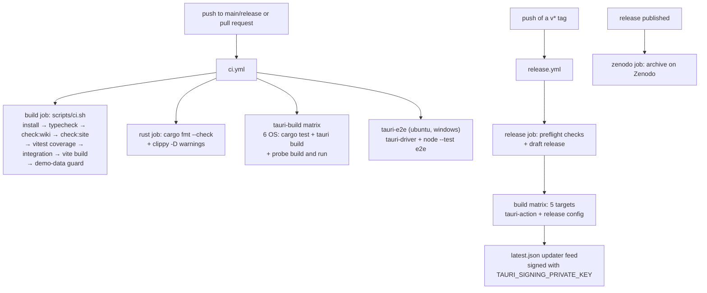
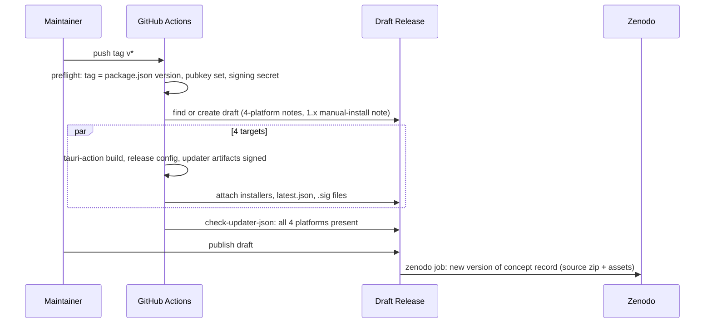

# Build, CI, and Release

SaiLoR 2.x is a Tauri app: a Vite/React renderer in `src/` plus a Rust shell in
`src-tauri/`. The build machinery follows the same split: the real work lives
in repo-local scripts and `Makefile` targets that run identically locally and on
any CI provider, while the GitHub Actions workflows only supply runners,
matrices, and provider-specific glue (artifact upload, scheduled triggers, wiki
mirroring). The previous Electron-era pipeline (`scripts/build-electron.sh`,
`sign-release.cjs`, `afterPack.cjs`, `Dockerfile.electron`, and the
electron-builder section of `package.json`) is gone; the Electron→Tauri
migration notes live in `docs/tauri-migration.md`.



*Build, CI, and release flow. CI runs on every push/PR; a `v*` tag builds
installers and a signed updater feed into a draft release, which is archived on
Zenodo when published.*

## Build pipeline

### What a build produces

The renderer is a plain Vite SPA. `npm run build` is `tsc -b && vite build`
and emits `dist/` (with `base: './'` and `__APP_VERSION__` injected from
`package.json`, which stays the single source of truth for the version —
`src-tauri/tauri.conf.json` reads `"version": "../package.json"`). The default
`vite.config.ts` also defines the unit-test config: jsdom environment,
`src/**/*.test.{ts,tsx}`, excluding `*.integration.test.*` so `npm test` stays a
fast per-PR gate; the integration suite runs separately via
`npm run test:integration` (`vitest.integration.config.ts`).

The desktop build is `npx tauri build`. Tauri compiles the Rust shell
(`src-tauri/`, crate `sailor`) with the release profile, bundles `dist/` (the
`beforeBuildCommand: npm run build` rebuilds the renderer first), and emits
installer bundles per host OS into `src-tauri/target/release/bundle/` (dmg,
nsis/exe, AppImage, deb, rpm). `package.json` keeps only plain npm scripts —
there is no electron-builder section anymore.

### Tauri config variants

- **`src-tauri/tauri.conf.json`** — the base config: product name `SaiLoR`,
  identifier `io.github.gram21.sailor`, `frontendDist: ../dist`,
  `bundle.targets: "all"`, macOS minimum system version 15.0, and the updater
  plugin pointing at
  `https://github.com/Gram21/SaiLoR/releases/latest/download/latest.json` with
  its embedded `pubkey` and `requireSignedVersion: true`. Windows main and the
  renderer talk to the shell as described in
  [Tauri Shell](tauri-shell.md).
- **`src-tauri/tauri.release.conf.json`** — merged over the base for release
  builds: restricts `bundle.targets` to `app, dmg, nsis, appimage, deb, rpm` and
  sets `createUpdaterArtifacts: true`, which is what produces the signed
  `latest.json` feed and `.sig` files from `TAURI_SIGNING_PRIVATE_KEY`.
- **`src-tauri/tauri.probe.conf.json`** — the CI probe variant: swaps the
  frontend build to `vite.probe.config.ts` (root `e2e/`, `outDir: ../dist-probe`,
  port 5199) so the probe binary embeds the e2e page instead of the real app.

The `probe` cargo feature (`[features] probe = []` in `src-tauri/Cargo.toml`,
commented "Never in a release build") adds the `probe_auto`/`probe_report`
commands the CI probe and e2e tests drive; it is deliberately absent from
release builds.

The release profile is size-optimized: `opt-level = "s"`, `lto = true`,
`strip = true`, `codegen-units = 1`, `panic = "abort"`.

### Makefile targets

Local repro goes through the `Makefile` (run `make` for the target list):

| Target | What it does |
|---|---|
| `make setup` | `scripts/setup.sh` (macOS/Linux) or `scripts/setup.ps1` (Windows): checks Xcode CLT / build tools, Node ≥ 22, Rust, and the Tauri system libraries (webkit2gtk, libxdo, appindicator, librsvg, …). Every install step asks first. |
| `make install` | `npm ci` |
| `make dev` | `npx tauri dev` (hot reload; renderer dev server on the fixed port 5173 from `devUrl`) |
| `make web` | `npm run dev` (renderer in a browser only) |
| `make build` | `npx tauri build` — release installer for this OS |
| `make build-debug` | `npx tauri build --debug --no-bundle` — debug app, no installers |
| `make probe` | `npx tauri build --no-bundle --features probe --config src-tauri/tauri.probe.conf.json` |
| `make check` | `typecheck lint test` (TS typecheck, `cargo fmt --check` + clippy `-D warnings`, JS + Rust unit tests) |
| `make test-integration` | `npm run test:integration` |
| `make clean` | removes `dist/`, `dist-probe/`, `cargo clean` |
| `make report` | `make -C technical-report` (the PDF) |
| `make docker-linux` | Linux bundles in Docker (below) |

Installers land in `src-tauri/target/release/bundle/` (`bundle/dmg`,
`bundle/macos`, `bundle/nsis`, `bundle/appimage`, `bundle/deb`, `bundle/rpm`).

## CI: `.github/workflows/ci.yml`

One workflow for everything that checks code; release and report workflows
stay separate. Triggers: push to `main` and to `release/**`, every pull
request, and `workflow_dispatch` — all with `paths-ignore: technical-report/**`
(report-only changes don't rebuild the app). There is deliberately no
push-on-every-branch trigger: a branch with an open PR would build twice per
push. A `concurrency` group on `${{ github.workflow }}-${{ github.ref }}` with
`cancel-in-progress: true` keeps only the newest commit per ref.

Four jobs:

- **`build`** (ubuntu-latest, Node 24) runs `scripts/ci.sh` — the
  provider-agnostic single source of truth ("does the app build and pass its
  checks"). It runs from the repo root under `set -euo pipefail` and executes,
  in order: install (`npm ci`, or `npm install` on a lockfile-less fresh clone;
  skippable with `SKIP_INSTALL=1`), typecheck (`tsc -b --noEmit`), the wiki-link
  check (`npm run check:wiki`), the project site link check
  (`npm run check:site`), `npm run test:coverage` (unit tests with coverage),
  `npm run test:integration`, the SPA build (`npm run build`), and a guard that
  fails when `dist/` holds the demo data (`KeimKaplan2026_ICSEBoF`). Unlike the Electron era, integration
  tests run in the main script too.
- **`rust`** (ubuntu-latest) lints the shell: installs the Tauri system
  libraries, then `cargo fmt --check` and `cargo clippy --all-targets
  --all-features -- -D warnings`. Rust *tests* don't run here — they run per OS
  in `tauri-build`.
- **`tauri-build`** — a `fail-fast: false` matrix over
  `macos-15, macos-26, windows-latest, ubuntu-22.04, ubuntu-24.04, ubuntu-24.04-arm`. Each runner
  installs the Linux Tauri libraries when applicable, runs
  `cargo test --manifest-path src-tauri/Cargo.toml`, builds the real installer
  bundle (`npx tauri build`) and reports installer sizes, then builds the probe
  (`--no-bundle --features probe --config src-tauri/tauri.probe.conf.json`) and
  **runs it**: with `SAILOR_PROBE_PROJECT` pointing at
  `samples/project.example.json` and the report at
  `SAILOR_PROBE_REPORT`, it waits up to 60 s for a `RENDER OK | PDF ERROR |
  RENDER ERROR` line and then asserts the report contains both `RENDER OK` and
  `-> 403` (the traversal check). On Ubuntu the headless WebView runs under
  `xvfb-run -a`. The report is uploaded as a `probe-report-<os>` artifact even
  on failure.
- **`tauri-e2e`** — `fail-fast: false` over `ubuntu-24.04` and
  `windows-latest` (tauri-driver has no macOS support). It installs
  `tauri-driver --locked` and, on Windows, downloads a matching `msedgedriver`
  for the installed WebView2 version by reading the EdgeUpdate registry key and
  prepends it to `PATH`. It rebuilds the probe binary and runs
  `node --test e2e/probe.test.mjs` — under `xvfb-run -a` on Linux; on Windows
  via gsudo at **medium integrity** (`sudo --integrity Medium`), because
  WebView2 ignores the driver's
  `WEBVIEW2_ADDITIONAL_BROWSER_ARGUMENTS` in the runner's elevated process, and
  with `icacls` granting Everyone full access to the workspace so the
  medium-integrity process can read it.

## Release: `.github/workflows/release.yml`

Triggers: push of a `v*` tag, `workflow_dispatch`, and `release: [published]`.
It has `permissions: contents: write` and a non-cancelling concurrency group.
The jobs:

1. **`release`** (skipped when the event itself is a release publication) — the
   preflight and draft step. It checks that the pushed tag matches
   `v<version>` from `package.json`, that `plugins.updater.pubkey` in
   `tauri.conf.json` is no longer the `REPLACE_` placeholder, and that the
   `TAURI_SIGNING_PRIVATE_KEY` secret is set. It then finds or creates a
   **draft** GitHub release for the tag, refusing if the release is already
   published. The draft's notes state the support contract: macOS 15 or later,
   AppImage/Windows/macOS builds update in-app, `.deb`/`.rpm` users update
   manually, and **users of 1.x must install this release once by hand**
   (the 1.x Electron app cannot auto-update across the 2.0 migration).
2. **`build`** (`needs: release`, `fail-fast: false`) — a five-target matrix:
   `macos-15` × `aarch64-apple-darwin`, `macos-15` × `x86_64-apple-darwin`,
   `windows-latest` × `x86_64-pc-windows-msvc`, `ubuntu-22.04` ×
   `x86_64-unknown-linux-gnu`, `ubuntu-22.04-arm` × `aarch64-unknown-linux-gnu`. Each runner optionally sets up macOS
   signing/notarization (`APPLE_SIGNING_IDENTITY` defaults to `-` for ad-hoc
   signing; empty `APPLE_*` secrets are deliberately not exported because an
   empty value makes the bundler attempt and fail signing) and optional Windows
   Authenticode signing (writing a `tauri.windows.conf.json` overlay with the
   certificate thumbprint only when `WINDOWS_CERTIFICATE` is set). It then runs
   `tauri-apps/tauri-action@v1` with `--target <matrix target> --config
   src-tauri/tauri.release.conf.json`, passing
   `TAURI_SIGNING_PRIVATE_KEY(_PASSWORD)` and the draft `releaseId`, so the
   updater artifacts (`latest.json`, per-platform `.sig` files, installers) are
   **signed with the Tauri updater key and attached to the draft release** —
   not a separate Ed25519 scheme as in the Electron era.
3. **`check-updater-json`** — downloads `latest.json` from the draft and asserts
   it lists all four platforms (`darwin-aarch64`, `darwin-x86_64`,
   `windows-x86_64`, `linux-x86_64`). The build jobs merge their platform into
   the feed one after another and a race can drop one; re-running the failed
   build job adds it back.
4. **`zenodo`** (only on a published release) — archives the release on Zenodo
   as a new version of the existing record (concept recid `23804729`, shared
   concept DOI): a `git archive` source zip plus every release asset, with the
   GitHub release notes rendered to markdown as the description, GPL-3.0-only
   license, and an `isIdenticalTo` related identifier. New versions start from
   the previous version's files (which are deleted and replaced), and publishing
   on Zenodo is permanent.

The updater flow at runtime is covered by
[Tauri Shell](tauri-shell.md) and the `plugins.updater` config above: the app
fetches `latest.json`, whose signatures were produced at release time by
`createUpdaterArtifacts`, and the updater verifies them against the baked-in
`pubkey` (`requireSignedVersion: true`).



*Release flow: a tag produces a complete, signed, verified draft; publishing it
triggers the Zenodo archive.*

## Linux Docker build

For building Linux bundles without installing Node or Rust locally:

```
make docker-linux
# = docker compose -f docker-compose.dev.yml run --rm --build tauri-linux
```

`Dockerfile.tauri-linux` is a **Ubuntu 22.04 build image — deliberately the
same as the release runner so the AppImage runs against older glibc**. It
installs the build tools plus the Tauri system libraries (webkit2gtk 4.1,
libxdo, appindicator, librsvg), Node 22 from nodesource, Rust via rustup, and
`APPIMAGE_EXTRACT_AND_RUN=1`, then defaults to
`npm ci && npx tauri build --config src-tauri/tauri.conf.json
--bundles appimage,deb,rpm`.

`docker-compose.dev.yml` bind-mounts the source at `.:/app` (a named volume
shadows `/app/node_modules`, and `tauri-target` carries `src-tauri/target`), so
the image carries only toolchain and the checkout supplies the code; the
resulting bundles appear in `./src-tauri/target/release/bundle/` on the host.
The container's `CMD` can be overridden for other tasks
(`... run --rm tauri-linux <command>`).

## Pages workflow: `.github/workflows/pages.yml`

Publishes the project website (`site/`) and the online demo under `/demo/` to
GitHub Pages. It runs on a push to `main` (and on `release/2.0.0` while that
branch is in flight) and on `workflow_dispatch`. A `concurrency` group named
`pages` never cancels a deployment in progress. The `build` job runs
`npm ci` and `scripts/ci/pages.sh`, which runs `npm run build:demo`, copies
`site/` and `dist-demo/` into `_site/` and checks the links with
`scripts/check-site-links.js`. The `deploy` job then uploads `_site` and
deploys it with `actions/deploy-pages`. `make ci-pages` runs the same build
locally.

## Technical report workflow

`.github/workflows/technical-report.yml` builds the PDF (`technical-report/`,
an `IEEEtran` conference-mode LaTeX report described in
[technical-report/README.md](../../technical-report/README.md)) on pushes and
PRs touching `technical-report/**`, `user-guide/screenshots/**`, or the
workflow itself, plus `workflow_dispatch`. It runs `xu-cheng/latex-action@v3`
with `latexmk`/pdflatex (`-jobname=SaiLoR-technical-report`) on `main.tex` and
uploads `SaiLoR-technical-report.pdf` as an artifact. Because CI ignores
`technical-report/**`, this is the only CI that reacts to report edits; `make
report` reproduces it locally (`make -C technical-report`).

## OpenWiki workflows

Two generator workflows keep the wiki fresh; two mirroring workflows keep
`openwiki/`/`user-guide/` in sync with the GitHub wiki.

### Generation

- **`openwiki.yml`** — the thin weekly refresh: a Monday 06:00 UTC cron (plus
  `workflow_dispatch`) that delegates entirely to the shared reusable workflow
  `ardoco/actions/.github/workflows/openwiki.yml@main`, passing only the
  `OPENROUTER_API_KEY` secret. The generation logic lives in that shared
  workflow, not in this repo.
- **`openwiki-update.yml`** — a daily 08:00 UTC (plus manual) self-contained
  update: it installs the `openwiki` npm CLI and runs
  `openwiki code --update --print` (OpenRouter provider, model `z-ai/glm-5.2`,
  LangSmith tracing), then opens a `docs: update OpenWiki` pull request via
  `peter-evans/create-pull-request` scoped to `openwiki`, `AGENTS.md`,
  `CLAUDE.md`, and the workflow file on the `openwiki/update` branch. Reviewing
  that PR is the normal way this wiki changes.

### Mirroring (publish ↔ import)

- **`wiki-publish.yml`** (*Publish openwiki → Wiki*) triggers on pushes to
  `main` under `openwiki/**`, `user-guide/**`, `.github/wiki-assets/**`, or the
  workflow file itself, plus `workflow_dispatch`. It clones `SaiLoR.wiki.git`
  and stages a combined layout: `Home.md` (from `.github/wiki-assets/`,
  verbatim), `Development.md` (from `openwiki/Home.md`, renamed to free the
  wiki's own Home slot), the rest of `openwiki/*.md` flat at the wiki root,
  section pages flattened under `Section-Page` names
  (`Operations-Build-Release`, …), `user-guide/*.md` renamed to `Guide-*` with
  `screenshots/` flattened alongside, and a global `_Sidebar.md`/`_Footer.md`
  assembled from `.github/wiki-assets/` plus user-guide fragments wrapped in
  `<!-- wiki-sync:NAME:start/end -->` markers. It strips OKF frontmatter,
  rewrites cross-links (`.md` → extensionless wiki URLs, `Home` → `Development`
  in the sidebar, `../README.md` → absolute GitHub URLs in the user guide), and
  `rsync --delete`s the wiki, committing as `github-actions[bot]` with a
  `[wiki-sync]` marker. `index.md` and `INSTRUCTIONS.md` are deliberately
  excluded.
- **`wiki-import.yml`** (*Import Wiki → openwiki*) is the reverse: `gollum`
  events (a wiki page edit) and `workflow_dispatch`. It maps each published
  piece back to its repo source — `Home.md` is dropped if it still carries the
  `<!-- wiki-sync:auto-home -->` marker (the untouched published template),
  `Development.md` → `openwiki/Home.md`, `Section-Page` → `openwiki/<section>/<page>.md`
  (reversing name flattening and link rewrites), `Guide-*` → `user-guide/<src>.md`,
  sidebar/footer fragments → `.github/wiki-assets/` — then `rsync --delete
  --include '*.md' --exclude '*'` mirrors the remaining pages into `openwiki/`,
  committing to `main` with `[wiki-sync]`.

### Loop prevention

Publish and import would otherwise form a loop (publish → wiki `gollum` →
import → commit to `main` → `openwiki/**` push → publish → …). Three
independent layers break it:

1. **Concurrency** — both mirror workflows share `concurrency: group:
   wiki-sync` with `cancel-in-progress: false`, so the two directions never run
   at the same time (a half-finished mirror is worse than a slow one).
2. **Commit-message guard** — `wiki-publish.yml` skips when the triggering
   commit message contains `[wiki-sync]` (the marker import's commits carry), so
   it never re-publishes a commit the import workflow itself created.
3. **Sender guard** — `wiki-import.yml` runs only when
   `github.event_name == 'workflow_dispatch'` or
   `github.event.sender.login != 'github-actions[bot]'` (the identity publish
   commits as), so it ignores wiki writes made by the publish workflow itself.

Together these mean each direction only reacts to *human*-originated changes on
the other side.
