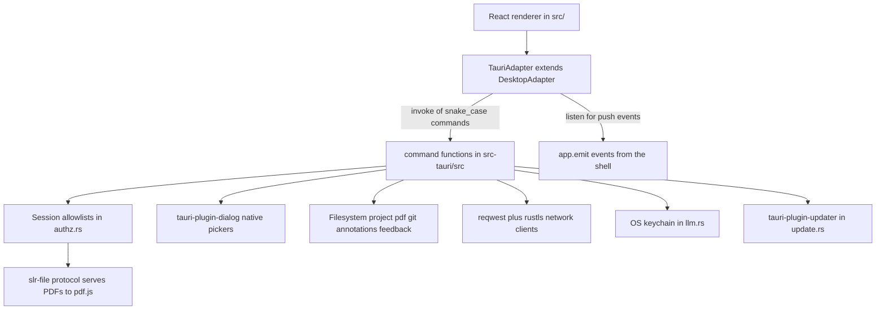
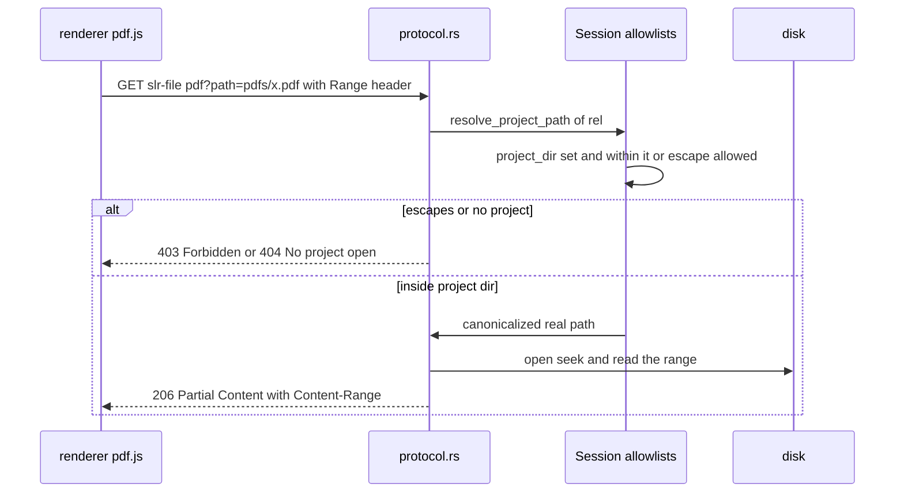
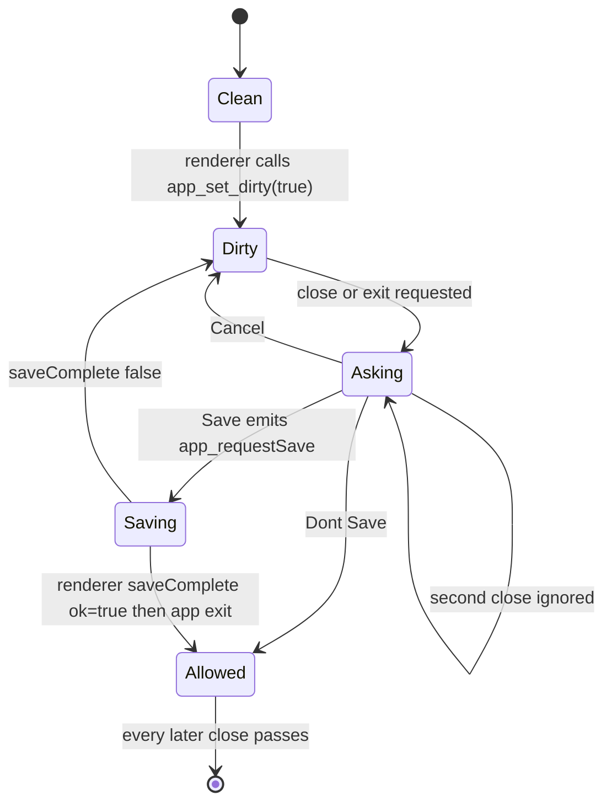

# Tauri Shell, IPC and Self-Update

SaiLoR 2.0 replaced the Electron main process with a Rust shell built on **Tauri 2**. The desktop
process is the `sailor` crate in `src-tauri/`; the renderer is the same React/Vite app, embedded
from `dist/` when packaged (see [Build, CI, and Release](build-release.md) and
[architecture.md](../architecture.md)'s "The Rust shell" section for the surrounding context). The
shell owns everything the renderer must not be trusted with: filesystem authorization, native
dialogs, process spawning, the OS keychain, network egress, and self-update. This page documents the
shell itself — the IPC seam, the security model, and the lifecycle machinery; feature flows that
ride on top of it live in [Git Integration](../workflows/git-integration.md) and
[LLM Annotation](../workflows/llm-annotation.md).



*The IPC seam: the renderer only reaches the OS through `SlrBridge` methods mapped to snake_case
Tauri commands; responses and push events flow back over the same boundary.*

## The transport: `SlrBridge` → snake_case commands

The renderer never imports `@tauri-apps/api` outside `src/platform/tauri.ts`. It programs against
the `SlrBridge` interface (`src/platform/bridge.ts`, one method per backend operation), and
`tauriBridge` (`src/platform/tauri.ts`) maps each bridge method to a Tauri command:

- **`command(channel)`** — the channel-to-command mapping: `project:open` → `project_open`,
  `pdf:embedMarks` → `pdf_embed_marks` (`':'` becomes `'_'`, then each capital letter becomes
  `'_'` + lowercase; `embedMarks` → `embed_marks`). This mirrors the old Electron channel names,
  so the Rust command names are derived mechanically.
- **`call(channel, ...names)`** — `invoke()` with positional arguments packed into a named-args
  object (`filePath`, `metaText`, `files`, …) matching the `#[tauri::command]` parameter names.
- **`send(channel, ...names)`** — fire-and-forget `invoke` with errors swallowed; used for aborts
  and dirty-state pushes (`app:setDirty`, `llm:abort`).
- **`subscribe(event)`** / **`replace(event)`** — wrap `listen()` for shell-emitted events;
  `replace` unsubscribes the previous listener so only the latest callback gets the event
  (`onNativeUpdateAvailable`, `onRequestSave`, …).

The `TauriAdapter` class is a thin subclass: it calls `setBridge(tauriBridge)` and inherits all
renderer logic (recents, the `lastWritten` save baseline, git parse reuse) from `DesktopAdapter`
(`src/platform/desktop.ts`). `getPlatform()` in `src/platform/index.ts` builds it when `isTauri()`
(`'__TAURI_INTERNALS__' in window`) is true; the only other adapter is the throwing
`createUnsupportedAdapter()` kept just for module-load-time calls (see
[architecture.md](../architecture.md)).

**`assembleProject` (RawProject assembly).** Rust does not build the whole-project JSON; project
and git commands return a `RawProject` (`path`, `text` for the `project.json` text, `files` of
`{relPath, text}` annotation entries, optional `siblings` for shared-annotations folders).
`assembleProject` in `tauri.ts` reassembles it into the single-project text `loadProject` accepts,
using `assembler` from `src/platform/assemble.ts`. The opening of a project (`opened` in `tauri.ts`) does
this in a worker: `offMain` runs an `open` job for the head and a `read` job for each batch (see
[Progressive Loading](../concepts/progressive-loading.md)). The assembler
parses `project.json`, derives the expected file names from the screening/annotation mode
(`consolidated.json` / `reviewer-N.json` / mark files), drops legacy mark files whose paper is
already covered by an annotation sibling, and pushes files that fail to `JSON.parse` into the
`corrupt` list rather than failing the whole open. Git commands returning snapshots or merge
sides (`gitPullBegin`, `gitLogDiff`, `gitHeadContent`, …) go through the same assembly so the
renderer always sees post-assembled project text.

**Binary export.** `export_write_bytes` (`pdf.rs`) writes bytes the renderer built, such as the graph
PNG and the diagram PNG and PDF (see [diagrams](../workflows/diagrams.md)). The export dialogs accept
only the extensions `txt`, `jsonld`, `ttl`, `graphml`, `csv`, `svg`, `png` and `pdf`. Like `text_write`, it accepts only a path from an export dialog this session (`export_target`) and
refuses a symlink. It is listed in `main.rs`, in `COMMANDS` in `build.rs`, and in
`capabilities/default.json`.

## The command registry (`main.rs`)

`main()`'s single `invoke_handler(tauri::generate_handler![...])` registers every command,
grouped by module. The registry is the authoritative list of what the renderer can do:

| Group | Commands (Rust module) |
| --- | --- |
| **CI probe** (feature-gated) | `probe_auto`, `probe_report` (`main.rs`, `#[cfg(feature = "probe")]` — compiled out of release builds; see below) |
| **project** | `project_open`, `project_open_path`, `project_read_papers`, `project_save`, `project_set_dir`, `project_pick_save_path`, `project_peek`, `project_screening_source`, `reference_pick` (`project.rs`) |
| **annotations** | `project_annotations_dir_users`, `project_shared_annotations`, `project_move_annotations_dir`, `project_split_annotations` (`annotations.rs`) |
| **feedback** | `project_write_feedback`, `project_list_feedback` (`feedback.rs`) |
| **pdf / text** | `pdf_pick`, `pdf_pick_folder`, `pdf_read`, `pdf_check_path`, `pdf_scan_folder`, `pdf_allow_path`, `pdf_pick_export_path`, `pdf_embed_marks`, `text_pick_export_path`, `text_write`, `export_write_bytes` (`pdf.rs`) |
| **paths** | `paths_relative`, `paths_rebase`, `paths_absolute`, `paths_sibling` (`paths.rs` — Node-compatible `path` semantics) |
| **webfetch** | `web_fetch`, `web_abort` (`webfetch.rs`) |
| **llm** | `llm_configs`, `llm_save_config`, `llm_delete_config`, `llm_call`, `llm_abort` (`llm.rs`) |
| **ollama** | `ollama_version`, `ollama_list`, `ollama_show`, `ollama_ps`, `ollama_pull`, `ollama_cancel_pull`, `ollama_delete`, `ollama_manifest_size` (`ollama.rs`) |
| **localserver** | `localserver_discover` (`ollama.rs`) |
| **local** | `local_probe` (`hardware.rs`); `local_runtime`, `local_runtime_plan`, `local_runtime_install`, `local_model_plan`, `local_model_install`, `local_cancel`, `local_installed`, `local_remove`, `local_start`, `local_stop`, `local_status`, `local_logs` (`localruntime.rs`) |
| **git** | `git_probe`, `git_pick_clone_dir`, `git_clone`, `git_pick_project_in`, `git_info`, `git_status`, `git_commit`, `git_last_commit_message`, `git_push`, `git_pull_begin/finish/abort`, `git_merge_begin`, `git_merge_preview`, `git_undo_merge`, `git_log_begin`, `git_log_diff`, `git_annotation_authors`, `git_repo_setup_status`, `git_apply_repo_setup`, `git_background_fetch`, `git_stash_list/push/restore/drop/branch`, `git_branches`, `git_branch_create`, `git_branch_delete`, `git_checkout`, `git_branch_switch_begin/finish/abort`, `git_head_content`, `git_working_content`, `git_commit_partial`, `git_write_working`, `git_discard_file` (`git.rs`) |
| **update** | `update_check`, `update_download`, `update_install` (`update.rs`) |
| **close / app** | `app_set_dirty`, `app_save_complete`, `app_reload`, `app_set_language` (`close.rs`, `shell.rs`) |

Push events (not commands) come from `app.emit`: `app:requestSave`, `app:undo`, `app:redo`
(macOS Edit menu), `update:available/progress/downloaded/error`, `ollama:pullProgress`,
`local:progress`.

**The CI probe feature.** `probe_auto` and `probe_report` exist only under the `probe` Cargo
feature (`src-tauri/Cargo.toml`: "CI probe commands (`probe_auto`, `probe_report`). Never in a
release build."). `probe_auto` opens `$SAILOR_PROBE_PROJECT` without a dialog and sets the
session's project dir so `slr-file` can serve; `probe_report` appends lines to
`$SAILOR_PROBE_REPORT`. CI builds them with `--features probe --config
src-tauri/tauri.probe.conf.json` (a `dist-probe` frontend and port 5199), runs the binary, and
greps the report for `RENDER OK` and the `-> 403` traversal refusal — then
`e2e/probe.test.mjs` drives the same binary through tauri-driver on Linux and Windows. This is
the only automated end-to-end check of the `slr-file` protocol; see
[testing.md](../testing.md).

**Shell wiring (`main()`).** Before the handler list, `main()` installs: the
`single-instance` plugin (second launches focus the existing window, `shell::focus_main`),
`window-state` (size/position/maximized), `dialog`, `updater`, a custom `slr-os` plugin that
injects `window.__SLR_OS__ = { platform, arch }` with Node-style names (`darwin`/`win32`,
`x64`/`arm64`) — the replacement for `process.platform`, read by `tauriBridge.os` — and a
**deny-all `on_permission_request`** so the webview can never obtain camera/mic/etc. permissions.
State is registered with `.manage()`: `update::State` (pending update + bytes),
`close::Guard`, and the `Mutex<Session>` the whole authorization model hangs on. The `slr-file`
scheme is registered as an **asynchronous** protocol handler that serves each request on a
spawned thread (PDF reads must not block the IPC loop). Finally the `.run()` closure intercepts
close/exit (see [Close guard](#the-unsaved-changes-guard-closers)) and on `RunEvent::Exit` calls
`localruntime::stop_all()` so no managed llama.cpp server survives the app.

## The security model: `authz.rs` and the `slr-file` protocol

The Electron-era trust model is deliberately preserved: the renderer is untrusted, and every path
the renderer names is checked against an in-memory **session allowlist** before anything touches
the disk. `authz.rs`'s `Session` (a `Default` struct, never persisted, owned by a `Mutex` managed
in `main()`) carries:

- `project_dir` — the open project's directory, set by `project:setDir` (called after every open
  and by `pickProjectLocation`), and the base `slr-file` resolves PDFs against. Changing it
  **clears `allowed_escapes`** (approvals are per-directory, not global).
- `allowed_escapes` — `pdf` values stored outside `project_dir` that the reviewer approved via
  the `pdf:allowPath` dialog ("Open anyway" / "Cancel", a native warning that spells out the
  risk of paths a downloaded project names).
- `known_projects` — project files opened via a dialog or read this session. `project_save`
  refuses anything not in it: *"it was not opened or chosen via a dialog this session."*
- `readable_pdfs` — absolute paths returned by `pdf:pick` / `pdf:pickFolder`. `pdf_read` (raw
  bytes for title extraction) refuses anything else.
- `writable_exports` — paths returned by the export dialogs. `text_write` and the
  `newPath` target of `pdf_embed_marks` accept nothing else.
- `stamps` — a per-project map of `mtime_nanos:len` for every file read or written
  (`Session::remember` on every open/save). This is the stale-detection state behind the
  save-refuses-when-changed rule: `changed(known, now)` reports a file as changed when it exists
  now but wasn't in the map, or its stamp differs; `Some → None` (file deleted) is *not* changed.
- `known_git_roots` — repository roots discovered by `git_info` or created by `git_clone`; every
  mutating git command re-checks via `assert_root`.
- `listed_splits` — what `project:sharedAnnotations` listed, with per-file stamps, so a later
  split does not act on a folder that changed under it.
- `heads` — for each opened split project, the validated annotations folder name and the set of
  paper ids `project.json` listed. `project_read_papers` serves paper batches from this record only
  (see [Progressive Project Loading](../concepts/progressive-loading.md)), so the renderer cannot
  name other folders.

Two helpers enforce the shape of every write:

- **`within(real, base)`** — component-wise containment (`real.starts_with(base)` on
  already-normalized absolute paths), used after resolution *and* again after
  `canonicalize()` so symlinked components can't satisfy the lexical check.
- **`assert_not_symlink(p)`** — `symlink_metadata` check that refuses to write through a link
  ("writing would modify the file it points at"), while treating a missing file as fine.

Project, annotation and export files are written with `paths::write_atomic`: the bytes go to a
temporary file beside the target, which is renamed over it, so a failed write never leaves a
truncated file.

Paths are normalized with Node's `path.resolve` semantics (`paths.rs`: absolute, `.`/`..` folded
lexically, links not followed) so the renderer's path strings behave exactly as the old
TypeScript checks expected.

### `slr-file://` serving (`protocol.rs`)

The renderer loads PDFs through `slr-file://project/pdf?path=<rel>` (the renderer-side
`DesktopAdapter` builds that URL), served by `protocol::serve`. The **path travels as a query
parameter** (the comment in `desktop.ts` notes: Chromium's URL parser collapses `..` in the *path*
per spec before the request is even made, so a path-based value would silently climb; query values
are not normalized). The handler:

1. Answers `OPTIONS` with CORS `Access-Control-Allow-Origin: *` and advertises `Range` — the
   renderer's origin (`tauri://localhost` or the dev server) differs from the custom scheme, so
   without CORS headers the fetch would be rejected before the handler runs.
2. Resolves `path` via `pdf::resolve_project_path`: no project open → `404 "No project open"`;
   traversal outside `project_dir` (and not in `allowed_escapes`) → **`403 Forbidden`**;
   missing → `404`.
3. Re-checks containment after `canonicalize()` — an approved escape that resolves back inside
   the project, or a directory swap via symlink, cannot smuggle a read.
4. Serves `application/pdf` (`.pdf` extension) or `application/octet-stream`, with single
   byte-`Range` support for pdf.js streaming: `206` + `Content-Range` for a satisfiable range,
   `416` with `bytes */len` otherwise, `Accept-Ranges: bytes`, full `200` when no (or
   multi-range/other-unit) `Range` is sent. `HEAD` returns headers only.

`pdf_check_path` runs the same resolution first so the UI can report an honest reason
(`no-project` / `escapes` / `not-found`) instead of pdf.js's opaque failure; `pdf_allow_path` is
the per-session escape approval behind `allowed_escapes`.



*A `slr-file` request: the session allowlists decide, then the file is served with one byte range
so pdf.js can stream. (`pdf_check_path` runs the same resolution to give the UI the reason before
rendering fails.)*

## LLM targets and API-key handling (`llm.rs`)

The LLM target list stays in **`<config_dir>/SaiLoR/llm-config.json`** in the Electron-era
format — entries kept as raw JSON so unknown fields survive, written mode 0600 on Unix. The API
key, however, **never reaches the renderer**:

- `llm_save_config` stores a non-empty key in the OS keychain via the `keyring` crate
  (`keyring::Entry::new("SaiLoR", "llm:<id>")`) and writes only a `"keyring": true` marker into
  the JSON entry. There is **no read-back**: `llm_configs` and every save/delete return
  `public_configs`, which strips `key`/`keyring` and exposes only `hasKey: boolean` — the user
  cannot retrieve the key to retype it, which is why an edit with a blank key field keeps the
  stored one (the `keep("key")`/`keep(MARKER)` closure).
- The renderer writes the sentinel **`{{apiKey}}`** in header templates; at call time
  `build_call_headers` substitutes the real key into the headers only when the key is loaded.
  A `noKey` (or managed) target drops sentinel headers instead; a target with a stored key but a
  failed lookup is an error.
- **Origin pinning:** `llm_call` parses the URL the renderer named and refuses to send the key
  unless the scheme matches the config's `baseUrl` scheme and the origin (scheme+host+port)
  is identical. Redirects are refused outright (the `NO_REDIRECT` client): a 3xx would carry the
  Authorization header to an origin nobody checked. A key is also never sent over plain `http`
  unless the host is local (`is_local_host`, built on the web-fetch blocked-address rules).
- **Managed local models:** for a target with `managed.catalogId`, the stored base URL is only a
  placeholder the origin check pinned; the real call goes to the llama.cpp server the shell
  itself runs (`localruntime::endpoint` → `127.0.0.1`, per-session key injected as the Bearer
  token), restricted to `/v1/*` and `/health` paths (`managed_target_url`), over the
  `LOOPBACK` client that forbids proxies so no man-in-the-middle sees the key.
- Calls run under a `Flight` id `llm:<requestId>` with a 10-minute timeout; `llm_abort` cancels,
  also while a managed local model is still starting. Answers are capped at 32 MB
  (`MAX_RESPONSE_BYTES`). `llm-config.json` is written through a temporary file and renamed, and
  an unreadable file is refused instead of overwritten (`read_configs_strict`).

The feature flow that uses these commands is [LLM Annotation](../workflows/llm-annotation.md);
the local-runtime commands it can target are in [Local Models](../workflows/local-models.md).

## Network plumbing (`net.rs`) and the web-fetch SSRF guard (`webfetch.rs`)

`net.rs` is the shared HTTP layer for the AI channels:

- A builder that installs the `ring` TLS provider into rustls — no cookies, no decompression.
- **`NO_REDIRECT`**, the shared client with `redirect::Policy::none()` — used by the LLM, Ollama
  and local-server calls so an origin nobody checked can never be followed.
- **The `Flight` abort registry**: `Flight::new(id)` registers a `tokio::sync::Notify` under the
  id; `Flight::run(limit, fut)` races the future against `abort(id)` and the timeout; `Drop`
  removes the entry (an abort that wins the race still counts because a permit is stored).
  The abort commands call `net::abort` with the id the flight registered — `llm_abort` uses
  `llm:<requestId>`, `web_abort` the bare `requestId`, `ollama_cancel_pull` `pull:<requestId>`,
  and `local_cancel` `local:<id>` (or `runtime`).

`webfetch.rs` implements the "fetch a web page" tool the AI layer offers. Because the URL comes
from an LLM that may have read attacker-controlled text, it is treated as hostile input, with a
**belt-and-suspenders SSRF guard**:

- **Pre-DNS checks on every hop** (`validate_fetch_url`): only `http`/`https`; no embedded
  credentials; literal IPs must not be in a blocked range; hostnames that are
  `localhost`, or end in `.localhost`, `.local`, `.internal`, are refused. Blocked IPv4 ranges:
  `0.0.0.0/8`, `10.0.0.0/8`, `127.0.0.0/8`, `100.64.0.0/10` (CGNAT), `169.254.0.0/16` (link
  local), `172.16.0.0/12`, `192.168.0.0/16`, and `>= 224` (multicast/reserved). Blocked IPv6:
  loopback, unspecified, the blocked v4 ranges inside IPv4-mapped, IPv4-compatible (`::/96`),
  NAT64 (`64:ff9b::/96`) and 6to4 (`2002::/16`) addresses, `fe80::/10` (link local), `fc00::/7`
  (ULA) and `ff00::/8` (multicast).
- **`check_public_host`** resolves a domain and refuses it unless *every* address is public —
  the Electron version accepted a TOCTOU here; the resolver the request actually connects with
  is `PublicOnly`, a custom `reqwest::dns::Resolve` that re-runs the same `resolve_public` rule.
  This **closes the DNS-rebinding window**: the checked answer is the pinned answer the
  connection uses.
- **Redirects are handled manually** with the same `check` closure re-run on every hop (up to
  `MAX_REDIRECTS = 5`, "Too many redirects." past that) — since the shared client refuses
  redirects, each `Location` is re-validated rather than followed.
- **No proxy**: the web client is built with `no_proxy()`, so environment proxy settings cannot
  route a fetch around the guard.
- **Caps**: 20-second timeout (`Flight`-abortable via `web_abort`), **2 MB body cap**
  (`read_capped` streams chunks and returns `truncated: true` when the cap cut the body), and
  a textual-content-type gate (`text/`, JSON, XML, XHTML, `+xml` suffix); the body is decoded
  with the charset the response named (default UTF-8).

## The unsaved-changes guard (`close.rs`)

Tauri's default close path would discard unsaved annotations. `close.rs` ports the Electron
`close` handler as a `Guard` of four `AtomicBool`s — `dirty`, `asking`, `saving`, `allow` —
managed in `main()`, driven by two commands and one native dialog:



*The quit gate: only a save the guard itself requested, completed via `app_save_complete`, lets
the app exit; "Don't Save" (Discard) opens the `allow` latch for all subsequent closes.*

The `main.rs` run closure intercepts `RunEvent::ExitRequested { code: None }` (a user quit; the
app's own `exit(0)`/`restart()` passes) and `WindowEvent::CloseRequested`; when `intercept()`
returns true the close/exit is prevented. With `dirty` set, `intercept` shows the native
warning dialog — **Save / Don't Save / Cancel** (custom labels, since the plugin's Yes/No/Cancel
mapping also accepts the stock buttons) — parented to the `main` window, once (`asking` dedupes
repeated closes while the dialog is up):

- **Save** emits `app:requestSave`; `useCloseGuard` (renderer) saves whatever surface is open
  (editor draft or annotation project) and reports `saveComplete(ok)`. `Guard::saved` only
  closes when *this guard's* requested save succeeded — a stray `saveComplete(true)` from an
  ordinary save never closes the app — then `app.exit(0)`.
- **Don't Save** sets `allow` and re-runs the exit.
- **Cancel** keeps the window open (a later close asks again).

The renderer's half is `useCloseGuard` (`src/hooks/useCloseGuard.ts`): it pushes the combined
dirty state of both stores on every change (`slr.setDirty`), handles `onRequestSave`, routes the
macOS Edit-menu `app:undo`/`app:redo` to the right store's history, and forwards the update
events below into the store.

## Self-update (`update.rs`)

Self-update is user-triggered only, on **`tauri-plugin-updater`**; the feed URL and public key
come from `tauri.conf.json` and are never renderer-controllable:

```json
"plugins": {
  "updater": {
    "endpoints": ["https://github.com/Gram21/SaiLoR/releases/latest/download/latest.json"],
    "pubkey": "dW50cnVzdGVkIGNvbW1lbnQ6IG1pbmlzaWduIHB1YmxpYyBrZXk6IEYyNDM3OEQ3MUNERTAzOTAKUldTUUE5NGMxM2hEOHE2S1lNMDBhZnY4L1VVdTE4cmUwbFFqakovcEtlZzNaR1dsZjZuc3dNOWEK",
    "requireSignedVersion": true
  }
}
```

`requireSignedVersion: true` means the updater refuses a manifest whose version number is not
itself covered by the minisign signature — the same "signed feed" idea the Electron build
implemented with Ed25519 over `latest.yml`, now delegated to the plugin (the release workflow
signs `latest.json` with `TAURI_SIGNING_PRIVATE_KEY`; see
[Build, CI, and Release](build-release.md)).

The three commands map to a `check → download → install` flow with a `Pending` state
(`update: Option<Update>`, `bytes: Option<Vec<u8>>`) managed in `main()`:

1. **`update_check`** — refuses to self-update unless the current bundle type is one that can be
   replaced in place: **AppImage, NSIS, MSI, or the macOS `App` bundle**. On deb/rpm and
   unbundled runs it returns `{ supported: false, manual: true }` so the renderer falls back to
   the manual download link instead of offering a broken in-place update. Otherwise it asks the
   plugin, stores the `Update`, and emits `update:available` with the version.
2. **`update_download`** — spawns the download, emitting `update:progress` with the integer
   percent (capped at 100, only when the total is known); the finished bytes are stored in the
   pending state and `update:downloaded` is emitted.
3. **`update_install`** — **refuses while the project is dirty** ("Save your project before you
   install the update."), takes the pending update + bytes, installs, and restarts the app. Any
   error at any stage is emitted as `update:error`.

## Other shell behavior (`shell.rs`)

`shell::setup` builds the `main` window from `tauri.conf.json` (`create: false`, so the window
is built here rather than by Tauri itself) and attaches the navigation guards: `is_app_url`
allows `tauri://localhost`, `about:blank`, `tauri.localhost` (Windows' `http(s)://tauri.localhost`)
and the dev origin in debug builds; anything else is denied in-window and, if http/https,
handed to `tauri-plugin-opener` (the system browser). `on_new_window` always denies and opens
externally — no renderer-created windows exist. A `Help → Settings…` menu item (`app:helpSettings`) opens the settings dialog. The module also migrates the pre-rename Electron
userData (`SLR Helper`/`slr-helper` → `SaiLoR`, copying `window-state.json` and `Local Storage`
once, best-effort, skipping symlinks, never overwriting) and, on macOS, replaces the Edit
menu's native Undo/Redo with `app:undo`/`app:redo` menu items so the app's own history runs
first.

The capabilities file (`src-tauri/capabilities/default.json`) grants the `main` window
`core:default`, `core:window:allow-set-title` and one `allow-<command>` permission per app
command. `src-tauri/build.rs` lists every command in `COMMANDS` and generates the matching
permission files in `src-tauri/permissions/autogenerated/`, so a command missing from either list
is unreachable and injected script cannot call commands added later. Every privileged operation
goes through the app's own commands, not Tauri's generic `fs`/`shell` plugins (which are not even
compiled in).

## Migration context

Nothing of the Electron shell survives in the code — `electron/` was deleted in the 2.0 cutover
(`docs/tauri-migration.md` records the evaluation). The port kept the old trust model (session
allowlists, sentinel keys, signed feeds) but moved each enforcement point into Rust, where the
renderer cannot bypass it. Legacy artifacts that remain deliberately: the `SlrBridge` channel
names (`project:open`, `app:setDirty`, `update:check`) still map one-to-one onto the Rust command
names, the `llm-config.json` format kept the Electron shape (including the old `safeStorage` key
blob, which is left in place but undecryptable — such keys must be entered once more), and the
recents key `slr.recents.electron` keeps its name.

## Tests

Rust unit tests live inline (`#[cfg(test)] mod tests` in each module) and run with
`cargo test --manifest-path src-tauri/Cargo.toml` (`make test-rust`; CI runs them on the
tauri-build matrix before building installers):

- `authz.rs` — the `changed()` stale-target rules.
- `project.rs` — save refusing unauthorized paths, escapes, feedback-dir collisions and
  symlinks; the stale/deletion round trip.
- `protocol.rs` — statuses and traversal (403 for `../secret.pdf`, absolute paths and
  `pdfs/../../…`), `+` decoded as space in the query, single-range `206`/`416` semantics.
- `close.rs` — dialog button mapping; the guard state machine (asks once, cancel re-asks,
  discard latches `allow`, only a requested save closes).
- `update.rs` — the bundle-type allowlist; percent capping; and a test pinning the feed
  endpoint, pubkey schema and `requireSignedVersion: true` from `tauri.conf.json`.
- `llm.rs` — sentinel substitution and origin pinning against a mock HTTP server
  (`net::mock::serve`); key sanitization (keys never appear in `llm-config.json`).
- `webfetch.rs` — the blocked-address/host tables, URL validation, per-hop re-checks and the
  2 MB cap, against the same mock server.
- `net.rs` — abort-vs-timeout races in the `Flight` registry.

On top of the unit tests, the probe build (`--features probe`) exercises the real shell:
CI's tauri-build job opens `samples/project.example.json` through `probe_auto`, renders its PDF
through `slr-file`, and asserts the traversal request is answered `403`; `e2e/probe.test.mjs`
drives the same binary over WebDriver on Linux and Windows. See [testing.md](../testing.md).
