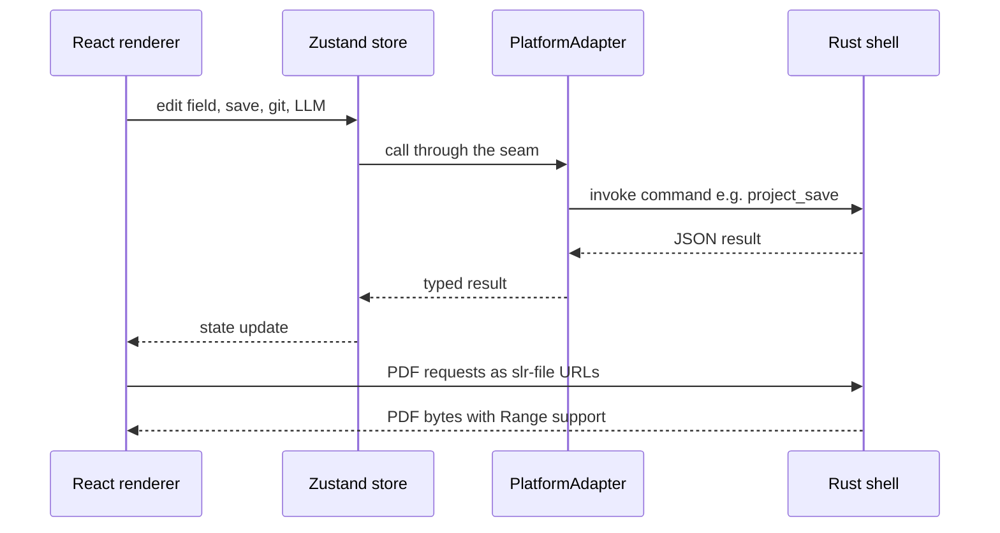

# SaiLoR — Quickstart

## What is SaiLoR?

SaiLoR is a tool for reviewers conducting **Systematic Literature Reviews (SLRs)** — the letters are in the name: **S**ai**L**o**R**. You open a "project" — a `project.json` file plus a sibling `annotations/` folder — that together hold:

1. **An annotation schema** — a nested, cardinality-controlled taxonomy defining what fields to extract from each paper, stored in `project.json`.
2. **A list of papers** — each with a PDF path and metadata, also in `project.json`.
3. **Every reviewer's/consolidation's annotation data** — the actual filled-in answers, stored separately under `annotations/<paperId>/` (see "On-disk layout" below and [Data Model](concepts/data-model.md)).

The app renders the PDF in the middle pane, shows the annotation form on the right, and lets you **grab text directly from the PDF** to populate fields. Annotations are saved back to the split files described above.

A project can also be set to **screening** mode instead of authoring a schema: one fast
Include/Exclude decision per paper (plus a reason when excluded), usually made from the title and
abstract before annotation even begins. See [Screening Mode](workflows/screening.md).

### On-disk layout

```
my-review/
├── project.json          Schema, protocol, screening config, and paper METADATA only —
│                          no annotation data
└── annotations/
    └── <paperId>/
        ├── consolidated.json   The single/consolidated annotation tree, plus aiUsage + equal
        └── reviewer-<n>.json   Each independent reviewer's own tree (multi-reviewer only)
```

A **screening** project names these `screening-consolidated.json` / `screening-<n>.json` instead —
same layout, distinguishable at a glance from an annotation project's files. The name `feedback`
is reserved inside `annotations/` for AI schema-feedback files, never paper data.

Per-paper, per-reviewer files are created lazily — only once that reviewer has actually written
something for that paper — and deleted again if the tree becomes empty. This exists because a
single all-in-one JSON file used to make two reviewers working on different papers (or different
reviewer slots of the same paper) collide in git on every save; splitting the data means ordinary
git tracks, diffs, and merges each paper/reviewer's file independently. **A project saved in the
old single-file shape opens and continues to work as before — it is migrated to the split layout
automatically on the next save, with no explicit "migrate" step.** See
[Data Model](concepts/data-model.md) for the full shape and migration mechanics.

## SaiLoR is a Tauri 2 desktop app — the web build runs only the demo

The desktop app is the only way to open real projects. At startup `src/App.tsx` checks `isTauri()`
(`'__TAURI_INTERNALS__' in window`, from `src/platform/adapter.ts`). Outside the Tauri shell, the
normal web build shows only a notice that the web version is discontinued. It blocks every
project-opening UI before any file picker or project state is reached. `npm run dev` and `make web`
show only that screen. They exist so the Vite build, the typecheck and the unit tests keep running.

The online demo is the one exception. `npm run build:demo` sets the compile-time constant `DEMO_MODE`
(`src/demo/mode.ts`). `getPlatform()` then returns `createDemoAdapter()` (in-memory project, bundled
demo PDFs) in place of the inert `createUnsupportedAdapter()`. See
[Online Demo and Project Site](operations/demo-and-site.md) and [Architecture](architecture.md) for the
`PlatformAdapter` seam.

Everything that touches the real machine lives in the **Rust shell** (`src-tauri/`): file
open/save with authorization, the `slr-file://` scheme that streams PDFs to the renderer,
native dialogs, git plumbing, LLM and local-model backend calls, and the native self-updater.

The desktop dev loop is **`make dev`** (`npx tauri dev`) — it starts the Vite renderer on
`localhost:5173` (the `devUrl` in `src-tauri/tauri.conf.json`) and the Rust shell together with
hot reload. There is no separate Electron dev command anymore.

## Tech Stack

| Layer | Technology |
|---|---|
| UI framework | React 19 + TypeScript 5.7 |
| State management | Zustand 5 + immer middleware |
| Validation | Zod |
| PDF rendering | react-pdf 9 (pdf.js) in the renderer; lopdf in the Rust shell for burning marks into export PDFs |
| Desktop shell | Tauri 2 — Rust `sailor` crate in `src-tauri/` (command modules per domain) |
| Renderer ↔ shell bridge | `SlrBridge` interface (`src/platform/bridge.ts`) mapped to Tauri `invoke` commands (`src/platform/tauri.ts`) |
| Build tool | Vite 6 (renderer only; the shell is built by Cargo/Tauri) |
| Testing | Vitest 3 + jsdom (unit + real-git integration), `cargo test` (Rust), tauri-driver probe e2e |

## Quick Commands

```bash
make setup            # install build prerequisites (Rust, Node, system libraries), asks first
make install          # npm ci

make dev              # desktop dev loop: npx tauri dev (renderer on http://localhost:5173)
make web              # renderer only in a browser — shows the discontinuation screen only (demo build: npm run build:demo)
make build            # release installer for this OS (npx tauri build)
make build-debug      # debug app without installer bundles (--no-bundle)

make test             # npm test (renderer unit) + cargo test --manifest-path src-tauri/Cargo.toml
npm run test:integration  # real-git integration suite (vitest.integration.config.ts); slow
make check            # typecheck + cargo lint (fmt --check, clippy -D warnings) + make test

make probe            # build the CI probe app (--no-bundle --features probe --config tauri.probe.conf.json)
node --test e2e/probe.test.mjs   # drive the probe binary via tauri-driver (after make probe)

make docker-linux     # build Linux bundles (AppImage, deb, rpm) in Docker
```

npm scripts that matter directly: `npm test` (Vitest unit run), `npm run test:integration`,
`npm run typecheck`, `npm run check:wiki` (wiki link check), `npm run check:site` (site link check), and `npm run scenario`
(the git-scenario fixture CLI in `samples/git-scenarios/`).

`scripts/ci.sh` is the single source of truth for "does the app build and pass its checks":
install → typecheck → wiki-link check → site-link check → unit tests with coverage → integration tests → `npm run build` → a guard that the normal build holds no demo data.
Run it locally with `./scripts/ci.sh` (`SKIP_INSTALL=1` to skip the install step). See
[Build, CI, and Release](operations/build-release.md) for the full pipeline, GitHub Actions
workflows, and Docker-based builds; `docs/tauri-migration.md` documents release-signing setup.

## How a call crosses the seam



*The renderer never touches the filesystem directly: state changes flow through the
`PlatformAdapter` seam into Tauri commands handled by the Rust shell, and PDFs stream back
over the custom `slr-file://` scheme.*

## Repository Layout

```
├── src-tauri/                 The Tauri 2 shell — Rust crate "sailor"
│   ├── src/main.rs            Plugin setup (single-instance, window-state, dialog, updater,
│   │                          slr-os init script), slr-file:// protocol registration, and the
│   │                          full command registry (generate_handler); probe_auto/probe_report
│   │                          behind the `probe` feature
│   ├── src/project.rs         project:* file handlers — thin authorized I/O; the actual split
│   │                          writes/deletes for project.json + annotations/ files
│   ├── src/annotations.rs     annotations:* (dir users, shared folder, move, split)
│   ├── src/git.rs             git:* plumbing (~40 commands: clone/status/commit/push,
│   │                          pull/merge/log/branch-switch begin-finish-abort triplets,
│   │                          stash, commit_partial, discard_file); mirrors the renderer's
│   │                          security validators (ref/path/url) in Rust
│   ├── src/protocol.rs        slr-file:// serving — path authorization, Range support, 403 on escape
│   ├── src/authz.rs           Session + path authorization (within, assert_not_symlink, stamps)
│   ├── src/paths.rs           Repo-relative path resolution helpers shared by the modules
│   ├── src/pdf.rs             pdf:* (pick/read/check_path/allow_path/embed_marks), text export
│   ├── src/llm.rs             llm:* (configs, call, abort) — HTTP to LLM providers
│   ├── src/ollama.rs          ollama:* (version/list/show/ps/pull/delete/manifest_size)
│   ├── src/localruntime.rs    localruntime:* — managed llama.cpp install/start/stop for local models
│   ├── src/webfetch.rs        web_fetch/web_abort for agent-mode web access
│   ├── src/update.rs          update:* on tauri-plugin-updater (check/download/install)
│   ├── src/close.rs           close guard: dirty-state intercept on quit/reload, app_set_dirty etc.
│   ├── src/shell.rs           Window creation (the config window is create:false), menu, focus
│   ├── src/hardware.rs        local_probe — hardware capability report for local models
│   ├── src/feedback.rs        project_write_feedback / project_list_feedback (AI feedback files)
│   ├── src/net.rs             Tiny local HTTP server used by the local runtime
│   ├── tauri.conf.json        devUrl localhost:5173, frontendDist ../dist, updater endpoint +
│   │                          minisign pubkey (requireSignedVersion)
│   ├── tauri.probe.conf.json  Probe-build config (make probe)
│   └── tauri.release.conf.json  Release-build overrides
├── src/                       The React renderer
│   ├── model/                 Domain model (pure, unit-tested)
│   │   ├── schema.ts          AnnotationDef/ResolvedDef types, zod schemas, resolveSchema
│   │   ├── annotations.ts     AnnotationValueTree, normalize/prune/init/add/remove helpers
│   │   ├── project.ts         loadProject / serializeProject / splitProjectFiles /
│   │   │                      isLegacyProjectShape / assembleLegacyProjectJson, Paper/Project
│   │   ├── validate.ts        Checks annotated papers (required/type/enum/cardinality);
│   │   │                      unannotated papers are skipped, not flagged
│   │   ├── annotationState.ts 5-state annotation vocabulary, filter buckets, completenessApplies
│   │   ├── alignment.ts       StoredAlignment — persisted consolidation entry-matching mapping
│   │   ├── pdfMarks.ts / pdfExport.ts / pdfMeta.ts / pdfText.ts   PDF mark model, export math,
│   │   │                                                      metadata/abstract extraction
│   │   ├── schemaVersion.ts   Carries answers across schema renames between file versions
│   │   ├── annotationsDir.ts  annotationsDirProblem, DEFAULT_ANNOTATIONS_DIR, feedback-path rules
│   │   ├── version.ts         GitHub-releases update check (silent while the repo is private),
│   │   │                      NEW_ISSUE_URL for "Report a bug" links
│   │   └── …                  paperId, duplicates, references, refPreview, staleSave, …
│   ├── screening/             Screening mode: derived schema, tri-state status, PRISMA counts
│   ├── git/                   Git support — pure logic; the plumbing lives in src-tauri/src/git.rs
│   │   ├── merge.ts           mergeProjects / applyResolutions — the field-level three-way merge
│   │   ├── ref.ts / relpath.ts / url.ts / ownAnnotationPath.ts   Security gates on strings that
│   │   │                      reach spawned git or file writes (mirrored in the Rust shell)
│   │   ├── output.ts          parsePorcelain / parseGitLog / capDiff — parsing what git printed
│   │   ├── changes.ts         Working-tree change analysis for the commit review
│   │   ├── concurrentRead.ts / deriveGitInfo.ts   Parallel revision/status reads
│   │   ├── fetchPolicy.ts / stash.ts / stashOps.ts / seatOwner.ts / repoSetup.ts / types.ts
│   ├── llm/                   AI-assisted annotation — providers, prompt, parse, agent mode,
│   │                          budget/cost, local catalogs, System One decision models
│   ├── consolidate/           Multi-reviewer consolidation — align, apply, similarity, metrics,
│   │                          disagreements, unanimous, readiness
│   ├── platform/              The PlatformAdapter seam
│   │   ├── adapter.ts         PlatformAdapter interface + isTauri()
│   │   ├── bridge.ts          SlrBridge — the backend API type the adapter implements
│   │   ├── tauri.ts           tauriBridge + TauriAdapter: maps channel:Name to snake_case
│   │   │                      Tauri commands, reassembles split files on open (assembleProject, built on assemble.ts)
│   │   ├── desktop.ts         DesktopAdapter: save baseline (lastWritten — writes only diffs,
│   │   │                      withBaselineDropped for tree-rewriting git flows), recents
│   │   ├── unsupported.ts     createUnsupportedAdapter — inert stand-in outside the desktop app
│   │   ├── index.ts           getPlatform() singleton (TauriAdapter or unsupported adapter)
│   │   ├── pdfjs.ts           Single place configuring the pdf.js worker
│   │   ├── recents.ts         Recent-projects list in localStorage
│   │   └── ollamaApi.ts / localRuntime.ts   Typed wrappers over the ollama/localruntime commands
│   ├── state/
│   │   ├── store.ts           Zustand + immer store (project, papers, save, annotations,
│   │   │                      undo/redo incl. PDF marks, currentTree seat routing, update state)
│   │   ├── gitStore.ts        Clone flow, commit/pull/push panel, merge/delete-branch prompts,
│   │   │                      history panel, stash (reads store.ts one-way)
│   │   ├── aiStore.ts         AI-assisted annotation flow (own phase lifecycle; meets the main
│   │   │                      store only at applyAiSuggestions)
│   │   ├── aiScreeningStore.ts  AI screening runs (screening-mode sibling of aiStore)
│   │   ├── editorStore.ts     Draft state for the project editor (schema tree + papers)
│   │   └── settings.ts        Theme + font-scale persistence
│   ├── components/            React UI (Toolbar, PaperList, PdfViewer, AnnotationPanel, Field,
│   │                          Screening*, Consolidation*, Git*, Ai*, LlmSettingsDialog, …)
│   ├── hooks/                 useKeybindings, useAutosave, useCloseGuard, useDirtyGuard,
│   │                          useConsolidationAlignment, useUpstreamPolling, useWindowTitle, …
│   ├── test/integration/      Real-git integration suite (*.integration.test.tsx)
│   ├── App.tsx                Component composition; the isTauri() gate shows the
│   │                          web-discontinued notice (or the demo adapter in the demo build)
│   └── styles/                index.css (full app styling), ai.css, editor.css, git.css, …
├── e2e/                       Probe e2e: main.tsx (probe page), probe.test.mjs (tauri-driver)
├── samples/                   Example projects (project.example.json, screening.example.json),
│                              PDFs, and the git-scenario fixtures + `npm run scenario` CLI
├── scripts/
│   ├── ci.sh                  Provider-agnostic CI pipeline (the checks, in order)
│   ├── setup.sh / setup.ps1   Build prerequisites installer (make setup)
│   └── check-wiki-links.js    Wiki link check (npm run check:wiki)
├── .github/workflows/         ci.yml, release.yml, technical-report.yml, openwiki*.yml, …
├── Dockerfile.tauri-linux     Rust + Node image that builds Linux bundles (make docker-linux)
├── Dockerfile.tauri-linux-gui Image that runs SaiLoR in a browser via the container GUI
├── docker-compose.dev.yml     Compose for both Docker flows
├── docs/                      annotation-schema.md (authoring guide), building.md,
│                              tauri-migration.md (migration + release-signing setup)
├── Makefile                   setup/install/dev/web/build/build-debug/probe/test/lint/check/…
├── vite.config.ts             Vite + Vitest unit config (port 5173 strictPort, __APP_VERSION__)
├── vitest.integration.config.ts  Standalone config for the integration suite
└── package.json               Scripts, deps (Tauri API v2, React 19, react-pdf 9, …)
```

## Task Routing

Where to start for common change areas (wiki page → source entry points → key symbols/types → focused tests → minimal validation):

| Change area / intent | Wiki page | Source entry points | Key symbols / types | Focused tests | Minimal validation |
|---|---|---|---|---|---|
| Annotation field value / instance lifecycle | [Architecture](architecture.md) | `src/state/store.ts` | `setFieldValue`, `addInstance`, `removeInstance`, `currentTree` | `src/state/store.test.ts`, `src/state/store.reviewers.test.ts` | `npm test -- src/state/store.test.ts` |
| PDF mark (highlight/note) + its undo step | [PDF Viewer and Marks](workflows/pdf-viewing.md) | `src/components/PdfViewer.tsx`, `src/state/store.ts`, `src/model/pdfMarks.ts` | `addHighlight`, `setMarkComment`, `removeMark`, `linkMarkToField` | `src/state/store.marks.test.ts`, `src/model/pdfMarks.test.ts` | `npm test -- src/state/store.marks.test.ts` |
| "Continue where you left off" reading position | [PDF Viewer and Marks](workflows/pdf-viewing.md) | `src/components/PdfViewer.tsx`, `src/state/store.ts` | `noteReadingPosition`, `initialPdfPosition`, `offsetFraction` | `src/state/store.readingPosition.test.ts`, `src/test/integration/pdfReadingPosition.integration.test.tsx` | `npm test -- src/state/store.readingPosition.test.ts` |
| Schema resolution / model round-trip / split files | [Annotation Schema and Validation](concepts/annotation-schema.md), [Project Data Model](concepts/data-model.md) | `src/model/schema.ts`, `src/model/project.ts`, `src/model/annotations.ts` | `resolveSchema`, `loadProject`, `serializeProject`, `splitProjectFiles`, `isLegacyProjectShape`, `assembleLegacyProjectJson` | `src/model/model.test.ts`, `src/model/split.test.ts` | `npm test -- src/model/split.test.ts` |
| Consolidation entry matching / alignment | [Multi-Reviewer Consolidation](workflows/consolidation.md) | `src/consolidate/align.ts`, `src/consolidate/apply.ts`, `src/state/store.ts` | `alignNode`, `alignableNodes`, `growConsolidated` | `src/consolidate/align.test.ts`, `src/consolidate/apply.test.ts` | `npm test -- src/consolidate` |
| Git merge / three-way field merge | [Git Integration](workflows/git-integration.md) | `src/git/merge.ts`, `src/state/gitStore.ts`, `src-tauri/src/git.rs` | `mergeProjects`, `applyResolutions`, `git_merge_begin/finish/abort` | `src/git/merge.test.ts`, `src/state/gitStore.test.ts` | `npm test -- src/git/merge.test.ts` |
| Git ref/path/URL safety gates | [Git Integration](workflows/git-integration.md) | `src/git/ref.ts`, `src/git/relpath.ts`, `src/git/url.ts`, `src/git/ownAnnotationPath.ts`, `src-tauri/src/git.rs` | `refProblem`, `relPathProblem`, `annotationsRelDir`, `validateGitUrl`, `ref_problem` (Rust mirror) | `src/git/ref.test.ts`, `src/git/relpath.test.ts`, `src/git/url.test.ts` | `npm test -- src/git/ref.test.ts src/git/relpath.test.ts` |
| Shell & IPC surface (Tauri commands) | [Tauri Shell](operations/tauri-shell.md) | `src-tauri/src/main.rs`, `src-tauri/src/shell.rs`, `src/platform/tauri.ts` | `generate_handler` registry, `tauriBridge`, `command` (channel→snake_case), `TauriAdapter` | `src/platform/tauri.test.ts` | `npm test -- src/platform/tauri.test.ts` |
| `slr-file://` PDF protocol / path authorization | [Tauri Shell](operations/tauri-shell.md) | `src-tauri/src/protocol.rs`, `src-tauri/src/authz.rs`, `src/platform/adapter.ts` | `protocol::serve`, `Session`, `PdfSource` | `cargo test` (protocol/authz modules) | `cargo test --manifest-path src-tauri/Cargo.toml` |
| Native self-update (tauri-plugin-updater) | [Tauri Shell](operations/tauri-shell.md), [Build, CI, and Release](operations/build-release.md) | `src-tauri/src/update.rs`, `src/model/version.ts`, `src/state/store.ts` | `update_check/download/install`, `checkForNativeUpdate`, `checkForUpdate`, updater `pubkey`/`requireSignedVersion` | `src/model/version.test.ts`, `src/state/store.update.test.ts` | `npm test -- src/model/version.test.ts` |
| Platform adapter seam / bridge | [Architecture](architecture.md) | `src/platform/adapter.ts`, `src/platform/bridge.ts`, `src/platform/tauri.ts`, `src/platform/desktop.ts`, `src/platform/index.ts`, `src/platform/unsupported.ts` | `PlatformAdapter`, `SlrBridge`, `TauriAdapter`, `DesktopAdapter`, `createUnsupportedAdapter`, `isTauri` | `src/platform/tauri.test.ts`, `src/platform/desktop.test.ts` | `npm run typecheck` |
| LLM annotation (AI-assisted pre-fill) | [AI-Assisted Annotation](workflows/llm-annotation.md) | `src/llm/providers.ts`, `src/llm/prompt.ts`, `src/llm/parse.ts`, `src/state/aiStore.ts`, `src-tauri/src/llm.rs` | `buildRequest`, `buildSystemPrompt`, `parseAnswer`, `applyAiSuggestions` | `src/llm/parse.test.ts`, `src/state/store.ai.test.ts` | `npm test -- src/llm src/state/store.ai.test.ts` |
| Local models (Ollama / managed llama.cpp) | [Local Models](workflows/local-models.md) | `src-tauri/src/ollama.rs`, `src-tauri/src/localruntime.rs`, `src/platform/ollamaApi.ts`, `src/llm/localCatalog.ts` | `ollama_pull`, `local_runtime`, `local_model_install` | `cargo test` (ollama/localruntime modules) | `cargo test --manifest-path src-tauri/Cargo.toml` |
| Screening mode (Include/Exclude + reason) | [Screening Mode](workflows/screening.md) | `src/screening/schema.ts`, `src/screening/status.ts`, `src/screening/counts.ts`, `src/state/store.ts` | `isScreening`, `screeningStatus`, `screeningCounts`, `screeningIssues` | `src/screening/counts.test.ts`, `src/state/store.screening.test.ts` | `npm test -- src/screening` |
| AI screening runs | [AI Screening](workflows/ai-screening.md) | `src/state/aiScreeningStore.ts`, `src/llm/screeningAi.ts`, `src/components/AiScreeningDialog.tsx` | `aiScreeningStore`, screening decision models | `src/state/aiScreeningStore.test.ts` | `npm test -- src/state/aiScreeningStore.test.ts` |
| Project editor (schema tree + papers) | [Annotation Schema and Validation](concepts/annotation-schema.md) | `src/state/editorStore.ts`, `src/components/ProjectEditor.tsx` | `editorStore`, `buildProjectJson` | `src/state/editorStore.test.ts` (+ siblings) | `npm test -- src/state/editorStore.test.ts` |
| Knowledge graph view and exports | [Knowledge Graph View](workflows/knowledge-graph.md) | `src/model/graph.ts`, `src/model/graphLayout.ts`, `src/model/graphQuery.ts`, `src/components/GraphView.tsx` | graph build, layout worker, depth and Cypher-subset queries, exports | `src/model/graph.test.ts`, `src/model/graphQuery.test.ts` | `npm test -- src/model/graph` |
| Result view diagrams (bar, stacked, line, pie, heat map; SVG, PNG, PDF export) | [Result view diagrams](workflows/diagrams.md) | `src/model/diagram.ts`, `src/model/diagramSvg.ts`, `src/model/diagram.worker.ts`, `src/components/DiagramView.tsx`, `src/components/diagramExport.ts`, `src/model/vectorPdf.ts`, `src/model/ttf.ts` | graph to counts, worker render, well-formed SVG, vector PDF with an optional embedded subset font | `src/model/diagram.test.ts`, `src/model/vectorPdf.test.ts`, `src/model/ttf.test.ts`, `src/components/DiagramView.test.tsx` | `npm test -- src/model/diagram` |
| Progressive loading of large projects | [Progressive Project Loading](concepts/progressive-loading.md) | `src/state/store.ts`, `src/platform/tauri.ts`, `src/platform/projectJobs.ts` | `loadState`, `projectGeneration`, batch retry, worker jobs | `src/state/progressiveLoad.test.ts` | `npm test -- src/state/progressiveLoad.test.ts` |
| Online demo and project site | [Online Demo and Project Site](operations/demo-and-site.md) | `src/demo/`, `src/platform/demoAdapter.ts`, `site/`, `.github/workflows/pages.yml` | `DEMO_MODE`, `createDemoAdapter`, `npm run build:demo` | `src/demo/*.test.ts` | `npm test -- src/demo` |
| Build / CI / release / packaging | [Build, CI, and Release](operations/build-release.md) | `Makefile`, `scripts/ci.sh`, `.github/workflows/release.yml`, `src-tauri/tauri.conf.json` | `make build`, `make docker-linux`, tauri bundle targets | — | `./scripts/ci.sh` |
| Test surface (unit / integration / Rust / e2e) | [Testing Strategy](testing.md) | `vite.config.ts`, `vitest.integration.config.ts`, `src/test/integration/`, `e2e/probe.test.mjs` | vitest `include`/`exclude`, `make test`, `make probe` | — | `npm test` then `npm run test:integration` |

## Where to Go Next

- [Architecture](architecture.md) — the renderer/shell split, the `PlatformAdapter` seam, the
  Zustand stores and undo/redo (incl. undoable PDF marks), the component tree, multi-reviewer
  consolidation with stored alignment, and why the web build is discontinued.
- [Tauri Shell](operations/tauri-shell.md) — the Rust command registry, the `slr-file://`
  protocol, path authorization, window/menu setup, and the native self-update feed.
- [Annotation Schema and Validation](concepts/annotation-schema.md) — `AnnotationDef`/`ResolvedDef`
  types, zod schemas, `resolveSchema`, field types, cardinality, and validation rules.
- [Project Data Model](concepts/data-model.md) — the on-disk `project.json` + `annotations/`
  format, the in-memory types, and the load → normalize → edit → prune → serialize lifecycle.
- [Multi-Reviewer Consolidation](workflows/consolidation.md) — entry matching, agreement scoring,
  stored alignment, and the consolidation UI.
- [Git Integration](workflows/git-integration.md) — clone-to-import, commit/pull/push, the
  field-level three-way merge, and the security gates.
- [AI-Assisted Annotation](workflows/llm-annotation.md) — the provider abstraction, prompt
  construction, response parsing, and API-key security.
- [Local Models](workflows/local-models.md) — Ollama integration and the managed llama.cpp
  runtime for local decision models.
- [PDF Viewer and Marks](workflows/pdf-viewing.md) — react-pdf rendering, text-selection capture,
  highlights/notes, mark export, and reading-position persistence.
- [Screening Mode](workflows/screening.md) — the derived Decision/Reason schema, tri-state
  status, PRISMA-style counts, and the screening UI.
- [Build, CI, and Release](operations/build-release.md) — the Makefile targets, CI script,
  release packaging, and Docker-based builds.
- [Knowledge Graph](workflows/knowledge-graph.md) — the graph view of papers and annotations, its layout, and its exports.
- [Result view diagrams](workflows/diagrams.md) — the Diagrams tab: worker pipeline, settings and SVG, PNG and PDF export.
- [Progressive Loading](concepts/progressive-loading.md) — how large projects load in stages and which features wait for the full load.
- [Online Demo and Project Site](operations/demo-and-site.md) — the `DEMO_MODE` build, the in-memory demo adapter, the two demo links, and the Pages deployment.
- [Testing Strategy](testing.md) — Vitest unit tests, the real-git integration suite, Rust unit
  tests, and the tauri-driver probe e2e.
