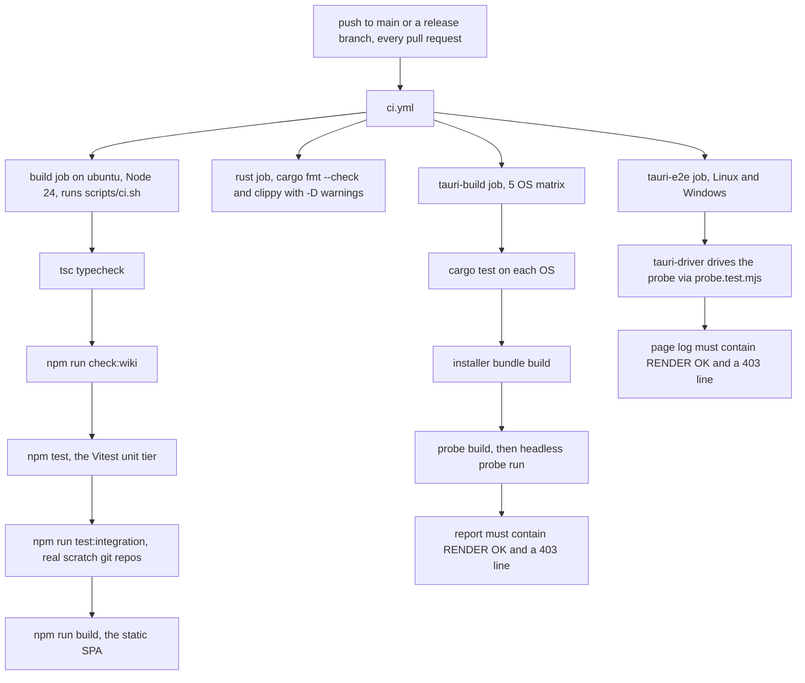
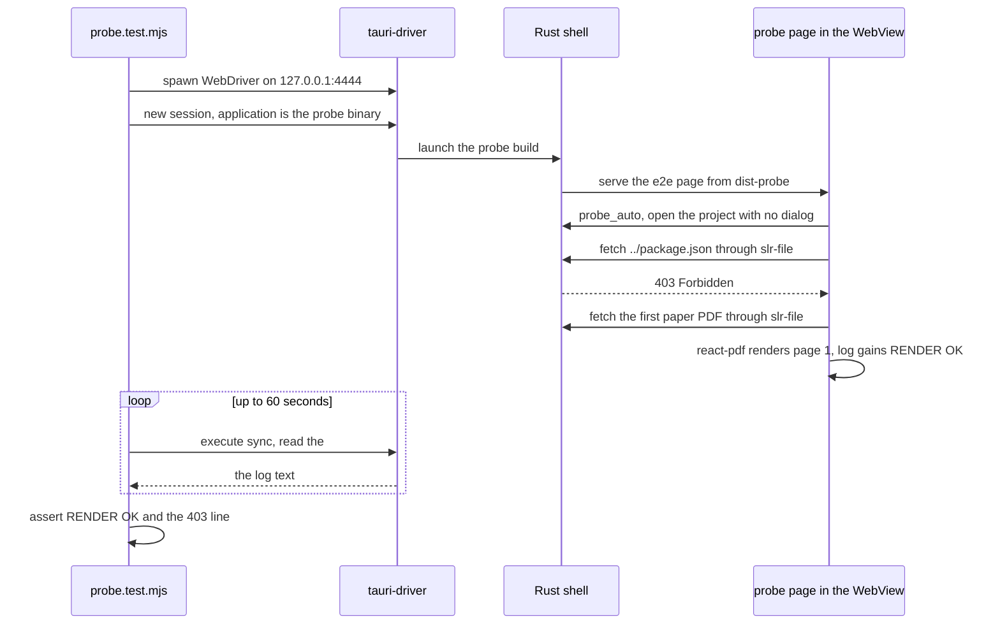

# Testing Strategy

SaiLoR is checked in four deliberately separated layers, each owning the class of
bug the layer below it structurally cannot see. The layering follows the process
split described in [Architecture](architecture.md) — a React/Zustand renderer
talking to a Rust shell — so the fastest tier exercises pure renderer logic, the
next drives the real components against a real `git` binary, the third tests the
shell's own logic, and the last runs the actual app in an actual system WebView.



*The CI gating flow: the renderer script and the three shell jobs all run on
every push and pull request. Release installers are built by a separate
workflow from a `v*` tag — see [Build, CI, and Release](operations/build-release.md).*

## The four test layers

| Layer | Run with | Lives in | What it owns |
|---|---|---|---|
| 1. Vitest unit tests | `npm test` | `src/**/*.test.{ts,tsx}` | Pure renderer logic: model, stores, git/consolidate/llm/screening modules, component helpers, the platform seam |
| 2. Integration suite | `npm run test:integration` | `src/test/integration/*.integration.test.tsx` | Real React components driven end to end against real scratch git repositories |
| 3. Rust unit tests | `cargo test --manifest-path src-tauri/Cargo.toml` (`make test-rust`) | `#[cfg(test)] mod tests` in every `src-tauri/src/*.rs` | The shell: git plumbing, the `slr-file://` protocol, authorization, the SSRF guard, the updater |
| 4. E2e probe | `make probe`, then `node --test e2e/probe.test.mjs` | `e2e/` | The real binary in the real system WebView: a PDF actually renders, and a path-traversal fetch is actually refused |

### Layer 1 — Vitest unit tests

The default, fastest tier — a fast per-PR gate, so it is kept to pure logic that
never touches a real filesystem or the git binary.

```jsonc
// package.json
"test": "vitest run",
"test:watch": "vitest",
```

Configured in the `test` block of `vite.config.ts`:

```ts
// vite.config.ts
test: {
  environment: 'jsdom',
  globals: true,
  include: ['src/**/*.test.{ts,tsx}'],
  exclude: [
    '**/node_modules/**',
    '**/dist/**',
    '**/.{idea,git,cache,output,temp}/**',
    '**/*.integration.test.{ts,tsx}',
  ],
},
```

- **Environment** `jsdom`, **globals** `true` (most files still import
  `describe`/`it`/`expect` explicitly for editor support).
- **Include** `src/**/*.test.{ts,tsx}`.
- **Exclude** explicitly keeps the integration suite out. Setting `exclude`
  *replaces* Vite's default list rather than appending to it, so the usual
  entries (`node_modules`, `dist`, …) are repeated alongside the
  `*.integration.test.{ts,tsx}` pattern.

What the tier covers, by area:

**Model — `src/model/*.test.ts`.** `model.test.ts` is the data model's
contract: schema resolution (defaults, path ids, duplicate sibling names, enum
options, `max < min` rejection, `required` defaults, and `visibleIf`
conditional-visibility resolution — bare-name, absolute-path, nested
`all`/`any` groups, equals filtering, cross-branch/ancestor reads),
`isFieldVisible` (fail-open semantics, per-instance repeatable reads),
`normalizeTree`/`pruneTree`/`canAdd`/`canRemove`, `loadProject` input validation
(`ProjectLoadError`), the `loadProject → serializeProject` round-trip,
`Paper.finished` (a human declaration, not derived), `Paper.aiUsage`
(AI-use disclosure), `config.ai` (an **opt-in**: disabled when absent, enabled
only by an explicit `true`, and written only when enabled), `config.aiSeat`,
`config.reviewers`/`Paper.reviews` (multi-reviewer skeleton, per-reviewer
normalization, deterministic serialization), `Paper.equal`, screening, and
`Project.provenance`/`protocol`/`schemaInfo` (each degrading field-by-field
rather than all-or-nothing). A regression suite pins hand-edited primitive
instances the loader must adopt as values rather than crash on. Fixtures are
built through the real load path (`loadProject`/`serializeProject`), never
hand-assembled `Project` objects, so inputs are exactly as schema-normalized as
a real file would be. Alongside it: `hostile.test.ts` (malformed project
files), `duplicates.test.ts` (import classification), `completeness.test.ts`,
`schemaVersion.test.ts`, `staleSave.test.ts`, `pdfMeta.test.ts` (against real
sample PDFs), `annotationSplit.test.ts`, and more.

**Stores — `src/state/*.test.ts`.** The platform seam is mocked at
`getPlatform()` with a fake adapter (`kind: 'browser'` or `'tauri'` as the test
needs), and a `beforeEach` loads a known project via `loadFromText`. Cover:
undo/redo (coalescing consecutive edits of the same field into one step, a new
edit clearing the redo stack, a resync clearing history), annotation lifecycle,
marks, reading position, reviewer seats, finished flags, save/save-as (a change
made during the write does not clear `dirty`; opening never writes), screening,
batch-unanimous adoption, stale-save, and AI-suggestion application
(`store.ai.test.ts`: never overwrite the reviewer, one undo step for the whole
run, a run that writes nothing leaves no trace). `gitStore.test.ts` stubs the
full `GitPlatform` shape and drives `runPull`'s orchestration — dirty guard,
pull classification, parse boundary, merge, resolution dialog — through each
branch via `beginPullResult`/`finishPullResult`.

**Git and consolidation — `src/git/*.test.ts`, `src/consolidate/*.test.ts`.**
`merge.test.ts` builds base/ours/theirs fixtures through the real `loadProject`
and covers `merge3`/`mergeProjects`/`applyResolutions`/`conflictId`;
`ref.test.ts` pins `refProblem`, the ref/path safety gate (option-like refs,
control characters, revision syntax, everything `git check-ref-format`
forbids); also `changes`, `output`, `relpath`, `url`, `stash`, `repoSetup`,
`seatOwner`, `deriveGitInfo`, `concurrentRead`, `ownAnnotationPath`. The
consolidate suite covers `alignNode` (matching entries recorded in different
orders, through wording differences), agreement metrics, unanimous adoption,
disagreements export, and readiness.

**Components — `src/components/*.test.ts` and `*.test.tsx`.** Two shapes: the
`.test.ts` files test pure helper functions extracted from components directly
without rendering (`PaperList`'s `paperIsMarkedDone` and `paperMetadataHaystack`,
`GitDialog`'s `mixedDiscardConfirmMessage` and `isProjectOwnPath`, `PdfViewer`'s
`destinationPoint`/`markVerticallyVisible`/`dedupeOverlappingRects`,
`PapersEditor`'s `duplicatePaperIds`, `Toolbar`'s `gitButtonState` and
`aiButtonState` — always-shown buttons disabled with a reason, never hidden),
while the `.test.tsx` files render the real components with React Testing
Library under jsdom (`PaperList`, `ScreeningPanel`, `SchemaTreeEditor`,
`GitDialog`'s discard flow, `PdfViewer`'s marks, …). The multi-step,
multi-component workflows still live in the integration suite.

**Platform seam — `src/platform/*.test.ts`.** The Tauri transport is tested
without Tauri: `tauri.test.ts` mocks `@tauri-apps/api`'s `invoke`/`listen` and
asserts `tauriBridge` maps each bridge call to its snake_case command with
named args (plus `assembleProject`'s `RawProject` reassembly), and
`desktop.test.ts` drives `DesktopAdapter.saveProject` against a mocked bridge,
pinning the split layout (meta-only `project.json` plus per-paper annotation
files) and the save baseline (only papers edited since open are written).

### Layer 2 — Integration suite

The jsdom-based integration tests. Slower by design, kept out of the default
run, and — since the move to Tauri — part of the main CI script (see
[CI gating](#ci-gating) below).

```jsonc
// package.json
"test:integration": "vitest run --config vitest.integration.config.ts",
```

A **standalone config** rather than `mergeConfig` over `vite.config.ts` —
Vite's `mergeConfig` concatenates array fields like `test.include` rather than
replacing them, which would silently pull the entire unit suite into this run
too:

```ts
// vitest.integration.config.ts
export default defineConfig({
  plugins: [react()],
  test: {
    environment: 'jsdom',
    globals: true,
    include: ['src/test/integration/**/*.integration.test.tsx'],
  },
})
```

Each test:

1. **Mocks `getPlatform()`** to inject a fake platform object at that single
   seam — the same factory that otherwise hands the app a `TauriAdapter` inside
   the desktop shell or the inert `createUnsupportedAdapter` elsewhere — so the
   whole React app runs under jsdom with no Tauri runtime. The fake's
   `saveProject`/`openProject` do real `fs` writes against the scratch repo,
   so `git status`/`git diff` see genuine content. (`{ kind: 'electron', path }`
   is what `DesktopAdapter` hands back for a desktop save handle — the legacy
   union-member name is still the desktop path kind in 2.x.)
2. **Spins up real scratch git repositories** (`mkdtempSync` → `git init` →
   initial commit — per test where a file holds several, per file otherwise) and
   wires a fake `GitPlatform` whose `status`/`commit`/`beginPull`/etc. shell out
   to the real `git` binary against that directory, mirroring what
   `src-tauri/src/git.rs` does — so merge, pull, branch-switch, discard and
   split flows run against genuine git, not a stub.
3. **Renders the real React components** with React Testing Library
   (`render`, `screen`, `userEvent`), driving them with real clicks, typing and
   DOM events — not direct store calls.
4. **Verifies independently of the app** by reading the scratch repo directly
   (e.g. `git log -1 --format=%s`, `git show HEAD:project.json`), so a green
   test proves a real commit landed rather than just that the store claims it
   did.

Because jsdom performs no real layout, the tests stub the geometry primitives
the components actually read — `getBoundingClientRect`, `Range.getClientRects`,
`ResizeObserver` — and mock `react-pdf` (which needs a real canvas/pdf.js
parsing jsdom cannot provide). Everything *above* that (selection capture, mark
creation, the comment popover, the annotation form, the Git panel) is the
genuine component code. `pdfReadingPosition.integration.test.tsx` goes further
and models a genuinely scrollable container (page tops track `scrollTop`,
placeholder heights grow to real heights per page as each text layer
"finishes"), so a correct, self-correcting `scrollTop +=` is distinguishable
from one that silently accumulates error.

The suite (`src/test/integration/`):

| File | Flow it owns |
|------|--------------|
| `annotationWorkflow.integration.test.tsx` | Author a schema covering every field type → annotate a real PDF (highlight from a selection, its comment popover, a sticky note, a field value) → save → commit with real git |
| `consolidationAndMerge.integration.test.tsx` | Two reviewer seats disagreeing, reconciled through the real Consolidation compare popup, plus a real three-way merge producing a genuine field-level conflict resolved through the merge dialog |
| `branchSwitch.integration.test.tsx` | Switching branches with uncommitted changes the target also touched — a real stash carry-over landing as a field-level conflict via `GitMergeDialog` |
| `pull.integration.test.tsx` | A real `git pull` against a bare "origin" diverged by a second clone, through `GitDialog`'s real "Pull" button |
| `discard.integration.test.tsx` | Discarding an uncommitted field-level change back to its last-committed value (`writeWorking`, not `commit`) — the first test to implement `headContent`/`workingContent` for real, i.e. the field-review path |
| `pdfReadingPosition.integration.test.tsx` | "Continue where you left off" — reopening lands on the same paper/page |
| `screeningImport.integration.test.tsx` | Real include/exclude decisions through `ScreeningPanel`, then the "New from screening…" flow (`startFromScreening` → `ScreeningImportDialog`) over real `fs` |
| `fetchPolicy.integration.test.tsx` | The background-fetch safety guard against a repo whose own config names a fetch command (`core.sshCommand`, `credential.helper`, `include.path`, …) — tested against real `git config --get-regexp`, because the pattern is only as good as its agreement with what git actually reports |
| `annotationSplit.integration.test.tsx` | Splitting a shared annotations folder in a real repository: git must see the moved files as renames, and each project's own-file staging must then see only its own files |
| `stashOps.integration.test.tsx` | `pushStash`/`restoreStash`/`dropStash`/`branchFromStash` against real git — a stash that no longer fits rolls all the way back, never leaving conflict markers, and the branch-switch carry-over is found by its message, not its position |
| `gitScenarios.integration.test.tsx` | The scenario rig (below): every scenario builds, holds what its README entry promises, and the README stays in sync |

### Layer 3 — Rust unit tests

The Rust shell carries its own test layer inline: every module in
`src-tauri/src/` except `main.rs` (the command registry) has its own
`#[cfg(test)] mod tests` block, run by

```bash
cargo test --manifest-path src-tauri/Cargo.toml   # or: make test-rust
```

CI runs them **per OS** (in the `tauri-build` matrix job — the same commands
that pass on Linux must pass where the paths, filesystems and WebView differ),
and a separate `rust` job gates style and lints:

```bash
cargo fmt --check
cargo clippy --all-targets --all-features -- -D warnings   # make lint
```

Representative coverage:

- **`git.rs`** (the largest test module) keeps the shell's security and parsing
  gates pinned — and deliberately *shared* with the renderer's `src/git` tests:
  `rel_path_problem`/`validate_git_url`/`validate_clone_path` vectors,
  `ref_problem` vectors, the porcelain/log/stash-list/annotation-authors
  parsers, own-annotation-path matching, merge-blocking and repo-setup rules.
  It then runs the real command surface against real scratch repositories:
  `info`/`status`/`commit` (including the detached-HEAD refusal and the
  session-root check), pull fast-forward/merge/`conflict-elsewhere` through a
  clone pair, stash push/restore/drop, branch-switch begin/abort/finish,
  `commit_partial`/`write_working`, repo setup, discard rules, and a
  symlink-escape check (unix).
- **`protocol.rs`** pins the `slr-file://` scheme: `../secret.pdf`,
  `pdfs/../../secret.pdf` and an absolute path all return **403**, a missing
  file 404, nothing-open says so — plus byte-range serving (206/416, and which
  malformed ranges are ignored) and the `OPTIONS` preflight.
- **`project.rs`** pins that `save` refuses a path the session never opened
  ("Refusing to save…"), and the stale-file/deletion rules of a round-trip.
- **`webfetch.rs`** pins the SSRF guard's blocked-address and blocked-hostname
  vectors; **`update.rs`** asserts the updater feed is the fixed HTTPS GitHub
  endpoint with `requireSignedVersion: true` (read from `tauri.conf.json`
  itself); **`authz.rs`**, **`close.rs`**, **`paths.rs`**, **`pdf.rs`**,
  **`annotations.rs`**, **`llm.rs`**, **`ollama.rs`**, **`localruntime.rs`**,
  **`net.rs`**, **`hardware.rs`**, **`feedback.rs`** and **`shell.rs`** each
  carry their own module.

See [Tauri Shell, IPC and Self-Update](operations/tauri-shell.md) for what the
tested modules *do*; the point for this page is that the shell's trust boundary
(refs, relpaths, URLs, the protocol, authorization) is pinned on the Rust side
by its own tests, not only by the renderer's copies in `src/git/`.

### Layer 4 — The e2e probe

The Electron-era Playwright specs (`e2e/openSaveProject.spec.ts`,
`e2e/gitPush.spec.ts`) are gone with the shell they drove. The e2e layer is now
a **probe app**: a minimal React page (`e2e/index.html` + `e2e/main.tsx`) that
is *not* the real app but shares its pdf.js worker setup
(`src/platform/pdfjs`), built into the real binary and driven through
`tauri-driver` by `e2e/probe.test.mjs`.

**Building it.** `make probe` runs

```bash
npx tauri build --no-bundle --features probe --config src-tauri/tauri.probe.conf.json
```

`tauri.probe.conf.json` swaps the frontend build to `vite.probe.config.ts`
(root `e2e/`, `outDir ../dist-probe`, dev port 5199), so the binary embeds the
probe page instead of the real app. The `probe` cargo feature adds exactly two
commands and nothing else — `probe_auto` (open `$SAILOR_PROBE_PROJECT` with no
dialog and register its directory, so `slr-file://` can resolve PDFs) and
`probe_report` (append a line to `$SAILOR_PROBE_REPORT`) — and is never enabled
in a release build.

**What the page does.** On mount it calls `probe_auto`, lists the project's
PDFs, then fetches `../package.json` and `nope.pdf` through the custom scheme,
logging `probe <rel> -> <status>` for each (the traversal attempt must come
back **403**). It renders the first paper's PDF with `react-pdf`, logging
`PDF OK pages=N` and `RENDER OK` on render success. Every line goes both to the
in-page `#log` element and, via `probe_report`, to the report file. A
"Traversal attempt" button fetches `../../../../etc/passwd` for manual poking.
The scheme base is `http://slr-file.localhost` on Windows and
`slr-file://localhost` elsewhere.

**Driving it.** `node --test e2e/probe.test.mjs` (after `make probe`):



*The probe e2e flow. `SAILOR_PROBE_PROJECT` defaults to
`samples/project.example.json`; the test needs `tauri-driver` on `PATH`.*

This is the one layer that proves, in a **real system WebView**, that the Rust
shell serves the embedded frontend, that `slr-file://` refuses a path traversal
with 403 (the same `protocol::serve` guard `protocol.rs`'s unit tests pin), and
that pdf.js actually renders a page of a real PDF — end to end, in the process
a user runs.

**In CI** the probe has two consumers: the `tauri-build` job runs the binary
headless (`xvfb-run -a` on Ubuntu) and asserts the report file contains
`RENDER OK` and `-> 403`; the `tauri-e2e` job runs `probe.test.mjs` under
`tauri-driver` on `ubuntu-24.04` and `windows-latest` — there is no macOS job,
because tauri-driver has no macOS support. On Windows the job also installs a
`msedgedriver` matching the installed WebView2 and re-runs the test at medium
integrity via gsudo (WebView2 ignores the driver's browser arguments in the
runner's elevated process).

## The wiki-link check

```jsonc
// package.json
"check:wiki": "node scripts/check-wiki-links.js",
```

The GitHub wiki has no build step, so a link to a page, heading or image that no
longer exists is a silent dead end. `scripts/check-wiki-links.js` is that build
step, and it runs as a step of `scripts/ci.sh`. For each of `openwiki/` and
`user-guide/` it verifies:

1. Every internal link points at a page that exists.
2. Every `#section` link points at a heading that exists, using GitHub's own
   anchor-slug rules — reproduced rather than approximated, including the `-1`,
   `-2` suffixes it adds to duplicate headings.
3. Every link leaving the bare-page-name form — an image, or a path stepping
   outside the directory (`../LICENSE`-style) — resolves to a real file on disk.
4. Every page is reachable from that directory's own table of contents
   (`openwiki/_Sidebar.md`, hand-maintained; `user-guide/README.md`'s "Guide
   contents" table serves the same purpose), so a new page cannot be left
   orphaned. Each directory has its own small set of exemptions (its chrome,
   OpenWiki's generated `index.md` listings, the generator's `INSTRUCTIONS.md`,
   and the flattened sub-page aliases the sidebar links to).

OKF YAML frontmatter is stripped before either scan, so a frontmatter line is
never mistaken for a heading or a link. Problems are printed as a list and the
script exits non-zero; a clean run prints the per-directory file and page
counts.

## The git-scenario rig

`samples/git-scenarios/` is a rig of ready-made situations for trying SaiLoR's
git support by hand — two reviewers, Anna and Ben, a shared `origin`, and one
situation each (a clean pull, a conflict, a renamed field, a stash left behind,
…). A git repository cannot be committed inside another one, so the scenarios
are kept as **definitions** (`scenarios.ts`, starting from the small review in
`base.ts`) and built on demand into real repositories:

```bash
npm run scenario -- list          # what there is
npm run scenario -- rename-vs-edit          # build one into a temporary folder
npm run scenario -- rename-vs-edit --out ~/sailor-scenarios/rename
npm run scenario -- all --out ~/sailor-scenarios
npm run scenario -- readme       # the generated scenario list for README.md
```

A built scenario folder holds `origin.git` and one clone per person
(`anna/`, `ben/`); open a clone's `review.json` and pull, push or commit as
that person. Three properties make the rig usable as a test fixture:

- **Deterministic.** Fixed names, e-mail addresses and commit dates (a fixed
  clock, one hour per commit), branch `main`, and none of the machine's own git
  configuration (`GIT_CONFIG_NOSYSTEM`, an empty stand-in global config, hooks
  disabled, `commit.gpgsign false`) — the same scenario gives the same commits
  everywhere, so a bug report can name exact hashes.
- **Never inside a repository.** `buildScenario` refuses an `--out` folder that
  is not empty or inside any git working tree (including this one), so a
  scenario's `.git` folders can never be committed by accident. The default is a
  fresh temporary folder.
- **Checked.** The README's scenario list is generated: after changing a
  scenario, run `npm run scenario -- readme` and paste the output between the
  `<!-- scenarios:begin -->` / `<!-- scenarios:end -->` markers —
  `gitScenarios.integration.test.tsx` fails while they differ. The same test
  builds *every* scenario and runs each definition's `verify()`, which drives
  SaiLoR's real `mergeProjects` over the built revisions (base/HEAD/origin) —
  so a scenario someone opens by hand is known to show what it claims, and a
  change to SaiLoR that breaks one fails here. It also pins determinism (two
  builds of the same scenario produce the same `rev-parse HEAD`) and the
  refuse-inside-a-work-tree guard.

See [Git Integration](workflows/git-integration.md) for what the scenarios
exercise; only `smith2021` has a PDF (copied from `samples/pdfs/`).

## CI gating

### `scripts/ci.sh` — the provider-agnostic renderer pipeline

The single source of truth for "does the app build and pass its checks". CI
providers do nothing more than check out the code, provide a Node toolchain, and
run this script — so the exact same checks run locally with `./scripts/ci.sh`:

```bash
# scripts/ci.sh — ordered steps (set -euo pipefail, run from the repo root)
step "Installing dependencies (npm ci)"   # npm install fallback; SKIP_INSTALL=1 skips
step "Type checking (tsc -b)"             # npm run typecheck
step "Checking wiki links (openwiki/, user-guide/)"  # npm run check:wiki
step "Running tests (vitest)"             # npm test  (unit tier)
step "Running integration tests (src/test/integration/)"  # npm run test:integration
step "Building static SPA (vite build)"   # npm run build
step "CI passed ✔"
```

Unlike the Electron era, the integration suite is part of the main script —
both tiers gate every push and PR, not just releases.

### `ci.yml` — four jobs

```yaml
# .github/workflows/ci.yml
on:
  push: { branches: [main, 'release/**'], paths-ignore: ['technical-report/**'] }
  pull_request: { paths-ignore: ['technical-report/**'] }
  workflow_dispatch:
concurrency: { group: "…-${{ github.ref }}", cancel-in-progress: true }
```

- **`build`** (ubuntu-latest, Node 24) runs `scripts/ci.sh` — typecheck, the
  wiki-link check, the unit tier, the integration suite, the SPA build.
- **`rust`** (ubuntu-latest) lints the shell: `cargo fmt --check` and
  `cargo clippy --all-targets --all-features -- -D warnings`. Rust *tests*
  don't run here — they run per OS in `tauri-build`.
- **`tauri-build`** — a `fail-fast: false` matrix over `macos-15`, `macos-26`,
  `windows-latest`, `ubuntu-22.04`, `ubuntu-24.04`. Each runner runs
  `cargo test --manifest-path src-tauri/Cargo.toml`, builds the real installer
  bundle (`npx tauri build`) and reports installer sizes, then builds the probe
  and **runs it headless** (report asserted to contain `RENDER OK` and
  `-> 403`; the report is uploaded as a `probe-report-<os>` artifact even on
  failure).
- **`tauri-e2e`** — `fail-fast: false` over `ubuntu-24.04` and
  `windows-latest` only (tauri-driver has no macOS support). Installs
  `tauri-driver --locked` (plus a WebView2-matching `msedgedriver` and a gsudo
  medium-integrity run on Windows), rebuilds the probe, and runs
  `node --test e2e/probe.test.mjs` — under `xvfb-run -a` on Linux.

There is deliberately no push-on-every-branch trigger: a branch with an open PR
would build twice per push for no extra signal. A `concurrency` group cancels
runs the newest commit supersedes.

### `release.yml` — not a test gate

Release installers are built by
[release.yml](operations/build-release.md#release-githubworkflowsreleaseyml)
from a `v*` tag (preflight, draft release, four-target build, the
`latest.json` platform check, Zenodo archiving on publish) — it re-runs **no**
test suite. The test gates above apply to pushes and pull requests; a tag push
triggers neither, so what reaches a release is whatever passed CI on the code
the tag points at.

## Which tests to run for a given change

| Area you changed | Run |
|------------------|-----|
| Data model (`src/model/*`) | `npm test` — the relevant `src/model/*.test.ts` |
| Store (`src/state/*`) | `npm test` — the relevant `store.*`/`editorStore.*`/`gitStore.test.ts` |
| Git logic (`src/git/*`) | `npm test` **and** `npm run test:integration` (real-git flows) |
| Components (`src/components/*`) | `npm test` (helpers + rendered) **and** `npm run test:integration` for multi-step flows |
| Platform seam (`src/platform/*`) | `npm test` (`tauri.test.ts`, `desktop.test.ts`, `recents.test.ts`) |
| Rust shell (`src-tauri/*`) | `make test-rust` **and** `make lint` (fmt + clippy `-D warnings`) |
| `slr-file://` protocol, PDF serving, authz (`protocol.rs`, `pdf.rs`, `authz.rs`) | `cargo test`, then `make probe` and the probe run — the only tier that exercises the real WebView path |
| Scenario definitions (`samples/git-scenarios/*`) | `npm run test:integration` (the `gitScenarios` suite) and `npm run scenario -- readme` if the list changed |
| Wiki pages (`openwiki/`, `user-guide/`) | `npm run check:wiki` |

For a full local pre-release check, mirror CI:

```bash
make check          # typecheck + fmt/clippy + both unit tiers
make test-integration
make probe && node --test e2e/probe.test.mjs   # needs tauri-driver on PATH
```
