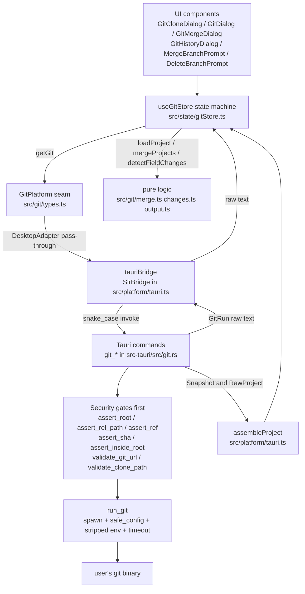
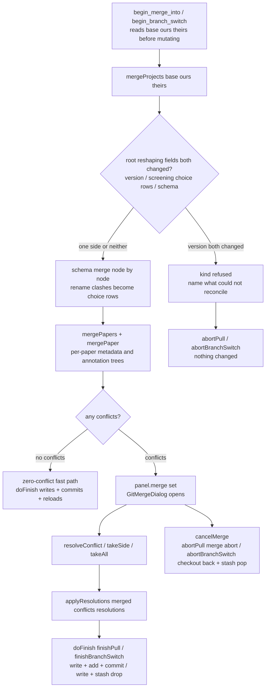
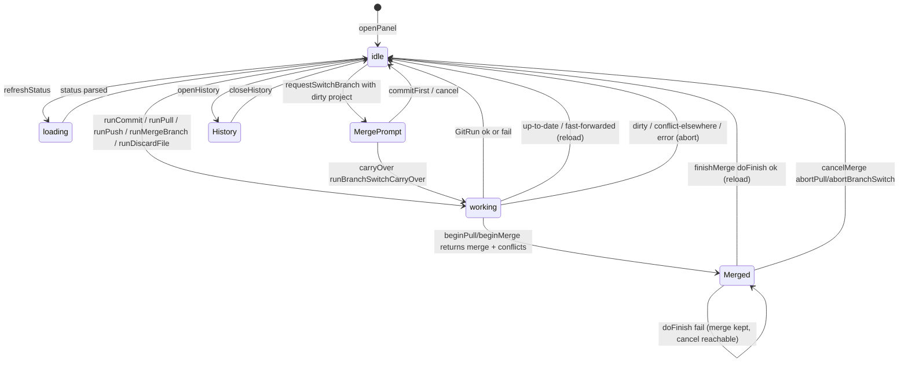
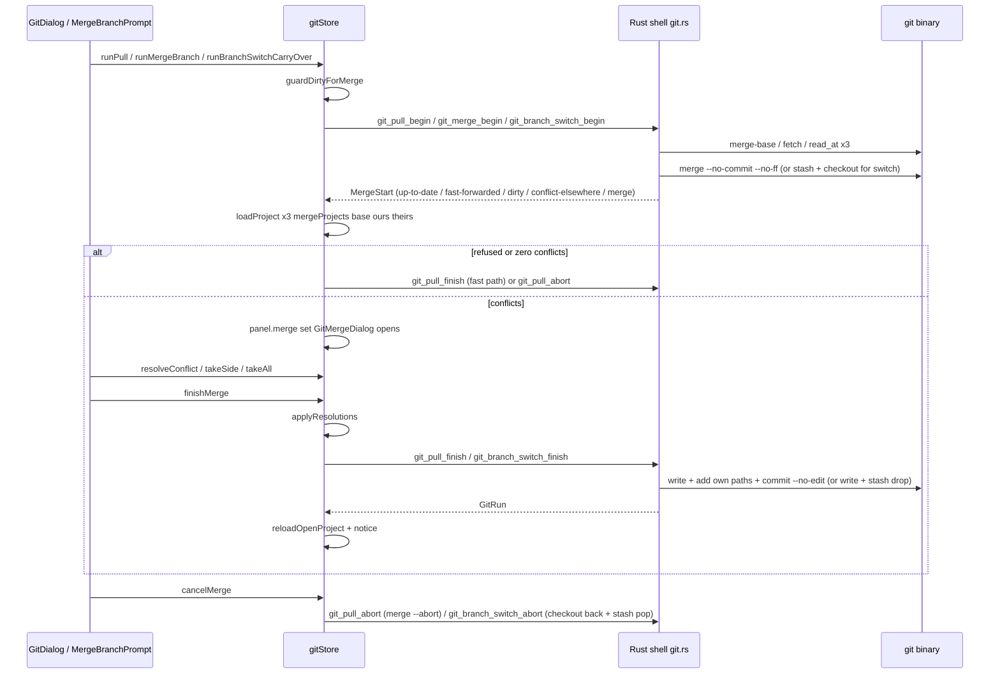

# Git Integration

Git support lets a review team share one SaiLoR project across machines without
SaiLoR ever teaching its users git. Two ideas make that possible despite a
file format that was *designed* so independent reviewers don't trample each
other (each reviewer's answers live in their own file under `annotations/`):

- a **field-level three-way merge** (`src/git/merge.ts`) that reconciles two
  divergent copies of the project by the single rule *"a side that did not
  change a value away from the base does not get a vote on it"*, and
- a strict **fetch-vs-parse split**: the Rust shell (`src-tauri/src/git.rs`) is
  the only thing that talks to git and touches the repository; it returns raw
  text and whole-project snapshots across the Tauri boundary, and the renderer
  parses and diffs them. Every diff — a commit panel's HEAD-vs-working review,
  a merge's base/ours/theirs, a history row's parent-vs-commit — is computed in
  the renderer from text the shell fetched.

This page follows the flow in four layers: the **security gates** that vet
every input before it reaches a spawned `git`, the **shell plumbing** in
`src-tauri/src/git.rs` that owns the only path to git, the **pure logic** in
`src/git/` (merge, changes, output, concurrency helpers), and the **gitStore**
state machine plus its UI components that drive the whole thing from the
renderer.



The diagram above shows who owns what; the layers below explain each one.

## Security gates: input never chooses argv

Every string the renderer names — a clone URL, a destination path, a
repo-relative path, a branch ref — is user input that reaches a spawned
process or a file write, so it is checked **at the trust boundary, before any
git command**. The check lives twice by design:

- The **TypeScript originals** stay in `src/git/{url,ref,relpath,
  ownAnnotationPath}.ts` — not inside `src-tauri/`, which sits outside vitest's
  test scope, because "a security gate with no tests is a security gate nobody
  can change safely". Each has a sibling `*.test.ts` and is unit-tested there.
- The **Rust twins** (`validate_git_url`/`validate_clone_path`,
  `ref_problem`, `rel_path_problem`, `own_matcher` in `src-tauri/src/git.rs`)
  re-implement the same rules and run on every command invocation, because a
  renderer-side check is advisory once the renderer is untrusted. The two sets
  are kept in sync by hand and pinned together by the git-scenario fixtures
  (see [Tests that matter](#tests-that-matter)) and by git.rs's own test
  module, which shares the same refusal vectors with the renderer tests.

The two are wired through the same guard shapes on the Rust side:
`assert_rel_path`/`assert_ref`/`assert_sha`/`assert_root`/`assert_inside_root`
run before a handler body does anything, and the `known_git_roots` set
(`src-tauri/src/authz.rs`'s `Session`) is populated by `git_info` and
`git_clone` so a mutating command can refuse a `root` the renderer invented
this session. `assert_inside_root` canonicalizes the real destination against
symlinks — the filesystem half of the relative-path guard. (See
[architecture.md](../architecture.md)'s trust-boundary section and
[tauri-shell.md](../operations/tauri-shell.md)'s command table for the shell
side in full.)

`run_git` (`src-tauri/src/git.rs`) itself hardens the environment so a hostile
`.git/config` from a folder received by zip/USB cannot run code on a mere
"open project":

- The **environment is stripped then pinned**: `STRIPPED_ENV` removes inherited
  `GIT_DIR`/`GIT_WORK_TREE`/`GIT_INDEX_FILE`/`GIT_OBJECT_DIRECTORY`/
  `GIT_ALTERNATE_OBJECT_DIRECTORIES`/`GIT_CONFIG`/`GIT_CONFIG_GLOBAL` variables
  (a shell sitting inside another repo would otherwise point every command at
  it), then `GIT_TERMINAL_PROMPT=0`, `GIT_EDITOR=true`, and
  `GIT_SEQUENCE_EDITOR=true` are set so git fails fast with its own message
  instead of blocking on a tty that does not exist. Background fetches add
  `NON_INTERACTIVE_ENV` (`GCM_INTERACTIVE=never`, `SSH_ASKPASS_REQUIRE=never`,
  empty `GIT_ASKPASS`/`SSH_ASKPASS`) from `src/git/fetchPolicy.ts`. Credential
  helpers, askpass programs and SSH agents are otherwise deliberately
  untouched: they are the user's own configuration and run only on network
  actions the reviewer asked for.
- `safe_config()` is a hard `-c` override **prepended to every invocation**
  (it becomes the leading arguments of `git` itself, and `-c` beats every
  config file): `core.fsmonitor=false`, a non-existent `core.hooksPath` under
  the OS temp dir (defanging `.git/hooks`), `core.pager=cat`,
  `core.editor=false`, `core.alternateRefsCommand=`,
  `uploadpack.packObjectsHook=`, and `protocol.ext.allow=never`. The threat is
  concrete: the docs describe receiving a project folder, and a copied `.git/`
  brings its `config` — a `core.fsmonitor` of `printf PWNED > /tmp/proof; false`
  runs on `git status`, which the Git button reaches in one click and
  `git_info` fires automatically on project open. Keys a user may legitimately
  set globally (`core.sshCommand`, `credential.helper`, `gpg.program`) are left
  alone; `--no-ext-diff`/`--no-textconv` are passed on the diff itself because
  setting `diff.external` empty makes git try to run the empty string.
- The **argument vector is fixed, never renderer-chosen**: a new operation is
  an enumerated `pub fn` handler, not a pass-through of arbitrary argv.
  Output is capped (`MAX_OUTPUT` = 32 MB kills the process — a runaway diff
  must not exhaust the shell), a per-command timeout applies (30 s normally,
  900 s for clone/push/fetch, 60 s for the background fetch), and on Windows
  the process is created without a console window.

Beyond the environment, four string-level gates vet renderer-supplied input:

- **`validateGitUrl` / `validateClonePath`** (`src/git/url.ts`, mirrored as
  `validate_git_url`/`validate_clone_path`): an **allowlist** of transports
  (`https://`, `http://`, `ssh://`, `git://`, `git+ssh://`, `file://`, plus
  scp-like `user@host:path` and absolute local paths) rather than a character
  blocklist — because `ext::sh -c '…'` is a git remote-helper transport that
  makes git run a program named by the URL, i.e. arbitrary code execution
  spelled as a URL. `REMOTE_HELPER` rejects any leading `scheme::`. A leading
  `-` is refused (git would read it as an option), as are control chars.
  `validateClonePath` requires an absolute destination and rejects a leading
  `-`. `repoNameFromUrl` derives the directory `git clone` would create so the
  dialog can show where it lands, and its rejection of `.`/`..`/separator
  names is also what stops `join(parent, name)` escaping the chosen folder.
- **`relPathProblem` / `annotationsRelDir`** (`src/git/relpath.ts`, mirrored
  as `rel_path_problem`/`annotations_rel_dir`): is this string safe as a path
  *relative to the repo root*? Refuses empty, absolute (incl. Windows drive
  letters and UNC/root separators — `path.isAbsolute` on POSIX doesn't
  recognise them), `..` traversal (split on **both** `/` and `\` because
  `path.win32.join` honours backslashes and a `..\..\` opaque segment used to
  pass), control chars, and any `.git` component (trailing dots/spaces
  stripped before comparing, since Win32 strips them itself so
  `.git.\config` opens `.git`). `annotationsRelDir` derives the project's
  `annotations/` folder from its `relPath` so the derivation has one
  implementation shared by the Rust side (which reads/writes it) and the
  renderer (which only needs to recognise it in a `git status` listing).
- **`refProblem`** (`src/git/ref.ts`, mirrored as `ref_problem`): is this
  string safe as a git ref? Refuses empty, leading `-` (option-like), control
  chars, and the revision-syntax / `check-ref-format` characters that turn a
  name into a *different* commit (`..`, `~`, `^`, `:`, `?`, `*`, `[`, `\`,
  `@{`, `//`, leading/trailing `/`, trailing `.`, a component starting with
  `.` or ending in `.lock`). Whether the ref *exists* is
  `git rev-parse --verify`'s job — the other half of the guard.
- **`ownAnnotationPathMatcher`** (`src/git/ownAnnotationPath.ts`, mirrored as
  `own_matcher`): does a path under a project's `annotations/` folder belong
  to *this* project, or to a *sibling* sharing the same directory?
  `annotationsRelDir` derives the folder purely from the project file's
  directory and says nothing about whether only this project lives there — and
  it routinely doesn't: SaiLoR's own "Start full-text screening" flow saves a
  derived project as a sibling JSON next to its source, and an ad hoc "Save
  As" does the same. Without this predicate, every flow that treats "anything
  under `annotations/`" as this project's territory (a branch-switch stash, a
  merge's conflict waiver, the staging scope of a merge commit) would silently
  stash, merge over, or delete a sibling's files. It matches
  `<paperId>/<name>.json` for *this* project's own paper ids and the
  `screening`/`reviewer` name family its config selects, duck-typed on the raw
  parse so a project that fails full validation for an unrelated reason
  doesn't make its own annotation paths unrecognizable.

### Where the shared-annotations rules meet git

The shared-annotations-folder rules are the connective tissue between the
gates and the flows. Three intersections matter:

- **Authorization for reading the folder** lives in `src-tauri/src/project.rs`
  and `src-tauri/src/authz.rs`: `annotations_dir_for` refuses an annotations
  folder outside the project's own directory (and one reached through a
  symlink), `read_project` reads only `.json` files inside the resolved
  folder for the project's own paper ids, and `projects_using_folder` lists
  sibling project files sharing that folder so the renderer can offer a split.
- **Membership for staging/waiving** is `ownAnnotationPathMatcher` /
  `own_matcher` — used by `own_annotation_paths_in` to compute what a
  commit/merge-commit may stage, and by `merge_blocking_paths` to decide what
  blocks a merge (every tracked change plus untracked files inside the
  project's own `annotations/` folder, excluding the `feedback/` folder).
- **Seat ownership** (`src/git/seatOwner.ts`, parsed by
  `parse_annotation_authors` from `git log --name-only` over the folder)
  answers "who has already read *this* paper in *this* seat" from who last
  committed each annotation file — per paper, because seats are not people in
  a large review.

## The shell plumbing: `src-tauri/src/git.rs`

The renderer never spawns git and never touches the repository. It reaches the
shell only through `DesktopAdapter`'s `git` object
(`src/platform/desktop.ts`), which implements `GitPlatform`
(`src/git/types.ts`) as thin pass-throughs to `SlrBridge` methods, which
`tauriBridge` maps to snake_case Tauri commands (`git:pullBegin` →
`git_pull_begin`). Every command runs its handler on a blocking thread
(`spawn_blocking`) — a clone or push can take minutes and must not occupy the
async workers.

A non-zero git exit is **data, not an exception** — `run_git` returns a
`GitRun` with `ok:false` and the exact stdout/stderr, because half of git's
useful output (a conflicting merge exits 1; that's the normal path here)
arrives on a failing exit code. Only a failure to launch git at all, a
timeout, or an output overflow is signalled with `code:null`.

The handlers, grouped by job:

**Probe / clone / open.**
`git_probe` runs `git --version`. `git_pick_clone_dir` opens a native folder
picker. `git_clone` validates URL + destination with `validate_git_url`/
`validate_clone_path`, runs `git clone -- url dest` with the network timeout,
and on success adds the destination to `known_git_roots`. `git_pick_project_in`
opens a project-file picker *inside* the freshly cloned dir; the caller reuses
the ordinary project-open path so opening logic isn't duplicated. `git_info`
resolves where the open project sits git-wise: it runs
`--is-inside-work-tree`, then six independent calls
(`--show-toplevel`, `--show-prefix`, HEAD-verify, current branch, `@{u}`,
`rev-list --count HEAD..@{u}`) and computes the fields inline. The sixth
(`behind`) counts commits the upstream has that this branch does not — as of
the last fetch. `git_info` itself never touches the network; the count is kept
fresh by `git_background_fetch`, which `refreshUpstream` runs when the
repository is detected, whenever the Git panel opens, and every two minutes
(`useUpstreamPolling`). `deriveGitInfo`
(`src/git/deriveGitInfo.ts`) is a pure **mirror** of that inline derivation,
extracted for testability to pin down exactly which input feeds which field —
a `Promise.all` array destructured into differently-named variables is exactly
the place a copy-paste reordering could silently swap two fields with no type
error. The Rust side uses `--show-toplevel` for the repo root and computes
`relPath` as `--show-prefix` + the file's base name, deliberately *not* doing
a `path.relative` against `--show-toplevel` alone, which resolves symlinks (on
macOS `/tmp` realpaths under `/private/tmp`) and would compute a `..` escape
pointing nowhere.

**Status / content / history.**
`git_status` runs `status --porcelain=v1 -z`, then
`--no-pager --no-color --no-ext-diff --no-textconv diff HEAD --` only when
HEAD exists, returning raw porcelain + diff; the renderer's
`GitPlatform.status` (`src/platform/desktop.ts`) parses the porcelain via
`parsePorcelain` and caps the diff via `capDiff` — the one place parsing
happens *outside* `src/git/`'s pure modules is still *inside* the renderer.
`--no-color` stops a user with `color.diff=always` from leaking ANSI escapes
into the `<pre>` as literal text. `git_head_content` and
`git_working_content` reassemble the project at HEAD vs the working tree:
`headContent` reads through `git show` (`read_at`), while `workingContent`
reads straight from disk via `project::read_project`
(`src-tauri/src/project.rs`) — deliberately not `git show :relPath` (the
index's copy), so the commit panel reviews what's really on disk, not what's
staged. `git_log_begin` runs `git log` scoped to the project's own file *and*
its `annotations/` dir (capped at `LOG_MAX_COMMITS` = 250, `truncated` when it
hits the cap); `git_log_diff` fetches the two revisions a history row needs
(`rev` and `rev^`) and returns raw text, with `'initial'` when there is no
parent.

**Commit / discard.**
Both `git_commit` and `git_commit_partial` start with a `detached_refusal`:
a commit made on a detached HEAD belongs to no branch — it succeeds, the
panel says "Committed.", and the work vanishes from the tree the moment the
reviewer checks out a branch again, recoverable only from the reflog. The
branch-switch flow already refused this; the commit path did not. An unborn
HEAD (no commits yet) is not detached — `symbolic-ref` still resolves — so
only a real detachment is refused. `git_commit` is the plain pathspec-limited
commit for non-project files: `add` then `commit -m message -- paths` (with
`--amend` when requested), never disturbing separately-staged work elsewhere.
`git_commit_partial` is what makes committing *some* of a project's
field-level changes possible at all: git has no native concept of staging part
of a file, but nothing requires the content `add` stages to be what's on
disk. Its sequence is **write → add → commit → (always) write again**:
`committed` goes onto disk just long enough to be staged, then `working` —
the state the working tree should hold afterward, composed by
`composeContents` from the reviewer's Use/Ignore/Discard choices — replaces
it. The write-back happens unconditionally (its failure is reported even when
the commit succeeded, and its success is what the return value reflects when
the attempt failed) because if `add` or `commit` fails partway, the working
tree must still end up holding `working`, never stuck mid-swap. Staging is
scoped to this project's own files (`relPath`, the reviewer's selections, and
`own_changed_paths` — never the whole `annotations/` folder, which may hold a
sibling project's work). `git_write_working` writes `working` *without*
staging or committing — the "throw away these local edits" counterpart, for a
reviewer who only wants to revert and shouldn't have to invent a commit.
`git_discard_file` is the whole-file counterpart to the project file's
field-level Discard: it re-derives the file's status (the tree can have
changed since the panel refreshed), deletes untracked files (via
`remove_dir_all` for a directory, `remove_file` for a file — the EISDIR bug
that used to wedge the panel), reverts tracked modified/deleted files via
`checkout --`, and refuses a rename or an unresolved conflict. It also refuses
the project's own file or anything under its `annotations_rel_dir` —
`GitDialog`'s `isProjectOwnPath` withholds the button, but that's UI not
enforcement, and the renderer must not be the only thing standing between a
stray click and data with no committed copy to recover. `gitStore`'s
`runDiscardFile` additionally wraps the call in `try`/`catch` so an uncaught
rejection never leaves `panel.phase` stuck at `working`.

**Pull / merge.**
`git_pull_begin` and `git_merge_begin` share `begin_merge_into`, which
classifies the merge and returns a discriminated `MergeStart` computed *before*
it mutates anything except in the `'merge'` case (where the merge is already
in flight): `up-to-date` (merge-base ancestry), `fast-forwarded`
(`merge --ff-only`), or divergent. For the divergent case it reads the three
revisions (base/ours/theirs) *before* touching the work tree, then
`merge --no-commit --no-ff`. It checks `MERGE_HEAD` to distinguish "a merge
that failed to start" (no MERGE_HEAD → abort would itself fail) from a real
in-progress merge, then filters unmerged paths down to the project's own
family via the **union** of `ours`' and `theirs`' own matchers (using only
`ours` would misclassify a remote-added paper as `conflict-elsewhere`).
Anything unmerged outside that family aborts the merge cleanly
(`'conflict-elsewhere'`): SaiLoR can merge an annotation JSON but not a PDF or
a `.gitignore`. `git_pull_begin` adds the pull-only cases: resolves `@{u}`,
fetches (network timeout), reports `'no-upstream'` when there isn't one — and
refuses first when the repo's merge-blocking paths are dirty. `git_merge_begin`
fetches when the chosen ref is genuinely remote-tracking (checked against git
via `rev-parse --symbolic-full-name`, not the `origin/` prefix), and
`^{commit}`-verifies the ref exists. `git_pull_finish` writes the resolved
project, `add`s the project file and the project's own changed annotation
paths (via `own_changed_paths`, never the whole `annotations/` folder — a
sibling project's uncommitted work must not be folded into a merge commit
nobody reviewed), and `commit --no-edit` (MERGE_HEAD set → a two-parent merge
commit). `git_pull_abort` is `merge --abort`. Both are wrapped in `as_run`
so a validation error becomes a failed `GitRun` the renderer can show instead
of a rejected promise.

**Branches / switch.**
`git_branches` lists local + remote-tracking refs via `for-each-ref` over
`refs/heads` and `refs/remotes`, dropping any refname ending in `/HEAD`
(a symref pointing at the remote's default branch, not a branch of its own —
merging it would silently mean `origin/main` under another name). Each entry
carries `name`/`current`/`remote`; remote-tracking refs can be merged but
never switched to (checking one out detaches HEAD), so the switcher filters
them out and only the merge picker offers them. `git_branch_create` is
`branch -- name` (the renderer follows with the ordinary switch flow; a
freshly cut branch shares its parent's commit so that switch can never itself
conflict). `git_branch_delete` is `branch -d --` — never `-D`; git's own "not
fully merged" refusal is the answer this app wants, surfaced as
`panel.error`. `git_checkout` is a plain `checkout branch --` for the
no-changes / no-project case. `git_branch_switch_begin` checks whether
switching is safe and — only in the `'merge'` case — actually performs it: it
reads the working-tree project (not HEAD, so an uncommitted new paper counts),
narrows "project's own files" via `own_matcher`, refuses
(`'other-files-dirty'`) if anything outside that is dirty, returns
`'no-changes'` if nothing is, and otherwise captures `base`/`ours`/`theirs`
**then** stashes the project's own dirty files (message
`sailor: switching branch`, excluding `feedback/`) and checks out the target
— atomically, so nothing can change the tree between "read what's there" and
"stash it". On a failed checkout it pops the stash back; if even that fails,
the carry-over message tells the reviewer their changes are parked as a stash.
`git_branch_switch_finish` writes the resolved project onto the new branch and
drops the carry-over stash (it is now folded in). `git_branch_switch_abort`
checks back out to `source_branch` and `stash pop`s — unlike `git_pull_abort`,
the checkout already succeeded by the time the reviewer can cancel, so this
*undoes* it rather than stopping something in flight.

**Stashes, seats, repo setup, background fetch.**
`git_stash_list/push/restore/drop/branch` manage parked work. Stashes are
identified by **commit sha, never `stash@{n}`** (the index shifts whenever
anything else pushes or drops; the shell resolves a sha back to its current
ref at the moment it acts, via `assert_sha`'s 40/64-hex check). A
carry-over stash is recognised by its message (`sailor: switching branch`)
rather than its position, and manual stashes carry the `sailor stash: ` prefix
(deliberately not a prefix of the carry-over message, so a reviewer who
happens to type "switching branch" is not mistaken for one). `restore_stash`
is all-or-nothing: it refuses a dirty-tree restore, applies, drops on success,
and on a failed apply rolls the tree back (`reset --merge`, then `clean -f`
of the stash's untracked third parent) and reports the conflict rather than
leaving markers. `git_annotation_authors` feeds `seatOwner.ts`.
`git_repo_setup_status`/`git_apply_repo_setup` manage the managed-block
`.gitattributes`/`.gitignore` rules (see `src/git/repoSetup.ts` for the bodies:
`*.json text eol=lf -merge`, plus the OS-droppings ignore list, written *next
to the project* so they scope to one project's tree), committing them authored
as SaiLoR and asking consent when the files already hold somebody's own rules.
`git_background_fetch` refuses (`refused: true`) when the repository's own
config names a fetch-time command (`FETCH_COMMAND_KEYS`: `core.sshCommand`,
credential helpers, `remote.*.uploadpack/receivepack`, `include.path`) — a
fetch nobody asked for must never run what a received `.git/config` says — and
otherwise fetches with `NON_INTERACTIVE_ENV` so it fails rather than prompting.

## Concurrent reads: the scenario behind `readAllConcurrently`

Reading a project at a revision needs `project.json` plus every
`annotations/<paperId>/*.json` file in it. Doing that one `git show` at a time
is the slow path. In production this lives entirely in the Rust shell:
`read_at` (`src-tauri/src/git.rs`) first `git show`s the project file, then
`ls-tree -r --name-only -z`s its annotations dir, filters the listing through
`own_matcher`, and reads the matching files **concurrently** via `show_all` —
a `thread::scope` fan-out with chunked workers (~8 files per worker), each
running `git show rev:path`. A file that no longer parses as JSON is dropped
(assembled as absent); a project file that fails `git show` means "did not
exist at this revision" (`Ok(None)`), and a legacy single-blob shape short-circuits
with no annotation files.

`readAllConcurrently` (`src/git/concurrentRead.ts`) is the TS **mirror** of
that orchestration, extracted purely so it can be unit-tested (`src-tauri/`
sits outside vitest's scope) — the comment in the Rust source names it. Its
shape documents the invariant the Rust fan-out must preserve:

```ts
export async function readAllConcurrently<T>(
  ids: string[],
  read: (id: string) => Promise<T>,
): Promise<Map<string, T>> {
  const results = await Promise.all(ids.map(read))
  return new Map(ids.map((id, i) => [id, results[i]]))
}
```

It launches one read per id at once, then rebuilds the id→result map by
*index* from the `Promise.all` result — so the mapping is correct regardless
of which read settles first. A rejecting read still rejects the whole call (the
same "the load failed" outcome a sequential loop has for a failing paper);
since every read is already in flight, if two fail at once it is not guaranteed
to be the *first* one (by `ids` order) whose error surfaces, only that it is a
real failure from one of them — an accepted, harmless difference from a
sequential loop's behavior.

## The field-level three-way merge (`src/git/merge.ts`)

`mergeProjects(base, ours, theirs)` is the heart of git support. It knows
nothing about git and nothing about the DOM: it takes a parsed `Project` at the
merge base (or `null`, when the file was added on both branches independently)
plus the two divergent copies, and returns either a `{kind:'merged', merged,
conflicts, notes}` or a `{kind:'refused', reason, details}`. `src/consolidate/`
is the pattern it follows: small, pure, hammered by unit tests.

The whole merge, in one rule applied at every granularity from a project's title
down to a single annotation field:

> **A side that did not change a value away from the base does not get a vote
> on it.**

That is precisely the guarantee this feature exists for — the fields *you*
changed cannot be overwritten by a remote that did not touch them, and vice
versa — and it is not a special case bolted on afterwards; it is the rule.
`merge3(base, ours, theirs, eq)` is its four-line embodiment: if `ours ===
theirs`, take it; if `ours === base`, take `theirs`; if `theirs === base`, take
`ours`; only when both sides changed to *different* things does it return `null`
— the one case no algorithm can settle and a person has to look at. A `null`
base (added on both branches) collapses cleanly: no base papers, every base
field value reads as absent/empty.



The diagram shows the merge lifecycle; the layers below are how `mergeProjects`
reaches each branch.

**Schema history comes first.** Before any field is compared, the merge
unifies the two sides' `schemaHistory` entries and fast-forwards each project
to that shared history (`atHistory`/`withMoves`), so a field one side renamed
and the other edited is the *same* field on both sides by the time `merge3`
sees it. A field both sides renamed differently starts out under our name,
with the other side's answers brought to it, and becomes a `schema` **choice
row** ("Call it X" / "Call it Y") the reviewer settles; the chosen rename is
recorded in the merge version's own moves so a file arriving later from the
other branch lands under the same name. `mergedSchemaVersion` takes either
side's version when it already includes the other's, otherwise mints a fresh
one with both as parents.

**Project settings become rows, not refusals.** Only a two-sided `version`
difference still refuses. `aiEnabled`, `aiSeat`, `finishCheckbox` (boolean
rows) and `reviewers` (number row, clamped to 1–10 on apply) are ordinary
conflicts; each `protocol` entry is a string row (lists one per line);
`screening` (whose choice carries the derived schema with it — a screening
project's schema comes from its reasons, so the two are one decision),
`annotationsDir`, `provenance` and unknown root or paper `extra` keys are
`type: 'choice'` rows whose `payload` holds each side's value and whose
resolution is `'ours'` or `'theirs'`. `title` and `schemaInfo` are ordinary
one-string rows — deliberately not refusals, since a conflict row expresses
each perfectly and refusing a whole merge because two people renamed the
review would be absurd.

**The schema is merged node by node** (`mergeSchemaDefs`). Identity is the name
within the parent, so a rename is a one-sided removal plus addition. Nodes only
one side has are kept when added, dropped when the other side left them
untouched, and become a keep-or-remove `presence` row when the other side
changed them. For nodes both have, each property goes through `merge3`:
`description`, `required`, `min`, `max` and `options` (one per line) are
editable rows, `type` and `visibleIf` are choice rows, and children recurse.
The merged schema keeps every node still in doubt, because the annotation trees
are walked against it; answers under a node that ends up removed ride along as
hidden answers (`orphanedNodes`) and `schemaRemovalNote` *says so* — a note
naming the fields and how many answers sit under them, not a refusal, because
nothing is lost: the trees are merged against every node either side kept, and
the answers come back if the field does. Ids are re-derived from the name path
afterwards (`withPathIds`). Because a combined schema can be something neither
side had, `mergeResultProblem` round-trips the resolved project through
`serializeProject`/`loadProject` before anything is written, in `gitStore`'s
`doFinish` and in the save-conflict flow.

**Paper-level metadata** (`mergePaper`) runs a `merge3` per field — `title`,
`pdf`, `doi`, `authors` (as a `deepEqualJson` array), `year` (rendered as a
bounded numeric control via `type:'year'`), `venue`, `abstract`, and
`abstractFromPdf` — pushing a `FieldConflict` on genuine disagreement. `extra`
keys per paper become choice rows. Annotation trees and each numbered
reviewer's tree are merged by the tree merger's `mergeTree`.

**Annotation-tree merge** walks the merged schema with `count` = the union of
all three sides' instance counts (clamped to `def.max`), and the arrays are
**never compacted** — position carries meaning (consolidation lines up each
reviewer's entries by index), so closing a gap would silently re-point that
alignment. Two correctness guards around repeatable nodes:

- **Bug 1 (both sides grew):** when *both* sides grew this node past the base's
  length, the surplus instances are additions, not competing values for the same
  slot. Only the truly new tail is appended raw; every index the base already
  had still goes through the ordinary per-field merge. Both tails are kept (with
  a `repeatable-additions-kept` note) — a duplicate is a five-second cleanup; a
  silently dropped or invented finding is not.
- **Bug 2 (shrunk-and-edited):** a deletion on one side shifts every later
  index, so positional matching can strand an edit the other side made on a
  phantom slot. `shrunkAndEdited` detects it (one side's count dropped below
  base's while the *other* changed an instance at or beyond the dropped
  position) and refuses rather than guess which entry the edit belongs to.

`valueAt` reads an absent slot as `emptyValue(def.type)` — required for
correctness, because `pruneTree` drops trailing empty instances on save, so an
instance that exists-but-is-empty and one that is simply not there are the same
thing on disk and must merge the same way.

**Paper add/remove asymmetry.** `mergePapers` keys papers by id (ours' order,
then theirs-only appended in theirs' order). The removal asymmetry is the
load-bearing one: a paper one side deleted and the other *changed* is **kept**
with a note, never deleted — a kept paper nobody wanted is one click from gone;
annotated work a merge deleted is gone. Only when both sides agree (the paper is
untouched on the side that kept it) does the deletion actually happen.

**Non-conflict bookkeeping** merges silently: `mergeEqual` (a set spelled as an
array — `merge3` of set membership), `mergeMarksList` (PDF highlights unioned by
id, last-`updatedAt` wins, never dropping one), `mergeReviewMarks` per reviewer,
`mergeAlignment` per node (a genuinely two-sided mismatch keeps *ours* silently —
this is a derived claim, not something a reviewer said, recoverable by reopening
Consolidation), `mergeAiUsage` (union by provider/model/appliedAt), and the
`finished`/`reviewsFinished` keep-the-declaration tiebreak (a wrongly-kept
declaration is one click from gone; a dropped reviewer statement is not).

**Applying resolutions.** `applyResolutions(merged, conflicts, resolutions)`
writes the reviewer's choices into the merged project with immer's `produce`
(chosen over `structuredClone`/JSON-round-trip because it handles a frozen input
the way Zustand hands one over and preserves `undefined`-valued keys
`deepEqualJson` cares about). Renames are applied *last* — every other row
addresses its field by the name it has in `merged`, so a rename must not move
the ground from under them. An id with no resolution keeps what `mergeProjects`
left there (our value — the safe side if resolution is ever skipped); a
resolution for an id not in `conflicts` is ignored. `applyOne` is a defensive,
non-throwing walk: a conflict id resolved against a schema that has since
changed is skipped, never thrown.

## Field-level commit review (`src/git/changes.ts`)

A genuinely different question from the merge: here there is one side that
changed (the working tree) and one that did not (HEAD), so every difference is
something the reviewer decides about, not something that might resolve itself.
`changes.ts` borrows `merge.ts`'s *shape* (canonical paths, per-tree identity,
the paper-metadata field list, the `conflictId` key shape) but not its `merge3`
rule, which has no "which side changed" question to answer when only one side
ever does.

`detectFieldChanges(head, working)` returns `null` (a structural refusal when
`head` and `working` disagree on anything that reshapes the file — `schema`,
`reviewers`, `aiEnabled`, `aiSeat`, `finishCheckbox`, `screening`, `version`,
`title`, `schemaInfo`, root `extra`, `provenance`, or `protocol`) or a
`{fields, papers}`: a `FieldChange` per leaf whose value differs (with
`headValue`/`workingValue`), plus `PaperChange`s for added/removed papers
reviewed as one unit. `provenance`/`protocol` are excluded for a different
reason from the others — each is a nested record no `FieldConflict` shape can
express. The caller falls back to a plain file-level commit in that state.
`PAPER_META_BUNDLES` folds `abstractFromPdf` into the `abstract` row (its
meaning is owned by `abstract` — "this text is a guess" — so it never gets a
row of its own), with a fallback giving the bundled field its own row if the
primary didn't change but the bundled one did. Bookkeeping fields that are not
typed values (`marks`, `finished`, `aiUsage`, `equal`, `alignment`, `extra`)
ride along with whatever disposition their paper gets — `papersWithBookkeepingChanges`
lets the dialog say so out loud rather than let it be a surprise.

`composeContents(head, working, changes, decisions)` produces the two outputs the
commit panel needs. The disposition rule, applied uniformly across a field
value, a paper added locally, or a paper removed locally:

- **use** — the committed content gets the new value/paper; the working file is
  unaffected (it already has it).
- **ignore** — the committed content keeps HEAD's value/paper (an added paper is
  left out; a removed paper's deletion is not committed); the working file is
  unaffected — the change stays, uncommitted, offered again next time.
- **discard** — the committed content keeps HEAD's value/paper, *and* the working
  file is rewritten to match (an added paper deleted from it, a removed paper
  restored, a changed field's edit erased). This is why discarding is a real write
  to disk, performed only when the reviewer presses Commit — never as a side
  effect of picking it in the list.

`growTreeToSource` grows each committed tree that will receive a "use" value to
the working tree's shape first — a reviewer-added repeatable instance needs a
slot to land in, or `writeAnnotationValue` would silently no-op and the added
answer would be permanently uncommittable. Padding never fabricates a *value*
(empty skeletons), and `max` is respected.

## The `gitStore` state machine (`src/state/gitStore.ts`)

A self-contained Zustand store (with the immer middleware) that owns the git
flows: importing from a repository (`CloneState`), the commit/pull/push panel
(`PanelState`), the merge-branch and delete-branch prompts, the new-branch
prompt, the commit-history panel, the stash list, the per-paper seat owners,
and the repo-setup prompt. It is kept out of the main `store.ts` for the same
reason `aiStore` and the project editor are — a self-contained mode with its
own lifecycle the ordinary annotation path never needs to know about.
**Dependency direction is one-way: `gitStore` reads and drives `useStore`
(`useStore.getState()`), but `store.ts` never imports it.** Refreshing `repo`
when the open project changes is therefore an `App.tsx` effect, not a call from
inside `store.ts` — and that effect is keyed on `saveHandle?.path`, not object
identity, because `reloadOpenProject` re-opens the same file and hands back a
fresh handle object every time.

The store's central guard is `guardDirtyForMerge`: `git status` sees the file on
disk, not the reviewer's unsaved annotations in memory, and a fast-forward or a
finished merge reloads the file from disk — without this check that would
silently discard unsaved work. Its sibling `guardFieldReviewFresh` compares a
fresh `workingContent` read against the `fieldReview` snapshot (parsed through
`loadProject`, not raw text, so cosmetic differences don't false-positive) and
refuses to compose against a stale snapshot — the routine way a stale snapshot
happens is the dirty banner's own "Save project" writing to disk without
refreshing `fieldReview`.



`applyMergeStart` is shared by `runPull` and `runMergeBranch` (which differ only
in how they name the other side). It branches on the `MergeStart` kind:
`up-to-date` → notice; `fast-forwarded` → reload + notice; `dirty` → fail;
`conflict-elsewhere` → fail; `error` → fail; `merge` → parse each revision
independently (so a parse failure names exactly which one is unreadable),
`mergeProjects`, refuse-and-abort on `refused`, fast-finish on zero conflicts,
or set `panel.merge` for `GitMergeDialog`. `runBranchSwitchCarryOver` mirrors
this almost exactly — the only real difference is where the three revisions and
the stash/checkout mutation come from (`beginBranchSwitch`, not a `git merge`),
and that it aborts via `abortBranchSwitch` on any failure, appending the
stranded-carry-over message when even the abort could not bring the stashed
changes back.

`doFinish` is the single finisher shared by the zero-conflict fast path and the
merge dialog's `finishMerge`: it `applyResolutions`, calls `finishPull` or
`finishBranchSwitch`, and only touches `panel` once it knows whether it
succeeded. On failure the repository is genuinely still mid-merge (or
mid-branch-switch), so `panel.merge` is **left in place** — Cancel merge must
stay reachable; the zero-conflict fast path back-fills it here rather than wedge
a repo with a failed finish and no in-app way to abort. On success it reloads
the open project, sets a per-source notice, and refreshes.

## The pull / merge / branch-switch conflict-resolution flow

Three flows reach the same merge UI — a **pull** (merging `@{u}`), a
**merge-branch** (merging another branch into this one), and a **branch-switch**
(merging the target branch while carrying the reviewer's uncommitted changes
over). `GitMergeDialog` renders all three identically — it is a thin wrapper
over the shared `ConflictResolutionDialog`, whose labels are the only thing
that changes — and only finishing and cancelling need to know which, and only
branch-switch actually differs there — it alone moved HEAD, so it needs
`finishBranchSwitch`/`abortBranchSwitch` and the `sourceBranch` to check back
out to on cancel. Pull and merge-branch are both an ordinary git merge,
finished and aborted by `finishPull`/`abortPull`.



The diagram makes the fetch-vs-parse boundary explicit: the shell fetches the
three revisions and (for merge/switch) starts the merge or the stash/checkout;
the renderer parses and merges. The `RawProject` snapshots (`{text, files}`)
that cross the boundary are reassembled into whole-project text by
`assembleProject` in `src/platform/tauri.ts` — the same assembly a project
open goes through — so every merge side and every revision read is exactly as
schema-normalized as a file the renderer would otherwise open from disk.
A refused or zero-conflict merge finishes without ever opening the dialog.

## UI components

- **`GitCloneDialog`** (`src/components/GitCloneDialog.tsx`) — import-from-git:
  a four-phase modal (`setup` → `cloning` → `done`/`error`) that pastes a URL,
  picks a destination folder, clones, then picks the project JSON *inside* the
  cloned repo and opens it through the ordinary project-open path. It derives
  the clone's destination name with `repoNameFromUrl` and shows an elapsed-time
  line while cloning (a repo of PDFs can take minutes) so a slow clone reads as
  "working", not "frozen".
- **`GitDialog`** (`src/components/GitDialog.tsx`) — the commit/pull/push panel
  and branch switcher: a per-file change list with the field-level review for the
  project's own file, a commit-message field with an amend toggle, the
  branch `<select>` (with `__sailor_new_branch__` and `__sailor_delete_branch__`
  sentinels), and a "Merge branch…" / "History…" pair. `isProjectOwnPath`
  withholds the whole-file ↺ button for the project's own paths (UI, not
  enforcement — `git_discard_file` refuses them again at the trust boundary).
- **`GitMergeDialog`** (`src/components/GitMergeDialog.tsx`) — the conflict
  resolution list: one group per paper, each row a field both sides changed to
  different things. It deliberately has no Escape, no backdrop-click, and no × —
  the repo is mid-merge for as long as it's open, and dismissing it without
  finishing or explicitly cancelling would leave the reviewer's checkout in a
  state they can't escape without the command line. "Use all mine"/"Use all
  remote" can be scoped to a subset of ids (another reviewer's own trees are
  excluded).
- **`GitHistoryDialog`** (`src/components/GitHistoryDialog.tsx`) — read-only
  history viewer: one row per commit, with an on-demand field-level diff per
  row (`loadCommitDiff`, lazy and cached, never eager for the whole list). Rows
  render `formatValue`'s Was/Now text without any Use/Ignore/Discard controls.
- **`MergeBranchPrompt`** / **`DeleteBranchPrompt`** — small pickers for the
  rare, explicit merge/delete actions. `DeleteBranchPrompt` lists local
  branches only (deleting a remote-tracking ref needs `git push --delete`, a
  network operation with consequences for other people, out of scope); `-d`
  never `-D`, so git's own "not fully merged" refusal surfaces as
  `panel.error`.

## Output parsing (`src/git/output.ts`)

Turning what git printed into data the UI can render — kept separate from the
plumbing so it can be unit-tested without spawning a process. The raw
porcelain/diff text crosses the Tauri boundary *on purpose*, precisely so it
lands here (and the Rust side keeps its own mirrored parsers, `parse_porcelain`
and friends, for the parts the shell itself needs).

- **`parsePorcelain`** parses `git status --porcelain=v1 -z` defensively: a
  short/malformed record is skipped, not thrown over. Records are NUL-terminated
  `XY<space><path>`; a rename/copy is two records (new path, then original), so
  the loop consumes the next record itself. `isUnmergedCode` flags unresolved
  conflicts (either side `U`, or `AA`/`DD`).
- **`diffLines`** classifies a unified diff for coloured rendering — *not* a
  bare `line.startsWith('+')` (that misreads an added line whose content starts
  with `+`/`-`, and the `+++ b/path` header pair), but a hunk-aware pass that
  only reads `+`/`-` once inside a `@@` hunk.
- **`parseGitLog`** parses the NUL-terminated `%H\t%aI\t%s` log format,
  splitting on only the first two tabs so a subject containing a tab or newline
  doesn't desync the fields.
- **`capDiff`** caps a diff at `MAX_DIFF_CHARS` (200 000) — the panel is for
  seeing what changed, not rendering a megabyte of it.
- **`gitErrorText`** formats a failed `GitRun` for display: stderr first (that's
  where git puts the reason), stdout only when it said nothing else, and a
  fallback for a git that never started.

## The git scenarios (`samples/git-scenarios/`)

`samples/git-scenarios/` is the rig that makes the whole feature testable and
demonstrable by hand: two reviewers (Anna and Ben, fixed identities), a shared
bare `origin`, and one situation per scenario — a clean pull, a same-field
conflict, a renamed field vs an edit under the old name, conflicting renames, a
settings conflict, a seat collision, unpulled commits, a risky local config,
stashes, repo setup (fresh and pre-existing), a detached HEAD, shared
annotations folders, screening beside an annotation project, screening
highlights carried into an annotation project, schema-version migration,
conflict markers on disk, and a stale save. A git repository cannot be
committed inside another one, so the scenarios are kept as **definitions**
(`scenarios.ts`, starting from the small review in `base.ts`) and built on
demand into real repositories:

```bash
npm run scenario -- list            # what there is
npm run scenario -- rename-vs-edit  # build one into a temporary folder
npm run scenario -- all --out ~/sailor-scenarios
npm run scenario -- readme          # the generated scenario list for README.md
```

A built scenario folder holds `origin.git` and one clone per person (`anna/`,
`ben/`); open a clone's `review.json` and pull, push or commit as that person.
Three properties make the rig usable as a test fixture:

- **Deterministic.** `builder.ts`'s `Stage` fixes names, e-mail addresses and
  commit dates (a fixed clock starting at `2026-01-05T09:00Z`, one hour per
  commit), branch `main`, and none of the machine's own git configuration
  (`GIT_CONFIG_NOSYSTEM=1`, an empty stand-in global config, hooks disabled via
  `core.hooksPath=/dev/null`, `commit.gpgsign=false`) — the same scenario gives
  the same commits everywhere, so a bug report can name exact hashes.
- **Never inside a repository.** `buildScenario` refuses an `--out` folder that
  is not empty or inside any git working tree (including this one), so a
  scenario's `.git` folders can never be committed by accident. The default is
  a fresh temporary folder.
- **Checked.** The README's scenario list is generated: after changing a
  scenario, run `npm run scenario -- readme` and paste the output between the
  `<!-- scenarios:begin -->` / `<!-- scenarios:end -->` markers —
  `gitScenarios.integration.test.tsx` fails while they differ. The same test
  builds *every* scenario, runs each definition's `verify()` (which drives
  SaiLoR's real `mergeProjects` over the built revisions via `pullOutcome`,
  base/HEAD/origin, exactly as the app would), pins determinism, and re-checks
  the refuse-inside-a-work-tree guard — so a scenario someone opens by hand is
  known to show what it claims, and a change to SaiLoR that breaks one fails
  here.

The scenario fixtures do something no unit test can: they pin the **TS/Rust
security-gate parity**. `base.ts`'s `start()` writes SaiLoR's real managed
blocks (`applyManagedBlock(null, ATTRIBUTES_BODY)` etc.) into the built
repositories, and `writeProject`/`projectAt` produce exactly the split layout
`splitProjectFiles` writes and `read_at`'s assembly expects — so a divergence
between the TypeScript gates in `src/git/` and the Rust twins in `git.rs`
shows up as a scenario that no longer verifies or behaves as its README says.

## Tests that matter

The correctness is layered, and the layers deliberately mirror each other:

- **Pure TS under `src/git/`** — each module has a sibling test file:
  `merge.test.ts` builds fixtures through the real `loadProject` so every
  base/ours/theirs is exactly as schema-normalized as a file the caller would
  hand it; `concurrentRead.test.ts` controls completion order with real short
  delays to test the *ordering* property, not timing precision; plus
  `changes`, `output`, `url`, `ref`, `relpath`, `ownAnnotationPath`,
  `seatOwner`, `fetchPolicy`, `repoSetup`, `stash`, and `deriveGitInfo` tests.
- **The renderer state machine** — `gitStore.test.ts` stubs `getGit()` with a
  fake `GitPlatform` and drives the store's orchestration against canned
  `GitRun`s (commit/field-review, pull, branch-switch, stash flows).
- **Integration (`src/test/integration/`, `vitest.integration.config.ts`)** —
  jsdom renders of the real components wired to fake `GitPlatform`s that
  **shell out to the real `git` binary** against scratch repositories,
  mirroring what `src-tauri/src/git.rs` does ("Mirrors src-tauri" comments mark
  the spots): `pull.integration.test.tsx` (a real pull against a bare origin
  diverged by a second clone, through `GitDialog`'s real Pull button),
  `branchSwitch.integration.test.tsx` (a real stash carry-over landing as a
  field-level conflict via `GitMergeDialog`), `discard.integration.test.tsx`
  (the first real `headContent`/`workingContent` field-review path),
  `consolidationAndMerge.integration.test.tsx`, `stashOps.integration.test.tsx`,
  `annotationSplit.integration.test.tsx`, `fetchPolicy.integration.test.tsx`,
  `annotationWorkflow.integration.test.tsx`, and `gitScenarios.integration.test.tsx`.
  Each test verifies independently of the app by reading the scratch repo
  directly (`git log -1 --format=%s`, `git show HEAD:project.json`).
- **Rust unit tests (`cargo test --manifest-path src-tauri/Cargo.toml`)** —
  `git.rs` is the largest test module: shared refusal vectors
  (`rel_path_vectors`/`ref_vectors`/`url_vectors`/`own_annotation_path_vectors`,
  deliberately the same cases the TS tests pin), the parsers, and the real
  command surface against real scratch repositories (detached-HEAD refusal,
  session-root check, pull fast-forward/merge/`conflict-elsewhere` through a
  clone pair, stash push/restore/drop, branch-switch begin/abort/finish,
  `commit_partial`/`write_working`, repo setup, discard rules, and a
  symlink-escape check on unix). CI runs them per OS in the `tauri-build`
  matrix (see [testing.md](../testing.md)).
- **The e2e probe** is no longer a git test: the Electron-era Playwright specs
  are gone with the shell they drove, and the e2e layer is now a probe app that
  exercises the `slr-file` protocol, not git (see
  [testing.md](../testing.md)). What no single automated test covers — the
  *composition* of gates, plumbing and merge against a real remote — is exactly
  what the scenario rig above is for, built and verified on every
  `npm run test:integration` run.

This split is the reason the gates live where they do: the shell handlers
themselves are not exercised by vitest (`src-tauri/` is outside its scope),
which is exactly why every gate and parser that matters lives in importable
`src/git/` modules — and why their Rust twins carry their own test module, and
why the scenario fixtures hold both to the same behavior.
