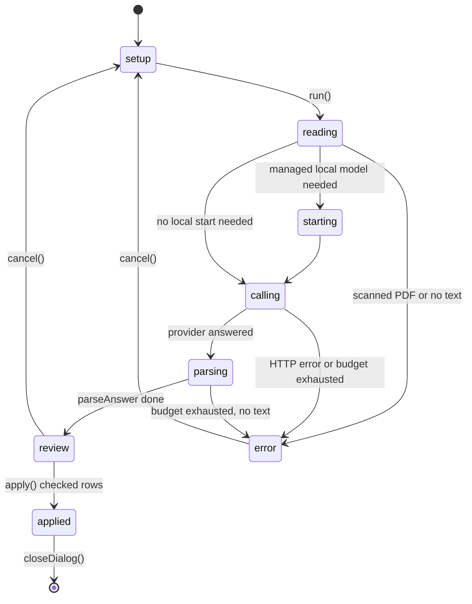
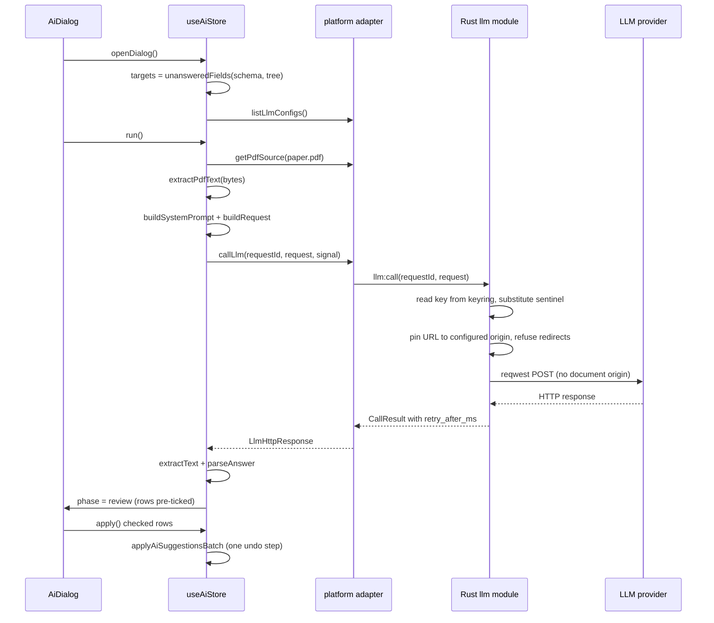

# AI-Assisted Annotation

The AI feature lets a reviewer point an LLM at one paper — or, with a consequences warning, at every candidate paper — and have it propose values for the paper's still-empty annotation fields. The reviewer then ticks the proposals they accept and applies them in a single undo step. Two invariants shape the whole subsystem and are worth holding in mind before the pieces:

- **An API key never lives in the renderer.** `LlmConfig` (`src/llm/types.ts`) has no `apiKey` field. The desktop app's Rust shell (`src-tauri/src/llm.rs`) stores each key in the OS keychain via the `keyring` crate — service `SaiLoR`, entry `llm:<id>` — and substitutes it into outgoing requests at the last moment; the renderer only ever learns *whether* a key exists (`hasKey`) and places the literal sentinel `{{apiKey}}` (`API_KEY_SENTINEL`) where the key goes.
- **Nothing the model returns reaches the project data unless it typechecks.** `parseAnswer` (`src/llm/parse.ts`) is the trust boundary: every proposed value is coerced against its `ResolvedDef`, and anything that does not fit (bad path, wrong type, value not in the enum, duplicate) is *rejected and shown*, never silently dropped and never guessed into shape. The same `coerce` backs the agent tools (`src/llm/tools.ts`) and the review table's Edit action.

The feature is per-project opt-in (`config.ai: true`); a project can forbid it outright. AI-assisted *screening* is a separate sibling flow — see [AI-Assisted Screening](ai-screening.md). Running models locally (Ollama, llama.cpp, managed System One) is covered in [Local Models](local-models.md); this page states the pieces it needs.

## End-to-end flow

`useAiStore` (`src/state/aiStore.ts`) owns the flow as a self-contained Zustand store, surfaced by `AiDialog` (`src/components/AiDialog.tsx`). The UI invariant is: **nothing is sent until Start, nothing is written until Apply.** The store meets the main store only at `apply()`, which hands reviewer-approved rows to `applyAiSuggestionsBatch` — a single undo step however many papers the run touched.



The phases (`AiPhase`) are `setup → reading → starting → calling → parsing → review → applied`, with `error` reachable from the network/extraction stages. `reading` extracts the PDF's text; `starting` starts an app-managed local System One model before the first call (`ensureLocalModel`); `calling` waits on the provider; `parsing` extracts the answer text and runs `parseAnswer`.



Because an `AbortSignal` cannot cross the platform boundary, each call carries a `requestId`; `cancel()` aborts the renderer-side controller and the adapter forwards an `llm:abort` command that the Rust `Flight` registry (`src-tauri/src/net.rs`) matches against the in-flight request. `cancel()` aborts only — it does not clear the controller slot (clearing it there made the run's own catch unable to tell an abort from a failure); the run clears the slot itself when it settles if it is still current.

## The provider abstraction

`src/llm/providers.ts` is where everything that differs between the eleven vendors lives: where to POST, how to authenticate, how to shape the body, and how to read the answer back out. `PROVIDERS` is the `Record<Provider, ProviderInfo>` keyed by the `Provider` union (`anthropic`, `openai`, `google`, `openrouter`, `groq`, `mistral`, `deepseek`, `xai`, `openai-compatible`, `systemone`, `ollama`).

Each provider carries:

- `defaultBaseUrl` — fixed per provider, except `openai-compatible`, `systemone` (the hosted Jev at `https://api.typesafe.ai`, or a self-run `laya-serve`), and `ollama` (`localhost:11434`), the three with `editableBaseUrl: true`.
- `supportsPdf` — whether a single inline-attachment request can carry a PDF. `groq`, `mistral`, `deepseek`, `xai`, `openai-compatible`, `systemone`, and `ollama` are `false`, so a target set to "send the PDF" against them silently falls back to extracted text at run time (`buildRequest` throws on a PDF for ollama and the store always sends text).
- `supportsModelListing` — `false` for `openai-compatible` and `systemone`: there is no single endpoint/auth/response shape safe to assume for an arbitrary self-hosted server, and a decision model has no chat model list.
- `supportsWebSearch` — true only for `anthropic` and `openrouter` (see below).
- `tokenParam` — `'max_tokens'` or `'max_completion_tokens'`. This exists to prevent the OpenAI-specific rename trap: OpenAI (and Groq, xAI) reject `max_tokens` on newer models and require `max_completion_tokens`, while OpenRouter, Mistral, DeepSeek, and self-hosted servers still document `max_tokens`. Sending the wrong one fails the whole call.

`buildRequest(cfg, system, user, opts?)` produces an `LlmHttpRequest` — built entirely in shared (renderer) code, with `API_KEY_SENTINEL` standing in for the key in the headers. There are four genuinely different request shapes:

- **Anthropic** — POST `/v1/messages`, `x-api-key` header, `anthropic-version`, body with `max_tokens`, `system`, `messages`. Reasoning effort maps to `thinking: { type: 'adaptive' }` + `output_config.effort`.
- **Google (Gemini)** — the model lives in the URL path (`/v1beta/models/{model}:generateContent`), not the body; auth is `x-goog-api-key` (so the key never sits in a URL). Reasoning effort switches between `thinkingLevel` (named, Gemini 3.x) and `thinkingBudget` (a token count derived from the chosen level via `GOOGLE_BUDGET_BY_LEVEL`: low 2000, medium 8000, high 24000, Gemini 2.5.x) — the two are mutually exclusive, and sending both is an error.
- **Ollama** — native POST `/api/chat`, never `/v1/chat/completions`, because the OpenAI-compatible route cannot set the context window. Every request carries `options.num_ctx`, `options.temperature: 0`, `options.num_predict`, `stream: false`, `keep_alive`, and `think` (false unless a reasoning level is configured); agent mode replays the assistant message verbatim and returns tool results as `{role:'tool', tool_name, content}`.
- **OpenAI-shaped** (everyone else) — POST `/v1/chat/completions`, `Authorization: Bearer` header, body with `model`, the provider's `tokenParam`, `messages`, and reasoning effort either as `reasoning_effort` (flat) or, for OpenRouter, `{ reasoning: { effort } }` (nested).

The `systemone` provider never goes through `buildRequest` at all: `src/llm/systemone.ts` builds and parses its one request shape (`/v1/systemone`, or Cloudflare Workers AI for `systemOneFlavor: 'cloudflare'`) itself.

`DEFAULT_MAX_TOKENS = 8192` is deliberately generous. On a reasoning-capable model the output budget is shared between hidden reasoning tokens and the visible answer; reasoning that runs long can exhaust the whole budget before a single visible token is written, surfacing as a "finish_reason: length" response with *no usable text* — not an error.

Reading a response back out is provider-specific and deliberately tolerant: `extractText` degrades to `''` and `extractError` always yields something a reviewer can read (including the Ollama 404 hint "pull the model first" and the Cloudflare `{success, errors[]}` envelope). `wasTruncated(provider, json)` distinguishes "a 2xx response was cut off by the token budget" from "the model had nothing to say" — both look like empty text, but the fix is different, and the store uses it to give a targeted message ("used its whole reply budget on internal reasoning") rather than "the provider answered, but the reply was empty."

Multi-turn agent conversations go through `src/llm/chat.ts`, a provider-neutral layer: `ChatMessage.raw` replays earlier turns verbatim (thinking blocks and `thoughtSignature` included), Anthropic gets `cache_control` on the system prompt and paper prefix, and an Anthropic `pause_turn` is replayed raw so server-side web-search state survives.

## Model discovery

`src/llm/models.ts` turns each provider's list-models endpoint into the flat `{ id, label, reasoning }` shape the model picker needs, and `fetchModels` in the store caches it per config id for `MODELS_TTL_MS` (1 hour) — a provider's catalog changes on the order of weeks, so the cache only makes reopening the settings dialog instant; an explicit refresh (`force: true`) always bypasses it. `fetchModels` never attempts `openai-compatible` (no safe shape to assume) and walks at most `MAX_MODEL_PAGES` (10) pages as a backstop against a provider that never clears its cursor.

The same-origin cursor check (`resolveSameOrigin`) is a security guard: a pagination cursor is whatever the provider said, and the follow-up request carries the API key. A cursor like `@evil.com/v1/models` read against an `openrouter.ai` base would parse as userinfo and hand the key to `evil.com`; the cursor is resolved as a URL against the base and rejected if it leaves the origin.

`ModelInfo` can also carry `pricing` (USD per 1M tokens) and `contextTokens` when the provider's listing states them. The pricing is used only to *prefill empty* price fields in `LlmSettingsDialog` (`openrouterPricing`) — pricing on a target is user-entered only, because provider prices go stale faster than this codebase gets updated; absent means "unknown" and cost estimates degrade to null rather than guessing. Ollama lists models via its own `GET /api/tags`.

## Prompt construction

`src/llm/prompt.ts` assembles the system and user prompts. The central idea is that the model is taught *how an annotation schema is written* before it is shown one, so it can read an unfamiliar schema rather than pattern-match a familiar one. `SCHEMA_FORMAT_DOC` mirrors `docs/annotation-schema.md` §3 — if the format changes, both must move. Every rule pushes the model toward saying nothing rather than something plausible: ground every value in the paper (no outside knowledge), omit a field the paper does not answer, quote a verbatim snippet of evidence (or omit it), respect field types, and match enum options verbatim.

`buildSystemPrompt(schema, targets, delivery)` is delivery-aware: when the paper arrives as extracted text, an extra rule warns that the extraction is lossy — tables, figures, and column layout may be garbled, and the model must not reconstruct or guess at illegible content. Field descriptions are flattened to one line (`oneLine`) so a reviewer-authored description containing a line break cannot forge prompt structure.

The model may also report up to five `schema_remarks` (`path`, `issue`, `suggestion`) where a field's name, description, or options were ambiguous, contradictory, or incomplete — parsed tolerantly (`parseSchemaRemarks`): only paths that resolve in the schema or are known field names survive, text flattened to one line and capped at 300 characters. The remarks travel with the run state per paper and reach the feedback file (see below).

Few-shot examples are an option (`slr.llm.fewshot`, count `slr.llm.fewshotCount`, default 2, 1–5): the reviewer picks a finished paper with (unticked-but-valid) values in the run's fields, and the prompt shows the mapping from paper text to the exact output object expected — the schema's `fewShot` fields narrowed to what this run asked.

`buildUserText` wraps the extracted text between `--- BEGIN PAPER TEXT ---` markers; a PDF delivery instead sends the bytes as a separate part with a short text caption.

### PDF text extraction

`src/model/pdfText.ts`'s `extractPdfText(bytes)` produces the plain text used on the text delivery path. `linesFromItems` reconstructs reading-order lines by bucketing pdf.js text items by baseline y (within `Y_TOLERANCE`) and sorting each bucket by x — a naive item-order join of a two-column paper is soup. It normalizes to NFC after the join and collapses whitespace. `empty` is true below `EMPTY_CHAR_THRESHOLD` (200 non-whitespace chars) — a scanned, image-only PDF yields nothing, and the run refuses to send it (it would invite the model to invent a paper from its title) and points the reviewer at the PDF path instead. Extraction is capped at `DEFAULT_MAX_PAGES` (2000); `countPdfPages` counts pages cheaply from the page tree alone for the trim estimates.

## Response parsing

`src/llm/parse.ts` is the trust boundary. `parseAnswer(schema, raw)` never throws — it sits on a network response, and unparseable garbage is a normal outcome, not an exceptional one. It returns an `LlmAnswer` of `fields` (accepted `Suggestion[]`), `skipped` (fields the model left empty, with reasons), and `rejected` (suggestions refused with a reason — kept and shown, because a silently dropped answer looks like the model said nothing).

`extractObject` tries a direct JSON parse, then a ```json fence (with the tag often missing or misspelled), then `scanForObject` — a balanced-brace scanner that knows about string literals and escapes (a regex cannot do this: a non-greedy match stops at the first `}`, which usually sits inside a quoted evidence string).

Each field entry is resolved against the schema with `resolvePath`, deduped by canonical path (two answers for one field = contradiction; keep the first, reject the rest), and coerced to its type. Coercion bends only where models reliably misbehave with exactly one honest reading:

- `"2021"` → number `2021`; `"true"`/`"True"` → boolean.
- A case- or whitespace-off enum answer is snapped to its canonical option; a value matching no option is *rejected*, never fuzzily matched to the nearest one.
- Confidence outside 0..1 is dropped to `null` (not clamped) — `95` may mean percent; folding it to `1` invents a near-certainty. An empty string is *not* confidence 0.
- Evidence and skip-reason strings are capped (`MAX_EVIDENCE_CHARS`/`MAX_REASON_CHARS`).

## Paths and field selection

`src/llm/paths.ts` is the path format used in the LLM contract: node names joined with `/`, each optionally followed by `[i]` to pick one entry of a repeated node (`[0]` when omitted). The model may name an index that does not exist yet — that is how it records a further entry of a repeatable node — so `resolvePath` checks against the *schema*, not the current data; missing instances are created at apply time. The `maxUnboundedIndex` option (only the LLM entry points opt in, via `MAX_UNBOUNDED_INDEX = 10_000`) rejects an absurd index on a `max: null` node, because those callers *materialize* every instance up to the index. Names containing `/`, `[`, `]`, or `\` are escaped with a backslash, and the escaping is load-bearing: canonical path strings are persisted (they key equality marks and AI-mark keys), so a name with none of these characters must escape to itself.

`src/llm/fields.ts` decides what to ask about. `isUnanswered` matches `validate.ts`'s notion of empty for strings/numbers, but booleans have their own rule: the data model cannot represent an *unanswered* boolean, so a boolean is offered unless already `true` — the AI can propose flipping it to true, never to false. `unansweredFields` walks existing instances only; the model records further entries by naming the next free index.

## The four run modes

- **Prompt** — a single pass: build the delivery-aware system prompt, send the whole (fitted) paper, parse the JSON object. The workhorse.
- **Agent** (`src/llm/agent.ts`) — a bounded tool loop. The model gets the schema and paper text plus tools: `search_paper` (search the extracted text), `read_pages` (re-read specific PDF pages), `scholarly_search` (OpenAlex), `lookup_doi` (Crossref), `fetch_url` (explicitly untrusted external content), and `submit_annotations` (the terminal tool, carrying up to 5 `schema_remarks`). Defaults: `DEFAULT_MAX_ROUNDS = 3` rounds, `DEFAULT_MAX_TOOL_CALLS_PER_ROUND = 12`. Tool executors self-validate their arguments; fetched/read text is capped (`MAX_READ_CHARS`/`MAX_FETCH_CHARS` 12k) and search snippets are cut around a 150-char radius.
- **Judge** — a separate model scores each *new or changed* proposal (signature-deduped across rounds) as `accept` / `revise` (with what to fix) / `reject`; round 1 proposals are always judged. The loop exits on all-accept, the round budget, or an identical resubmission; proposals still unaccepted at the end are *rejected* (kept and shown, never silently applied). A judge can be a different provider/model from the annotator; its window is budgeted separately.
- **Classify** (`src/llm/systemone.ts`) — System One closed-answer models instead of a chat model: booleans become `noul` questions, string enums with 2–255 options become `choice` questions; ineligible fields (free text, numbers, out-of-range option counts) are reported "not handled by \<model\>" rather than silently dropped, and the state mode (`full` / `abstract+body` / `abstract-only`, below `MIN_BODY_STATE_TOKENS` 2000) is surfaced in the review. Per-family profiles (`src/llm/modelProfiles.ts`) bound the state size and questions/options per request: Jev 32k state / 16 questions, hosted Clef 65,536 / 64, local Clef 16,384 / 64, Laya English 512 / 192, Laya multilingual 1024 / 256. Questions are greedily packed (repeating the state in each request, `mergeSystemOneResults` combines replies); a Cloudflare flavor validates the 32-hex account id and `clef`|`clef-flash` model. Confidence recorded is System One's own (`noul` or `probs[choice]`).
- **Re-check** (`src/llm/recheck.ts`) — a Prompt-mode-only, opt-in, never-persisted extra call that double-checks *already-answered* fields of the target seat's tree. The model returns one verdict per field: `agree`, `disagree` (requires a valid coerced `proposed` value differing from the current one *plus* a verbatim supporting quote, else downgraded to `unsure`), or `unsure` (the safe default). A disagreement is only a proposal: it is applied only with the reviewer's approval, in the same single undo step as the fills, and only when the field still equals the value the AI checked (`expectedCurrent`), else it is counted as skipped and reported as "N replaced".

A Classify target can also serve as the **cross-check** model for a Prompt or Agent run: System One answers the same eligible fields, and a suggestion whose cross-check disagrees (with confidence ≥ `slr.llm.threshold`, default 0.8) starts unticked. A cross-check disagreement never fails the paper — it is a note, not an error.

## The batch loop

`executeBatch` (shared by `run()` and `resumeBatch()`) runs one paper at a time with a small pool (`slr.llm.concurrency`, 1–4, default 2 — clamped to 1 unless the all-papers scope). Each in-flight paper has its own `AbortController` (`paperControllers`), so `skipPaper` aborts one paper — recorded in `skippedPapers`, not `errors`, and it stays a resume candidate — without touching the rest. The all-papers mode stops *starting* new papers once spend exceeds the cap while the in-flight paper finishes.

An unfinished all-papers batch persists across restarts (`slr.llm.batch.<identity>.<seat>`), so the dialog can resume it or the reviewer can discard it; above `PERSIST_SIZE_CAP` (2 MB serialized) the record drops its rows/notes/errors and resume re-runs the scope instead of replaying stale review rows.

At review, every suggestion row is pre-ticked *unless* a rule flags it — the reviewer's job is to remove what is wrong (the direction that makes a careless click safe-ish):

- agent mode: judge `accept` and not `webUnverified`;
- classify mode: System One confidence ≥ threshold;
- cross-check disagreement (Prompt/Agent): unticked, `flagged` mirrors the initial tick so the "needs attention" filter survives re-ticking.

`apply()` builds one entry per (paper, reviewer) pair; verdict counts come only from the rows actually applied, edits are counted, and only ticked re-check disagreements become replacements. The batch key and roles key (`slr.llm.roles.<projectIdentity>`) remember the target and mode/threshold/few-shot choices across sessions.

## Input-window fitting, retry, and cost

- **Fitting** (`src/llm/budget.ts`, `fitForChat` in the store): when a target's `contextTokens` is known, the paper is cut to what is left of the window after the system prompt (schema, rules, few-shot block), the user-message wrapper, a reply reserve, and `THINK_RESERVE` (4096, only with a reasoning effort). `fitPaperText` drops the reference list first, then trailing pages, then cuts inside page 1, keeping the `[page N]` markers and noting the omitted pages; below `MIN_PAPER_TOKENS` (256) the paper fails instead of being sent. The fit is recorded per paper and the review notes it ("Paper trimmed to fit \<model\>'s input window…"). An unknown window means "send everything".
- **Guards**: agent mode requires at least `AGENT_MIN_CONTEXT` (32,000 tokens) on annotator *and* judge; an Ollama target with unset "Context to use" blocks the run (its default window would silently cut the paper); and a reply whose `prompt_eval_count` lands within 64 tokens of `num_ctx` sets `inputTruncated` and fails the paper, so nothing from a truncated prompt reaches the review.
- **Retry** (`src/llm/retry.ts`): statuses 408/429/500/502/503/504/529 are retried at most 4 times with jittered backoff capped at 60 s, honoring the server's `Retry-After` (delta-seconds or an HTTP-date — the Rust shell parses both and returns `retry_after_ms`).
- **Cost** (`src/llm/cost.ts`): `estimateRun` gives a low/high range per mode (agent 5–15 requests per paper, the judge 2–4 requests with 200/400 output, classify overhead 100–300 tokens per request) before Start, using the user-entered prices; the estimate line and trim hint are shown on the setup screen. Absent prices degrade to null, never a guess.

## Provider-native web search

Agent mode can enable the annotator provider's own server-side web search (`slr.llm.websearch`) — but only for `anthropic` (`web_search_20250305`, `max_uses` 5) and `openrouter` (plugin `{id:'web'}`, citations as `url_citation` annotations). Google and OpenAI are known ceilings, the rest have no equivalent; `src/llm/websearch.test.ts` is the specification (there is no `src/llm/websearch.ts` — the behavior lives in `chat.ts`). Searches are billed by the provider on top of tokens; the per-paper count is shown in the usage line and recorded as `webSearches` in the usage record. Because a search-result URL was never *fetched*, its quote cannot be checked: a suggestion whose source is only a search result carries `webUnverified` ("web · quote unchecked"), starts unticked, and the judge is told to treat it conservatively.

## The Rust shell: key storage and the wire

`src-tauri/src/llm.rs` is where the key invariant is physically enforced.

- **Storage.** Keys live in the OS keychain via the `keyring` crate — service `SaiLoR`, entry `llm:<id>` — never in the renderer. The target list stays in `config_dir/SaiLoR/llm-config.json` in the Electron-era format (entries kept as raw JSON so unknown fields survive), mode `0o600`, read-modify-write serialized by a `FILE: Mutex`. A key saved here sets a `"keyring": true` marker on the entry; a legacy Electron `safeStorage` `key` blob is left in place but cannot be decrypted, so such a key must be entered once more. `public_configs` strips the key and marker and adds `hasKey` — the renderer's view. Saving with a blank key field keeps the stored key (the user cannot read it back to retype it); `save_config` validates the numeric/flavor/account-id fields and refuses rather than write nonsense.
- **The `llm:call` path.** The renderer names the URL, so the shell pins it: the request URL's scheme must be `http`/`https` and match the configured base's scheme, and the origin must match *exactly* — a compromised renderer cannot post the substituted key to a host of its choosing, and a `file:` base cannot authorize any `file:` target. Redirects are refused both by the client policy (`net.rs` `NO_REDIRECT`) and by treating any 3xx status as an error: following one would carry the key — including provider-specific headers like `x-api-key` that the fetch stack does not strip — past the origin check. `LLM_TIMEOUT` is 10 minutes, enforced by the `Flight` abort/timeout registry in `src-tauri/src/net.rs`, which also matches `llm:abort` to the in-flight request.
- **Sentinel substitution.** `build_call_headers` replaces `{{apiKey}}` across every header value with the key read from the keyring. A keyless (`noKey`) target — a local Ollama/LM Studio/vLLM server — instead *drops* every sentinel-bearing header and sends the rest, so no empty `Authorization` confuses a server.
- **Managed local models.** A target with `managed.catalogId` names an entry of the local-model catalog; the stored base URL is only a placeholder the origin checks pinned the request to, and the call is re-pinned to the running llama-server's origin (paths restricted to `/v1/*` and `/health`) over a loopback client with that server's per-session `--api-key`, which only the shell knows.

Outbound tool `fetch_url` requests go through `src-tauri/src/webfetch.rs`, whose SSRF guard blocks private/loopback/link-local IP ranges at the resolver level and caps bodies at 2 MB with a 20-second timeout.

## The apply step, marks, and disclosure

`apply()` passes the checked rows to `useStore.getState().applyAiSuggestionsBatch(items)`, one item per (paper, reviewer). `applyAiSuggestionsBatch` (`src/state/store.ts`) is the *only* place model output reaches the project data, and it guarantees:

1. It never overwrites the reviewer — a suggestion whose field has since been answered (or whose path no longer resolves) is skipped and counted, never written; a replacement needs `expectedCurrent` to equal the field's current value.
2. The whole batch is one undo step, and a batch that writes nothing leaves no trace (no undo entry, no dirty flag).
3. It refuses at apply time if the project is multi-reviewer with no seat, the seat is Consolidation, or it is a screening project (screening applies via its own `applyAiScreeningBatch`); a batch applied from the AI's own seat bypasses the no-seat/Consolidation refusals because it writes into the AI seat.

Three artifacts come out of a fill:

- **`aiMarks`** — a session-only record (`src/state/store.ts`) keyed by `aiMarkKey(paperId, canonical, reviewerScope)`, marking fields *the app* filled that the reviewer has not yet looked at. It lives beside the project, never inside it, so it can never reach the disk. `useAiMark` exposes the (is it marked? / confirm it) pair; `confirmAiMark` drops the mark.
- **`AiUsageRecord`** (`src/model/project.ts`) — a *disclosure* record appended to `paper.aiUsage` only when a fill actually changes something: `{ provider, model, appliedAt }` plus the mode (`prompt`/`agent`/`classify`/`screening`), judge model and per-verdict counts, rounds, few-shot, edited count, `rechecked`/replaced count, `webSearches`, and the reviewer. Unlike the mark it is persisted — it is the paper's record of how it was annotated, and a wrong value there is a research-integrity problem. `AiUsageDisclosure.tsx` shows them, seat-filtered: a reviewer sees their own plus unattributed records, Consolidation sees all.
- **The feedback file** — the optional schema-feedback option (`slr.llm.feedback`, default on) writes, once per review (on Apply, and on Discard/close of an unapplied review — unapplied proposals are feedback too), a `buildRunFeedback` aggregate via `project:writeFeedback` (Rust `feedback.rs`) to `annotations/feedback/run-<timestamp>-<id>.json`: per-field outcomes (applied, unticked, edited with AI/final value, left empty, rejected, judge verdicts, cross-check disagreements, up to 10 truncated edits) plus the deduped schema remarks, sorted most troublesome first. Field paths, truncated values, counts and remarks only — **no paper text, no evidence quotes**. A write failure never blocks Apply or Discard and is shown on the applied screen.

## The UI

**`AiDialog`** (`src/components/AiDialog.tsx`) is a pure view over `useAiStore`, rendering by phase: the setup screen (target picker, mode radios with per-mode explanations, judge/cross-check pickers, options — few-shot, re-check, web search, concurrency, feedback — the consent line stating what leaves the machine, the cost estimate, and the all-papers consequences warning before it lets a run touch every paper), the running screen (spinner, elapsed seconds, per-paper agent events, cancel, skip-paper), the review table (one row per suggestion with field, proposed value, evidence quote, confidence, judge verdict, cross-check, `webUnverified` badge, and an Edit that re-validates through the same `coerce`), the re-check section (only ticked disagreements actionable; agree/unsure collapsed), the applied screen (filled/replaced/skipped counts, feedback path or its failure), and the error screen with retry (and the scanned-PDF hint when that was the cause). A resume banner offers to continue a saved unfinished batch; a "needs attention" filter isolates flagged rows. A preview notice marks the whole feature as a preview whose proposals must be checked.

**`LlmSettingsDialog`** (`src/components/LlmSettingsDialog.tsx`) manages the targets. It enforces the key invariant in the UI: an existing key is only ever `hasKey` — never shown, never pre-filled; a blank key box on an edit keeps the stored key. It shows the OS-keychain notice (in the browser build, which is discontinued for AI use, it warns that storage is not encrypted). Provider switching resets the base URL, model, reasoning effort and fetched list; the reasoning-effort selector appears only for a model with a `ReasoningProfile`; price fields are prefilled (only when empty) from an OpenRouter listing's own pricing. The local-model panels (Ollama chat, guided local System One with download consent) are covered in [Local Models](local-models.md).

**`ModelPicker`** (`src/components/ModelPicker.tsx`) is deliberately *not* `ComboBox`: the model field stays a free-text input the reviewer can always type into (a catalog can be incomplete or unfetched), with a searchable dropdown and a red "not a model {provider} listed" flag judged only against a list actually fetched — an empty list means "unknown", never "invalid".

## Extension points

- **Adding a provider**: add it to the `Provider` union, `PROVIDERS`, and `PROVIDER_LIST`; give it a `buildRequest` branch (or let it fall through the OpenAI-shaped path); add a `parseModelsResponse` branch and a reasoning detector in `models.ts`. The per-provider `tokenParam`, `supportsPdf`, and `supportsWebSearch` flags are the easy-to-get-wrong parts.
- **A new field type**: add it to `coerce` in `parse.ts` (and the prompt's type rules in `prompt.ts`) *and* to `validateAnswerObject` in `verify.ts` if agent mode must accept it. The rule stays: nothing enters `fields` unless it typechecks; bending only where there is exactly one honest reading.
- **Schema format changes**: `SCHEMA_FORMAT_DOC` in `prompt.ts` is hand-kept in sync with `docs/annotation-schema.md` §3 — both must move together.
- **A new System One family**: add a profile in `modelProfiles.ts` (state size, questions, options budget) and the request/parsing glue in `systemone.ts`; the packing and confidence recording are family-agnostic.
