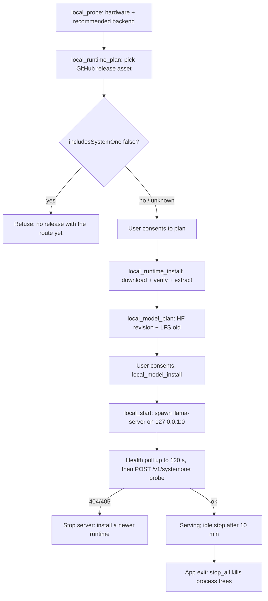

# Local Models and Ollama

SaiLoR can run every AI step — decision-model annotation, recheck, and screening — without a single packet leaving the machine, in two ways:

- **App-managed local models** (provider `systemone` with `managed: { catalogId }`): the app downloads a llama.cpp `llama-server` runtime plus a cataloged decision-model GGUF file, hash-verifies both, starts one server per model on `127.0.0.1`, and calls its `POST /v1/systemone` route. Implemented in `src-tauri/src/localruntime.rs`, surfaced to the renderer through `src/platform/localRuntime.ts`.
- **User-run local servers** (provider `ollama`, or any loopback `systemone` base URL): the app connects to a server the user runs — Ollama's native API, LM Studio, llama.cpp, or vLLM — discovered by the `localserver:discover` probe. Implemented in `src-tauri/src/ollama.rs` with pure parsers in `src/llm/ollama.ts`.

The AI settings dialog (`src/components/LlmSettingsDialog.tsx`) offers both as *guided* entries in the Provider select: `local-chat` (→ `LocalChatPanel`), `local-s1` (→ `LocalSystemOnePanel`), and `hosted-s1` (→ `HostedSystemOnePanel`). Both local panels render `<Unavailable />` outside the desktop app.

Related: [Architecture](../architecture.md), [Tauri Shell](../operations/tauri-shell.md), [AI Screening](ai-screening.md), [LLM Annotation](llm-annotation.md), [Screening](screening.md), [Testing](../testing.md).

## Trust model

The managed runtime records its trust model in the source of `localruntime.rs`:

- **The renderer only names a catalog id.** URLs, file paths, and the executable are decided in Rust (`id_of` rejects anything not in the `CATALOG`; a user-set binary path comes only from the `SAILOR_LLAMA_SERVER` env var, never from the renderer).
- **Every download is hash-verified** against a digest the *host itself* publishes: the GitHub release asset's `digest` field (`sha256:<hex>`) for the runtime, the Hugging Face tree entry's LFS `oid` for model files. A file whose size or SHA-256 does not match is discarded, never installed.
- **A download only starts after a matching plan was produced (and shown for consent) in this session**: `local_model_install` / `local_runtime_install` error with "Review the … download plan first" if `local_model_plan` / `local_runtime_plan` has not stored one in the session's `Shared` state. The panels implement this as a two-step `ConsentBox`.
- **Every hop of every download is host-checked.** `get()` follows redirects manually and re-applies the allow-list per hop (`allowed_download_url`): GitHub downloads may only come from `github.com`, `api.github.com`, or `*.githubusercontent.com` on port 443 https with no credentials; Hugging Face downloads from `*.huggingface.co` / `*.hf.co`. A redirect to any other host is refused.

## Hardware probing and backend choice

`src-tauri/src/hardware.rs` (the `local:probe` command) builds a best-effort `HardwareInfo` — every probe may fail, which means "unknown", never an error:

- **GPU discovery**: `nvidia-smi --query-gpu=name,memory.total --format=csv,noheader,nounits` on Windows/Linux (VRAM in MiB → bytes), `system_profiler SPDisplaysDataType -json` on macOS (Apple GPUs share system RAM, so no VRAM), `Get-CimInstance Win32_VideoController` via PowerShell on Windows, `lspci` elsewhere. Vendor is classified from the adapter name (`vendor_of`): nvidia/amd/intel/apple/other, with word-boundary matching to avoid e.g. "Search Architect" reading as intel ("arc").
- **RAM and disk**: via `sysinfo` (`System::refresh_memory`) and `sysinfo::Disks` — free space on the longest matching mount point of the data dir, `-1` when unknown.
- **Recommended backend** (`recommend_backend`): `metal` on darwin/arm64 (else `cpu`); `vulkan` when an NVIDIA/AMD/Intel GPU is present; `cpu` otherwise. Note the backend is *advisory*: the real backend is re-read from the server's startup log at launch.

The probe drives the release-asset choice in `select_asset`: macOS → `macos-<arch>.tar.gz` (Metal); Windows → Vulkan build if a GPU was detected, else CPU (Vulkan is preferred over CUDA because CUDA builds need a separate cudart bundle); Linux → `ubuntu-vulkan-<arch>.tar.gz` or `ubuntu-<arch>.tar.gz`.

## The managed model catalog

`src/llm/localCatalog.ts` and the Rust `CATALOG` are deliberate mirrors — a Rust unit test (`catalog_matches_the_renderer`) fails if an id, repo, file, license, context window, or status string drifts out of sync. Five entries:

| id | HF repo / file | status |
| --- | --- | --- |
| `laya-en-q8` | `ggml-org/Laya-GGUF` / `Laya-Q8_0.gguf` | available |
| `laya-multilingual-q8` | `mys/laya-multilingual-GGUF` | planned — community GGUF uses the `ggmlc` architecture, which llama.cpp cannot load |
| `laya-typed-decisions-q8` | `mys/laya-typed-decisions-GGUF` | planned — same reason |
| `clef-flash` | `bartowski/Cloudflare_clef-flash-GGUF` | planned — needs a llama.cpp build with Clef support |
| `clef` | `bartowski/Cloudflare_clef-GGUF` | planned — same reason |

Only `laya-en-q8` is downloadable today. `require_available` returns the planned-reason as the error for the other four, so the renderer can show *why*. The available entry runs with `contextTokens: 2048` (batch sizes equal the context, one slot: `-c = -b = -ub = 2048`, `-np 1`) and `optionsBudgetTokens: 192`.

## The managed runtime lifecycle



A managed model's path from probe to a stopped server. Each download needs a consented plan from the same session.

### Runtime discovery (`local_runtime`)

`runtime()` resolves the usable `llama-server` in order:

1. `SAILOR_LLAMA_SERVER` env var, if it points at a file — `source: "system"`, version parsed from `llama-server --version`, `supportsSystemOne: "unknown"`.
2. The newest managed install under `<dataDir>/local-runtime/llama.cpp/<bN>/` (release tags are strictly `b<1-7 digits>`; anything else never reaches a path). The binary is found by a bounded recursive scan; a `manifest.json` written at install time records `includesSystemOne`.
3. A system `llama-server` found on `PATH` plus `/opt/homebrew/bin`, `/usr/local/bin`, `/usr/bin`, `~/.local/bin` — `source: "system"`.
4. Otherwise `found: false, source: "none"`.

`data_dir` is the platform config dir joined with `SaiLoR` — deliberately the same location the earlier Electron build used, so existing installs are reused.

### Runtime plan and install

`local_runtime_plan` lists the llama.cpp pre-releases (`b<N>` tags, drafts skipped), picks the machine's asset, skips assets whose digest is missing or still uploading ("never guess"), and records `includesSystemOne` by asking the GitHub compare API whether the release contains commit `a4cb4c61…` (the commit that added `POST /v1/systemone`, PR #29818) — `ahead`/`identical` → true, anything else → `"unknown"`. The install **refuses** when that flag is `false`: no llama.cpp release with the route means no managed System One.

`local_runtime_install` then downloads the archive (resumable `.partial`, see below), extracts it with bsdtar (`tar.exe` from System32 on Windows, `tar` elsewhere — a PATH `tar` may be GNU tar, which cannot read zip), sets mode 0755, smoke-tests `llama-server --version`, writes the manifest, swaps the directory into place, and deletes every *other* managed release. Progress is emitted on the `local:progress` event with phases `download → verify → extract → done`.

### Model plan and install

`local_model_plan` resolves the repo revision (40-hex `sha`) from the HF API, then the tree entry for the GGUF file — its `lfs.oid` is the SHA-256 and `lfs.size` the size — and produces a `ModelPlan` with `resumeFrom` (bytes of the existing `.partial`). `local_model_install` refuses when free disk cannot cover `sizeBytes - resumeFrom`, downloads, verifies, and renames the `.partial` to the final file. `local_installed` lists only files whose directory name is a catalog id, and `local_remove` stops the model's server before deleting it.

### Downloads: resume, cancel, stall

`download_verified` is shared by runtime and model installs:

- A previous `.partial` is resumed with a `Range` request **only if** the server answers 206 with a `Content-Range` that starts exactly at the offset; a plain 200 (server ignoring Range) restarts the file from scratch. A `.partial` already at full size skips straight to verification.
- `local_cancel(id)` (or 60 s with no data, `STALL`) aborts the flight and *keeps* the partial for a later resume — the error reads "Download cancelled or stalled; the partial file is kept for resuming."
- After streaming, size and SHA-256 (`ring`, 1 MiB chunks) must both match the published digest or the file is deleted and the install fails.
- Progress events throttle to ~4/s.

### Server manager

`local_start` (also reached lazily via `localruntime::endpoint` from `llm.rs` for `llm_call`) runs one `llama-server` per model:

- **Bind**: an OS-chosen free port on `127.0.0.1` (`TcpListener` bind to `:0`), plus a per-session random API key (`ring` SystemRandom, 24 bytes hex) passed as `--api-key`; `--no-webui` and `-lv 4` are always set. GPU starts add `-ngl 99`; CPU starts `-dev none -ngl 0`.
- **Refuses to run as root** (unix) and refuses models not yet downloaded.
- **Startup**: health-polls `GET /health` with a 120 s deadline (`HEALTH_TIMEOUT`); a GPU launch failure (driver/VRAM) is retried once on CPU with a note — except build/model incompatibility, which fails the same way on CPU and is not retried.
- **The real backend is read from the startup log**, never from what was asked: `parse_server_log` scans a 2000-line ring buffer for `using device …` and the `offloaded N/M layers to GPU` summary; zero offloaded layers means `cpu`. Failure messages are translated by `explain_start_failure` (incompatible build/model vs. out-of-memory).
- **Feature probe (commit gate)**: after start, `probe_route` posts a minimal decision request to `POST /v1/systemone`. 404/405 → "This llama.cpp build has no System One route (/v1/systemone). Install a newer runtime."; 501 → the model is not a decision model for this build. Any failure *stops the server* and fails the start — a managed model is never served without the route.
- **Lifecycle**: concurrent starts are deduplicated by a global `START` mutex plus a `starting` set (`local_status` reports `starting`/`running` states). A 30 s loop kills servers idle for 10 minutes (`IDLE_STOP`); every `endpoint`/`running()` access resets the idle clock and prunes dead servers. `stop`/`kill` signal the whole process group (SIGTERM, then SIGKILL after 3 s, on unix; `taskkill /T /F` on Windows), and `stop_all` — wired to `tauri::RunEvent::Exit` in `main.rs` — kills every server's tree synchronously on app exit. `local_logs` returns the last ~200 lines per model.

## Local targets in LlmConfig

A managed model appears in the store as:

```ts
{ provider: 'systemone', managed: { catalogId: 'laya-en-q8' },
  baseUrl: 'http://127.0.0.1', noKey: true, model: 'laya-en-q8',
  contextTokens: 2048, optionsBudgetTokens: 192 }
```

`LocalSystemOnePanel.use()` patches exactly these; `selfRun` clears `managed` and the catalog-derived numbers when the user switches to a self-run server. Per-run behavior in `src/state/aiStore.ts`:

- `isLocalModel` is true for any `managed` config or a loopback base URL; the consent line then reads "This model runs on your machine; nothing leaves it."
- `ensureLocalModel` starts the managed server *before* a batch so the run can show a `starting` phase and surface the real startup error.
- `systemOneProfileFor` (`src/llm/modelProfiles.ts`) resolves the catalog entry for a `managed` id and uses its `contextTokens`/`optionsBudgetTokens` unless the user set their own numbers; the family profile (laya-English/multilingual, clef, jev) fills the rest, and the context feeds paper-fit trimming and the token budgeting described in [LLM Annotation](llm-annotation.md) and [AI Screening](ai-screening.md).

## User-run local servers (Ollama and friends)

`src-tauri/src/ollama.rs` exposes the `ollama:*` commands and the `localserver:discover` probe; `src/llm/ollama.ts` holds the pure parsers the renderer reuses. **The renderer names the server URL, so it is checked in Rust**: `check_base_url` allows only `http`/`https`, no embedded credentials, and reduces the URL to its origin (the path is dropped — a path-prefixed reverse proxy is unreachable). Blocked-IP/hostname tests from `webfetch` decide `isLocal`, which the UI uses for the "papers would leave the local network" warning.

### Base-URL and tag validation

Every call passes `server()` first: base URL validated as above, and any model tag through `is_valid_model_tag` (lowercase/digit/`. _ / -`, optional `:version`, ≤ 200 chars, no `..`/`//`, no leading `/`) — a tag from model output is never trusted into a request body or registry URL.

### Ollama operations

| Command | Route | Notes |
| --- | --- | --- |
| `ollama_version` | `GET /api/version` | "Not an Ollama server" if the version field is absent |
| `ollama_list` | `GET /api/tags` | name/size/digest/parameter size/quantization/family |
| `ollama_show` | `POST /api/show` | capabilities, `contextTokens` from `<arch>.context_length`, `thinking` values, and `kvBytes` — the KV-cache estimate `estimate_kv_bytes` (f16 K+V: `2 * layers * kv_heads * head_dim * 2 * ctx`, per-layer arrays read as their max, i.e. over-estimates) at the requested `numCtx` |
| `ollama_ps` | `GET /api/ps` | loaded models with `sizeVram` → the GPU/split/CPU status in `LocalChatPanel` |
| `ollama_pull` | `POST /api/pull` (NDJSON) | progress events on `ollama:pullProgress` tagged with the request id; a pull idle for 120 s (`PULL_IDLE`) is dead; the pull only succeeds when a `{"status":"success"}` line arrived |
| `ollama_delete` | `DELETE /api/delete` | |
| `ollama_manifest_size` | `https://registry.ollama.ai/v2/<repo>/manifests/<ver>` | the *unofficial* registry endpoint `ollama pull` uses; download size = sum of manifest layer sizes, `null` on 404, treated as an estimate. This is the one client that follows redirects (CDN) |
| `ollama_cancel_pull` | — | aborts the flight; the server may keep downloading, and pulling the same tag again resumes |

Requests time out at 15 s (`REQUEST_TIMEOUT`), 3 s for discover probes.

### `localserver:discover`

One probe classifies a server and lists its models: `/api/version` answering → `ollama` (models from `/api/tags` with loaded/context info from `/api/ps`); else LM Studio's `GET /api/v1/models` (embedding models dropped) → `lmstudio`; else llama.cpp's `/props` (`n_ctx`) → `llamacpp`; else `/v1/models` with `max_model_len` → `vllm`; a bare OpenAI `/v1/models` list → `unknown`; nothing answering → failure. `LocalChatPanel` uses this to let the user pick a chat model from any of these.

### Context-window budgeting

Ollama's OpenAI-compatible route cannot set the context window and silently drops the *front* of an over-long prompt, so the app uses the native `POST /api/chat` (`ollamaChatBody` in `src/llm/ollama.ts`) with `options.num_ctx` always set explicitly: the target's configured `contextTokens` if present, else prompt + output reserve rounded up to a multiple of 1024 (never below 8192, capped at the model's own maximum from `/api/show`). `keep_alive: '10m'` keeps the model warm between calls; `inputWasTruncated` checks `prompt_eval_count` against `num_ctx` afterwards and surfaces "The local model cut off the start of the prompt…". An Ollama target without a configured context window blocks any run start (`startBlocker`).

## Guided setup panels

- **`LocalSystemOnePanel`** — hardware sentence, runtime status/plan/install with the `ConsentBox`, the catalog list (planned entries show their reason), model download/remove with progress bars, start/stop test buttons, and per-model server logs. Renders `NO_RELEASE_YET` when the newest llama.cpp release lacks the System One route.
- **`LocalChatPanel`** — server type presets (Ollama `http://localhost:11434`, LM Studio `:1234`, llama.cpp `:8080`, vLLM `:8000`, other), a discover check, model pick with memory/KV-cache warnings, Ollama pull (with manifest-size consent and streamed progress), delete, and GPU-placement text per loaded model.
- **`HostedSystemOnePanel`** — the non-local System One flavor (Clef/Clef-flash on Cloudflare Workers AI, or Jev at `https://api.typesafe.ai`); selecting it clears `managed` and `noKey` so the hosted profile (`systemOneProfileFor`) supplies the context window.
- **`LlmSettingsDialog`** maps drafts back to these kinds (`kindOf`): `managed` or a non-Cloudflare loopback `systemone` URL → `local-s1`, provider `ollama` → `local-chat`, else plain providers or `hosted-s1`.

## Tests

- `localruntime.rs` tests cover asset selection per platform/backend, digest and release-tag parsing, resume/`Content-Range` math, the download host allow-list (including credential, port, and redirect-to-evil cases), resume/cancel/restart against a mock HTTP server, SHA-256 failure discarding, the Rust↔renderer catalog mirror, managed-vs-system runtime lookup on disk, and that `terminate` kills a spawned grandchild.
- `ollama.rs` tests cover base-URL and model-tag validation, every parser, handler failures, NDJSON pull (success, truncated, error, missing request id), and `discover` against mock Ollama/LM Studio/llama.cpp/vLLM/unknown servers.
- `hardware.rs` tests cover each tool-output parser, vendor classification edge cases, backend recommendation, and a live self-probe.
- Renderer budgeting of managed models is tested in `src/state/aiStore.budget.test.ts` and `src/llm/modelProfiles.test.ts` (catalog window vs. user-set numbers).