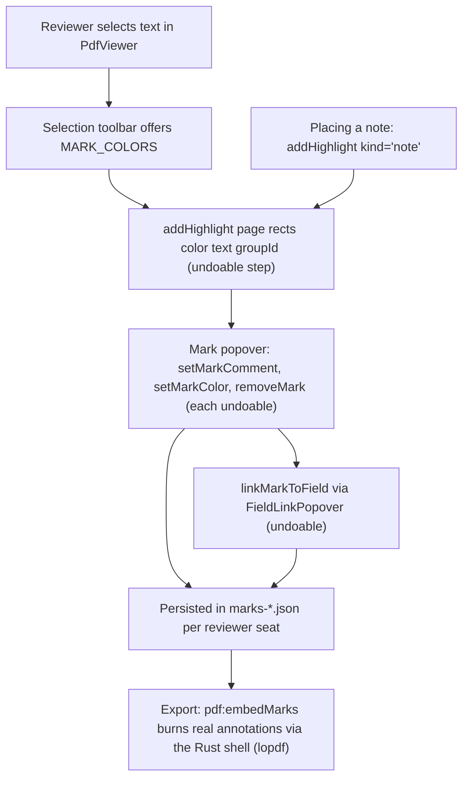

# PDF Viewer and Marks

The middle pane of SaiLoR is a PDF reader built on [react-pdf](https://github.com/wojtekmaj/react-pdf) (pdf.js underneath). It does three jobs at once: render and navigate the paper, let the reviewer highlight and annotate it, and feed the annotation panel — text the reviewer selects can be "grabbed" straight into a field, and highlights can be linked to fields as evidence. Crucially, the marks a reviewer makes are **SaiLoR's own overlay data, never written into the PDF binary**; they live in the project's per-seat `marks-*.json` files alongside the annotations and are burned into real PDF annotations only on explicit export. Keeping the PDF untouched is what lets it stay a plain relative-path reference, shared and diffed by git like everything else in a project — writing real PDF annotation objects into the file would make every reviewer's mark a binary edit to a file every reviewer references, with no way to tell whose is whose.

In the desktop app (SaiLoR's only shipping runtime), the PDF bytes the viewer renders are served by the Rust shell over the custom `slr-file://` scheme, under the same project-directory authorization as everything else (see [Tauri shell](../operations/tauri-shell.md) and the serving contract below).

This page covers the `slr-file://` serving contract as the viewer experiences it, the viewer component itself, the marks model and its undoable mutations, field-linking, mark export, reading-position persistence, the PDF folder scan, and the PDF metadata/text extraction that pre-fills project fields and feeds LLM prompts.

## Mark lifecycle

A mark begins as a text selection (or a pinned sticky note), becomes an undoable highlight, may be linked to annotation fields as evidence, and is finally either persisted in `marks-*.json` or burned into a real PDF file on export.

*The mark lifecycle: selection → undoable `addHighlight` → optional comment/color/link mutations (each its own undo step) → persist in `marks-*.json` or burn into the PDF on export.*

## The `slr-file://` serving contract

`src-tauri/src/protocol.rs` implements the `slr-file` scheme registered in `src-tauri/src/main.rs` (`register_asynchronous_uri_scheme_protocol`). Every URL is `slr-file://project/pdf?path=<rel>` — the project-relative `pdf` path is a **query parameter, never the URL path**, because Chromium's URL parser collapses `..` segments per spec before the request is made, and a path-carried value would silently climb to the wrong file; query values are not subject to that normalization (`src/platform/desktop.ts` `getPdfSource`).

Resolution reuses `resolve_project_path` (`src-tauri/src/pdf.rs`), the same check the `pdf:*` commands share: the path must resolve inside the open project's directory, or be a stored escape the reviewer approved this session (below). Responses:

- **Path traversal → 403 Forbidden.** `../secret.pdf`, `pdfs/../../secret.pdf`, and absolute paths all escape the project directory and get a flat 403 — as does a symlink *inside* the project that points outside it (`authz.rs`'s `assert_not_symlink` discipline; `resolve_project_path` canonicalizes and re-checks `within` on the real paths).
- **No project open / not found → 404**, with a readable body ("No project open", "Not found") rather than pdf.js's opaque generic failure.
- **Byte-range streaming.** A satisfiable single `bytes=` range returns **206 Partial Content** with `Accept-Ranges: bytes`, `Content-Range`, and `Content-Length`, seeking and reading exactly that window of the file — so pdf.js can fetch the tail (xref/EOF) and lazy-load page objects without pulling the whole file. A multi-range, malformed, or other-unit request degrades to a 200 serving the whole file; an unsatisfiable range (start beyond EOF, `bytes=-0`) returns **416** with `Content-Range: bytes */len`. An `OPTIONS` preflight returns 204 with `Access-Control-Allow-Headers: Range` (pdf.js's range requests are cross-origin from the perspective of the custom scheme).

`parse_range` is unit-tested directly in `protocol.rs` (suffix ranges, over-long ends clamped to EOF, `bytes=10-` → 416, `bytes=0-1,4-5` → whole file, etc.).

### Per-session escape approval

A PDF stored *outside* the project's own folder is not a hard refusal — a project can legitimately reference a file that lives elsewhere on disk, but a project that arrived from someone else could name a path the reviewer never meant to share. The flow, in `src/platform/desktop.ts`'s `getPdfSource`:

1. `pdf:checkPath` (`pdf_check_path`) runs the same traversal/symlink/existence check the protocol enforces, so a blocked or missing PDF surfaces its honest reason (`no-project`/`escapes`/`not-found`) as an error message instead of pdf.js's opaque failure.
2. On `escapes`, `pdf:allowPath` (`pdf_allow_path`) shows a native warning dialog *in the Rust shell* — deliberately not in the renderer, so a renderer can't approve its own escape — explaining that opening means reading a file the project itself names. Approval inserts the relative path into the session's `allowed_escapes` set (`src-tauri/src/authz.rs` `Session`), after which both `resolve_project_path` and `project_pdf` (the export-side reader) accept it. Nothing here is persisted; the approval lives only for the session.

The session's authorization state also gates the *write* side: `pdf:embedMarks` only reads a PDF that is inside the project directory or an approved escape (`project_pdf`), and only writes to a path the export dialog returned this session (`writable_exports`, checked by `export_target`) or to `'original'` itself. `pdf_read` similarly refuses any path not returned by `pdf:pick`/`pdf:pickFolder` this session (`readable_pdfs`).

**Overwrite original is limited to the project.** `embed_marks` refuses `'original'` when the source PDF lies outside the project folder, even if the reviewer approved it for reading: "Refusing to change … it lies outside the project folder. Save a copy instead." Writes go through `write_atomic`, so a failed export never leaves a half-written PDF. A `HEAD` request to `slr-file://` returns the same headers and `Content-Length` as the `GET` without reading the body.

## The PdfViewer component

`src/components/PdfViewer.tsx` is the renderer. It mounts a react-pdf `Document` and one `Page` element per page — there is **no virtualization**: every page is a React element with its own canvas, text layer, and annotation layer, plus an entry in `pageRefs`. Real documents never reach five figures, but a hostile PDF (a 2.4 KB file whose page tree is a DAG) can claim 16 million pages, so `onLoadSuccess` caps the mounted count at `MAX_PDF_PAGES` (5000) and records any overflow in `truncatedPages` for a notice.

### Rendering and zoom

PDF zoom lives in the Zustand store (`pdfZoom`) rather than local component state so keyboard shortcuts (`Ctrl`/`Cmd` `+`/`-`) can drive it too. The page renders at the fit-to-width base size scaled by the zoom factor (`renderWidth = width * zoom`), clamped to `PDF_ZOOM_MIN`/`PDF_ZOOM_MAX` (0.4–3, in 0.2 steps, rounding to 2 decimals). `Ctrl`/`Cmd` + wheel zooms instead of scrolling — implemented as a native non-passive `wheel` listener because React's synthetic handler is passive by default and `preventDefault` would no-op. The page elements are memoized (`pages = useMemo(...)`), and the `onRenderTextLayerSuccess` callback is a stable `useCallback` (bumping a `textRenderTick` counter) so unrelated re-renders (typing in the search box) reuse the same element identities and keep pdf.js's text layers intact.

### Navigation and current-page tracking

`updateCurrentPage` runs on every scroll: the current page is the last page whose top has scrolled into the upper 30% of the viewport. It also dismisses the fixed-position popovers (selection toolbar, mark popover, link preview), since scrolling invalidates their captured anchor points. Page jumps come from the page input (`commitPageInput`, clamped to `[1, numPages]`), `scrollToPage`, internal-link clicks (pdf.js's `LinkService` scrolls to the destination), and the search active-match centering.

**Jump history** (back/forward) mirrors a browser: before an internal-link jump moves the view, `recordJumpIfMoved` polls briefly and, once the view has actually moved more than 24 px, pushes the prior scroll position onto a `backStackRef` and clears the forward stack (external links don't move the view, so they're ignored). `jumpBack`/`jumpForward` move between the two stacks with instant (non-smooth) scrolls that respect reduced motion.

### In-PDF search

`Ctrl`/`Cmd` `F` opens the search bar (`openSearch`) and focuses it, overriding the browser's native find. `findMatches` walks every rendered page's text layer with a `TreeWalker`, concatenating text nodes so matches can span pdf.js's per-run spans, and builds a `Range` per match (case-insensitive by default, with a case-sensitivity toggle). The query is **debounced** (150 ms) so a fast typist doesn't trigger a full re-scan per keystroke; the input still reflects `query` immediately, only the re-search is delayed. Matches are tinted via the **CSS Custom Highlight API** (`CSS.highlights` + `Highlight`, registry names `slr-pdf-search`/`slr-pdf-search-active`), which tints text ranges without mutating react-pdf's text-layer DOM — reached for dynamically and degraded gracefully when unavailable. The active match is centered in the scroll container on every `activeMatch` change, the same rect-delta centering `scrollToMark` uses.

`findQuoteRanges` reuses the same machinery for the "jump from AI evidence to PDF" flow (`pdfFindRequest` from the LLM annotation view, see [LLM annotation](llm-annotation.md)): extracted text never matches a PDF's text layer byte-for-byte (curly quotes, ligatures, line-break hyphenation), so it tries progressively looser queries — the quote as-is, then `normalize`d, then its first 8/5/3 words — and lands near the passage rather than finding nothing. A request whose pages aren't rendered yet is retried on every `textRenderTick`; a 2.5 s timeout (restarted by each new request's nonce) gives up with a "couldn't locate" toast.

### Text-selection capture for field-grabbing

`captureSelection` reads `window.getSelection()`, NFC-normalizes the text (pdf.js's text layer can split an accented letter's base character and combining mark into adjacent DOM spans), and stores it in the store's `pdfSelection`. When the selection is non-collapsed, `updateSelectionToolbar` positions the highlight color toolbar near where the selection ends. `Field.tsx`'s "grab from PDF" button reads `pdfSelection` and writes it into the field — parsing it as a number for `number` fields, a plausible four-digit year via `parseYear` for `year` fields (not `parseNumber`, which would read "Vol. 12, 2021" as 12), or raw text otherwise. Enum dropdowns offer no grab button; only free-text/number/year fields do.

A selection that spans a page boundary is split into one highlight fragment per page (`splitRangeByPage`), each clamped to that page's text layer, with auto-extended boundaries on intermediate pages trimmed before a likely running header/footer (`AUTO_EXTEND_MARGIN`, 8% of page height — never applied to the pages the reviewer actually clicked/released on; a page that ends up entirely header/footer contributes nothing). All fragments of one cross-page highlight share a `groupId`. `dedupeOverlappingRects` folds near-duplicate rects (a cross-browser `getClientRects` quirk that can report the same line twice) into their union, while leaving genuinely side-by-side rects on the same line alone.

Because mark overlays sit on top of pdf.js's text layer, a mousedown on a mark could never anchor a native selection. `handleMarkMouseDown` turns `pointer-events` off for the whole gesture (via the `.pdf-marks-dragging` class, applied synchronously so `caretRangeFromPoint` already sees through the mark), uses `document.caretRangeFromPoint` to find the real text under the cursor, anchors a selection, and extends it on mousemove past a 4 px drag threshold — so dragging across a highlighted region selects the text instead of grabbing the empty overlay div. A bare click (no drag) still opens the mark's popover, which native `onClick` can no longer provide.

### Internal-link hover previews

Hovering an internal PDF link (a citation, figure/table reference, or TOC entry) previews its destination — a strip of the destination page copied from that page's **already-rendered canvas** (every page is mounted), so no extra pdf.js render is needed. `resolveLinkPreview` resolves the link's explicit destination (handling both string destinations via `getDestination` and plain page indices some producers emit), gets the destination page, converts the destination point to scale-1 viewport coordinates, and fits a crop box to the destination's own entry using `detectEntryBox` (see below). The crop is copied out of the canvas at full backing-store resolution and scaled down only at display time so a shrunk preview stays sharp; the preview flips above the link when there's no room below. `linkHoverTokenRef` invalidates any in-flight resolution when the hover ends, so a slow destination resolution never overwrites a newer hover. External links open in a new browser tab (`externalLinkTarget="_blank"`); internal links are handled by pdf.js's `LinkService`, which scrolls without navigating.

Plain-text `[N]` citations (PDFs without link annotations) get the same preview via mousemove + `caretRangeFromPoint` + `detectNumericCitation`: the reference list is searched backwards from the last page to the citing page (the list sits after its citations), each number's hit cached per document in `citeLookupRef`.

`destinationPoint` decodes a pdf.js explicit destination array into an `x`/`y` in PDF user space (with `null` for an axis a `FitH`/`FitV`/`Fit` destination leaves unspecified, and `FitR` anchored at the rectangle's top-left), and is the only piece of the preview flow that's pure and unit-testable without a live document.

`src/model/refPreview.ts`'s `detectEntryBox` is a compact port of SumatraPDF's `DetectEntryBox`: it clusters the destination page's text items into lines by y, anchors on the line nearest the destination, expands it into a gap-bounded run that never crosses a column gutter (gutters are wider than word spacing), then walks following lines until the next entry starts (a line back at the entry's left margin, or a hanging-indent continuation ends it) or a paragraph gap. It returns `null` when the page is too sparse/image-only to fit an entry, in which case `resolveLinkPreview` falls back to a page-wide window below the destination.

### Single-page view

A page-icon toggle next to the zoom group (one tall page in single-page view, a short page above a half page in scroll view) switches `PdfViewer` to single-page view. All `Page` elements stay mounted,
but every page except the current one gets the `pdf-page-hidden` class (`display: none`). The render width is
the smaller of the pane width and the pane height times the page aspect ratio, so one page fits the pane at 100 %
zoom. The scroll-based current-page tracking is off in this mode. A non-Ctrl wheel handler (`passive: false`)
lets the pane scroll first; only at the bottom (or top) edge does it flip to the next (or previous) page, at most
once per 300 ms, and the pane then shows the top (or bottom) of the new page. The setting is stored in
`localStorage` under `slr.pdf.singlePage`.

## PDF marks

`src/model/pdfMarks.ts` defines the in-app overlay model. A `PdfMark` is one highlighted region or one sticky note, stored as a **fraction of the page's own rendered size** (`MarkRect`, 0..1 from the top-left) rather than pixels or PDF points — a page's aspect ratio is fixed regardless of zoom, so a fraction stays correct at any zoom level without pdf.js viewport math. A text highlight's `rects` trace the selection (one per wrapped line, matching `Range.getClientRects()`); a sticky note has exactly one rect whose `x`/`y` is the pinned point.

Key fields:

- `kind`: `'highlight'` (traces selected text) or `'note'` (pins a sticky note at a point).
- `text`: the raw text selected at creation time, captured once and never edited — a fallback display label when `comment` is empty. `undefined` for notes and marks predating the field.
- `linkedFields`: the annotation fields linked to this mark as supporting evidence, each carrying a canonical `path` and a denormalized human-readable `label` (so the popover still shows something if the field is later renamed or removed).
- `groupId`: present only on a mark that's one page-fragment of a highlight spanning a page boundary — every fragment sharing a `groupId` is one logical highlight rendered as disjoint regions on different pages.

`MARK_COLORS` is the palette offered when creating or recoloring: `['#ffe066', '#a5f3a5', '#a5d8ff', '#ffb3c1', '#d0bfff']`.

### Marks persistence and per-seat files

Marks are persisted in the project's annotations folder, one JSON file per reviewer seat (`src/model/annotationSplit.ts`): `marks-<n>.json` for reviewer `n` and `marks-consolidated.json` for the consolidation; a **screening** project names its highlight files apart as `screening-marks-<n>.json` / `screening-marks-consolidated.json`, like its decision files, so a screening and an annotation project over the same papers can share a folder (`src/model/project.ts`'s `marksFileName`/`parseMarksFileName`). The screening marks of other seats render read-only in the viewer (`screeningMarks`, labelled with `screeningSeatLabel`) — a drag across one still selects text, but there is nothing to open.

### Defensive parsing and merge

`parseMarks` parses a `PdfMark[]` defensively — a malformed entry is dropped, never thrown over (the same rule every hand-editable array in the file format follows). `parseReviewMarks` parses the per-reviewer mark map, keeping only keys that look like a reviewer number. `parseLinkedFields` returns `undefined` rather than `[]` for "no links", so an unlinked mark round-trips byte-identical and `marks-*.json` doesn't grow a `"linkedFields": []` on every mark. `mergeMarksList` unions two sides' marks by id for a pull merge or a branch switch: every mark survives, and a mark both sides edited differently keeps whichever was touched more recently (`updatedAt`, "ours" on a tie). This is deliberately not a field-level conflict the reviewer is asked about, because a highlight is a personal reading note, not the record a review reports.

### Reading order: `sortMarksForCycling`

`sortMarksForCycling` produces stable reading order for the "next/previous annotation" toolbar and the field-link popover's page-ordered tail: by page, then by **column** (`columnOf` — left half before right half at `COLUMN_SPLIT_X = 0.5`), then by the first rect's `y` within that column. Neither plain `y` (which interleaves a two-column paper's columns) nor plain `x` (which can reorder two same-column highlights by indentation jitter) is real reading order; bucketing into a column first and comparing `y` only inside it gets both right. Cross-page highlight fragments are deduped down to one (their earliest-page fragment) via `dedupeMarkGroups`, so cycling lands on a logical highlight once, not once per page it touches. `dedupeMarkGroups` is the single place every "list/count marks" consumer routes through, so they can never disagree about what counts as "one mark".

`orderMarksForLinking` orders marks for the field-link popover: up to `RECENT_LINK_CANDIDATES` (3) of *this session's own* marks (tracked by `sessionCreatedMarkIds`, not every mark's `createdAt`, so reopening a paper with old highlights doesn't pin three of them at random), most recently made first, then everything else in `sortMarksForCycling` order — each mark appearing exactly once.

### Undoable mark mutations

Every mark mutation is its own undo step in the Zustand store (see `src/state/store.ts`). Marks ride along inside the project snapshots undo/redo restore, but a mark edit is a separate, lower-stakes concern from an annotation answer — the store's doc comments call this out explicitly.

- `addHighlight(page, rects, color?, kind?, text?, groupId?)` creates a mark, returns its id (so the caller can open its comment popover right away), pushes a `HistoryEntry`, records the id in `sessionCreatedMarkIds`, and sets `dirty`. It no-ops (returning `null`) when read-only, when there's no project, no rects, or (on a multi-reviewer project) no selected reviewer seat.
- `setMarkComment(id, comment)` replaces a mark's comment (`''` clears it). Consecutive keystrokes coalesce into one undo step via the shared `lastFieldKey` mechanism (keyed `mark-comment:<id>`, and any other edit resets it), the same coalescing `setFieldValue` uses. Comment changes propagate to every fragment sharing a `groupId`.
- `setMarkColor(id, color)` recolors a mark and all its `groupId` siblings, always its own (non-coalesced) undo step.
- `removeMark(id)` removes a mark and all its `groupId` siblings.
- `linkMarkToField(markId, path, name, index)` adds a `LinkedField` (no-op if already linked) and propagates to `groupId` siblings.
- `unlinkMarkFromField(markId, canonicalPath)` removes one link by canonical path, deleting `linkedFields` entirely once the last link is gone (rewritten to `undefined`, never `[]`, so a never-linked mark round-trips byte-identical).

## Field-linking

The 🔗 button in `src/components/Field.tsx` opens a `FieldLinkPopover` — the **only** entry point for creating a link; a mark's own popover in `PdfViewer` only shows/unlinks, never adds. The popover has two sections: a top list of marks already linked to this field (fixed to those linked *before* the popover opened, so a freshly-linked mark stays in the picker below), and a fold-out picker of every other mark in `orderMarksForLinking` order, with a search box. Clicking a mark's snippet jumps to it in the PDF (`setPendingMarkJump` → `PdfViewer` flashes it, and scrolls only if it's off-screen) without linking or closing the popover, so the reviewer can see which mark is which before committing.

A mark just created (`lastCreatedMarkId`) is offered once to the next field-link popover to open, auto-linking it instead of making the reviewer find it in the list — the common "highlight, then link it" flow. It's narrowed by `lastCreatedMarkAllowedField`: any field may claim it right after creation, but once a specific field is edited, only that field may claim it; anything else in between (editing a different field, undo, touching another mark) drops the offer back to `null`. The popover consumes the offer exactly once (`clearPendingMarkLink`, also called by every mark mutation above so a stale offer can't attach to an edited mark).

`useLinkedMarkCount(path, name, index)` drives the 🔗 button's badge count (routed through `dedupeMarkGroups`, so a cross-page highlight counts as one).

## PDF folder scan and rescan

A project may name a PDF folder (`config.pdfFolder`, a relative path inside the project folder; `pdfFolderProblem` rejects unsafe segments). SaiLoR then offers the PDFs in that folder as new papers.

1. **Scan (Rust).** `pdf_scan_folder` calls `scan_folder` (`src-tauri/src/pdf.rs`). The folder resolves through `resolve_project_path` and must stay inside the project (`no-project`, `escapes`, `not-found` are the error codes). It lists every `.pdf` below it (`collect_pdfs`, sorted) as `{ path, sha256 }`. For the paper `pdf` paths the renderer passes as `known`, it returns the hash, `"missing"` for a file that is gone, or `null` for a path that cannot be read. Hashes are cached per path by size and modification time (`sha256_file`), so a rescan hashes only changed files.
2. **Filter (renderer).** `newPdfFiles` (`src/model/pdfFolder.ts`) drops every file whose hash is ignored (`extra.ignoredPdfs`), known, or already stored on a paper (`extra.pdfSha256`). A renamed or moved file is therefore not offered again. `missingPaperIds` marks papers whose PDF is `"missing"`; the paper list shows them.
3. **Propose.** `scanPdfFolder` in the store reads metadata from each new file with `extractPdfMeta`. If `config.crossrefLookup` is on and a DOI was found, it asks Crossref (`crossrefUrl`, `parseCrossrefWork`). `proposeNewPaper` merges the values in the order PDF info, Crossref, file name and records the source of each field.
4. **Confirm.** `PdfFolderDialog` lists the proposals. The reviewer edits the fields, then adds the paper, skips it for now, or ignores it for good. `addPdfPapers` creates the papers (`newPaper` makes a unique id from the file name and stores `pdfSha256`) as one undo step. A read-only project cannot add or ignore.

A scan runs when a project opens, on every window focus (`App.tsx`) and on the dialog's Rescan button. The dialog opens by itself only for a file it has not offered before this session. A scan does not run while the project is still loading (see [Progressive Project Loading](../concepts/progressive-loading.md)), and a result is dropped if another project replaced this one (`projectGeneration`).

## Demo notice

In the online demo build there is no file system, so the adapter has no PDF for most papers. `PdfViewer` then shows `DEMO_NO_PDF` and, when the paper has one, a link to read it on arXiv (see [Online Demo and Project Site](../operations/demo-and-site.md)).

## Mark export

Export is the one place marks become real PDF annotations. The coordinate math lives in `src/model/pdfExport.ts`, kept pure and free of any PDF library on purpose so it's trivially unit-testable without a real PDF:

- `rectToPdfPoints(rect, pageWidth, pageHeight)` converts a fraction-based `MarkRect` (top-left origin, y-down) into PDF user-space points (bottom-left origin, y-up). The result's `y` is the rect's **bottom** edge (a `/Rect`'s `lly`), which is why the flip subtracts the already-scaled height.
- `rectToQuadPoints(rect, pageWidth, pageHeight)` produces the 8-number `/QuadPoints` array per the PDF spec (§8.4.5): top-left, top-right, bottom-left, bottom-right — that specific pairing, not a clockwise walk, is what viewers expect; getting it wrong renders the highlight mirrored or skewed.
- `annotatedFileName(name)` derives the export name (`paper.pdf` → `paper-annotated.pdf`), adding a `.pdf` extension when the source has none and leaving an already-`-annotated` name alone rather than double-suffixing.

`src/components/ExportPdfDialog.tsx` is the one-way export dialog. It resolves the current paper's relative `pdf` to an absolute path via the platform adapter (`paths:absolute`), then offers two targets: save as a **new** PDF (a native save picker, `pickPdfExportPath` → `pdf:pickExportPath`, defaulting to the annotated name) or **overwrite the original** (with a warning that this affects every reviewer sharing the file and likely causes a git conflict; the Rust shell refuses it for a PDF outside the project folder). Both call `embedPdfAnnotations`, which crosses the platform bridge (`bridge.embedPdfMarks`) to the `pdf:embedMarks` Tauri command (`src/platform/tauri.ts`) and lands in **`src-tauri/src/pdf.rs`'s `pdf_embed_marks`** — the Rust shell is the only place in the app that both opens PDFs and writes files.

There, with the **lopdf** crate, `embed_marks` builds one annotation dictionary per mark by hand (lopdf exposes the raw object graph, not a high-level "add Highlight" helper):

- A `Highlight` annotation for highlights: `/QuadPoints` per rect (`to_points`, the same flip-and-subtract math as `rectToPdfPoints`), a union `/Rect` over all the rects, `/CA 0.4` translucency, `/Contents` as the comment, `/C` as the color as a 0..1 `/C` array (`rgb01`, falling back to highlighter yellow `1.0, 0.88, 0.4` on a malformed hex), and `/T` `'SaiLoR'` as the author.
- A `Text` ("sticky note") annotation for notes: `/Subtype Text`, a 20 pt square `/Rect` centered on the pinned point, `/Name Comment`, `/Open false` — same contents/color/author fields.
- `/Contents` is written as a UTF-16BE hex string with a byte order mark (`pdf_text`, mirroring pdf-lib's `PDFHexString.fromText`), so non-ASCII survives; `createdAt`/`updatedAt` become PDF dates (`/CreationDate`, `/M`) via `pdf_date`'s `D:YYYYMMDDHHmmSSZ` UTC format when parseable.

The page's own dimensions come from its `MediaBox`, walking the page tree to inherit it (US Letter as the fallback). Annotations are appended to each page's existing `/Annots` — whether stored as a direct array or as a reference to one — so annotations already in the PDF survive. A mark whose page is beyond the PDF's actual page count is skipped rather than failing the whole export (`embed`), since the marks and PDF bytes are two files a reviewer might have edited independently. `parse_marks` re-implements `parseMarks` defensively (a malformed mark is dropped), and an encrypted PDF is refused outright before anything is written.

Authorization on the export path: the source must be a PDF of the open project (`project_pdf` — inside the project directory or an approved escape), the destination must be either `'original'` or a path the export dialog returned this session (`export_target`, from `writable_exports`), and the final write refuses a symlink destination (`assert_not_symlink`). Outcomes come back to the dialog as `{ ok: true, path }` / `{ ok: false, error }` — failures never throw across the bridge.

The same gate protects the text and binary exports of other features: `text_pick_export_path` accepts the file types `txt`, `jsonld`, `ttl`, `graphml`, `csv`, `svg`, `png` and `pdf`, and `text_write` and `export_write_bytes` write only to a path it returned this session. The graph image download and the diagram export use them (see the Knowledge Graph View and Result view diagrams pages).

## Reading-position persistence

Reopening a project lands the reviewer back on the same paper, PDF page, and scroll offset — a local convenience stored in `localStorage`, keyed by the project's file path (`slr.readingPosition.<path>`), never in the shared project JSON (where it would be diff noise).

- `noteReadingPosition(paperId, page, offsetFraction)` is the write side, called debounced (500 ms) from `PdfViewer` as the reviewer scrolls. It takes `paperId` explicitly rather than reading `currentPaperId` off the store at fire time, because by the time a debounced call fires the reviewer may have switched papers — writing the now-current paper's id against a position captured for the previous one would attribute it to the wrong paper. It's a no-op with no stable save location.
- `readOffsetFraction(pageNumber)` computes how far scrolled into a page as a fraction of its current rendered height — the same resolution/zoom-independent "fraction of the page" convention `MarkRect` uses, so it still lands roughly right if the page renders at a different size next time.
- On project load, `loadFromText` reads the stored position and only uses it if the paper it names still exists, otherwise falling back to the first unfinished paper. The loaded position populates `initialPdfPosition` (session-only).
- `PdfViewer` consumes `initialPdfPosition` once it has mounted pages: it scrolls to the remembered page and offset via a single combined `scrollTop` delta computed from the same rects `scrollToMark` uses (not `scrollIntoView` plus a separate adjustment, which could disagree and land the page right but the offset wrong). Because pages are still at their loading-placeholder height when `numPages` first becomes known, the restore **re-snaps on every `textRenderTick`** (each page's text layer finishing) rather than scrolling once — earlier pages growing to their real height would otherwise push the target out from under the already-applied scroll. The request is dropped (and `initialPdfPosition` cleared) after a short idle window, and the load effect drops it outright if the reviewer has navigated to a different paper before it runs, so it can never misapply to a paper opened later by hand.

## PDF metadata extraction

`src/model/pdfMeta.ts` is best-effort extraction of a paper's title, authors, DOI, and abstract, used to pre-fill the project editor and (for the abstract alone) a screening paper opened with none recorded yet. Title/authors come from two sources in order:

1. The PDF's embedded metadata (`Title`/`Author`) — cheap and exact when present, but validated by `isPlausibleTitle` (rejects filenames, junk like "Microsoft Word - paper_final_v3.doc", and single-word strings) since plenty of publisher toolchains leave it blank or fill it with junk.
2. A layout heuristic over page 1 (`titleAndAuthorsFromLines`): the largest text near the top is the title, the lines just under it are the authors, parsed per-column (`namesFromAuthorBlock` joins a wrapped list per column before splitting, so a name broken across a line break can be repaired).

The abstract has no metadata source (PDFs carry no standard "Abstract" field), so it is always the layout heuristic (`abstractFromLines`): find a line starting with "Abstract" below the title/author block, take its `Segment`'s `x` as the column, and walk down taking only each line's segment at that same `x` until the next section heading — this is why `Segment` carries an `x`, because on a two-column paper the left column's "Abstract" and the right column's "1 Introduction" arrive on the same baseline as one `Line`. Hyphenated line breaks are healed (`joinWrappedLines`). Extracted abstracts are length-bounded and flagged (`Paper.abstractFromPdf`) for a durable "unverified" warning wherever shown, because they're what a screening decision gets made on. The DOI (`findDoi`, the first `10.xxxx/…` string without trailing punctuation) comes from the embedded metadata values first, then from the page-1 text; the folder scan uses it for the optional Crossref lookup. `extractPdfMeta` never throws — it returns `{}` when it can't tell.

## PDF text extraction

`src/model/pdfText.ts`'s `extractPdfText(data, opts?)` produces the full plain text of a PDF, one `[page N]` block per page, so it can be pasted into an LLM prompt instead of uploading the PDF itself (cheaper, and works with models that don't accept file attachments). `linesFromItems` mirrors pdfMeta's layout heuristic (bucket by baseline y within `Y_TOLERANCE`, sort each bucket by x, NFC-normalize *after* joining so a decomposed accented letter straddling two items is recomposed) rather than naively joining `item.str` in item order — pdf.js does not promise items in reading order, and a two-column paper joined naively is soup. It's duplicated here rather than imported to keep the module independent of pdfMeta.ts. A single bad page inside an otherwise-readable document is skipped, not allowed to sink the rest; only a document that can't be opened at all throws (a genuine corrupt/encrypted pdf.js error).

Extraction is capped at `DEFAULT_MAX_PAGES` (2000) — a default, not "unlimited": both production callers pass no limit, and the page count comes from the file (a 2.4 KB PDF whose page tree is a DAG reports 16 million pages at ~7 ms each), so an uncapped walk would be an indefinite freeze with no way to stop it. When the cap truncates, a `[N more page(s) omitted]` block records what was skipped. The result's `empty` flag (`bodyChars < EMPTY_CHAR_THRESHOLD`, 200, counting only the body text and not the `[page N]` markers, which would otherwise make a scanned 27-page PDF read as non-empty) marks a scanned/image-only PDF so the AI flow can fall back to uploading the file. `countPdfPages` parses the page tree alone for a cheap cost estimate. This is the text delivery path described in [LLM annotation](llm-annotation.md).

## Supporting modules

- `src/platform/pdfjs.ts` is the single place that points pdf.js at its worker (loaded from the bundled dependency, so it works offline and inside the desktop app); setting it twice from two modules would be a silent footgun. Both `PdfViewer` and the metadata/text extractors (`pdfMeta.ts`, `pdfText.ts`) import it for its side effect.
- `src/model/linkify.ts` splits free text into plain-text and URL segments (`http(s)://` only, matching what the feature it exists for was asked to recognize) so a schema field's `description` can render URLs as clickable links without building HTML from the input. It is not a general-purpose URL library.
