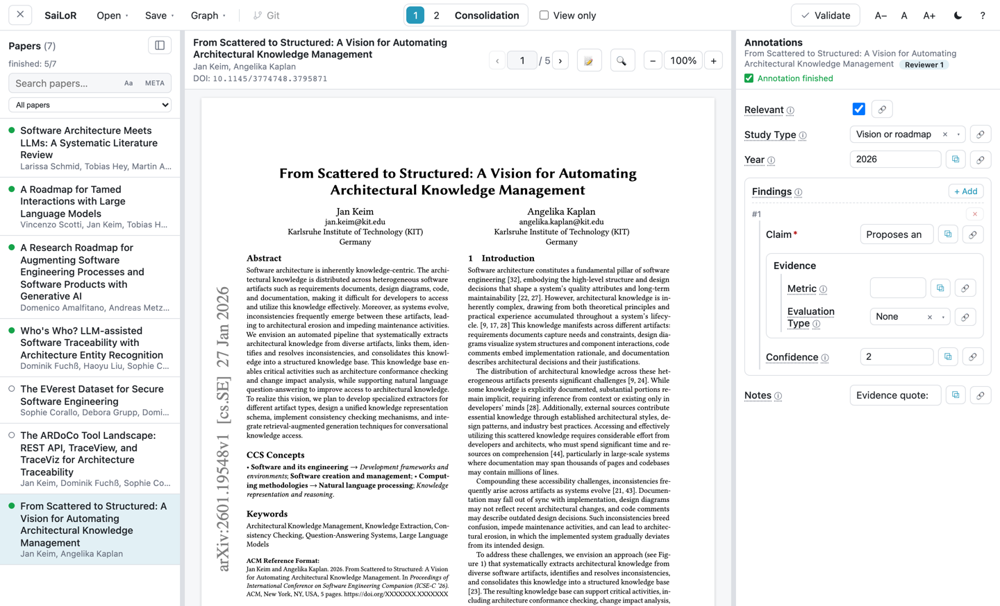
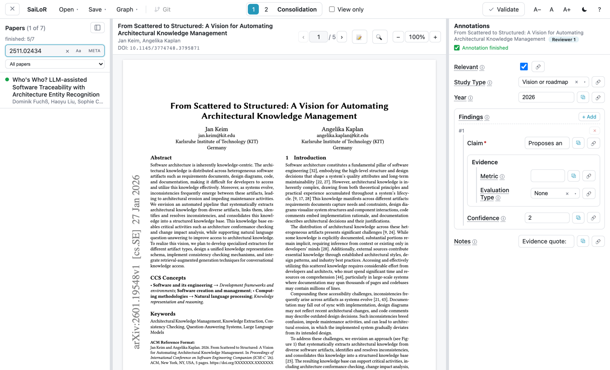
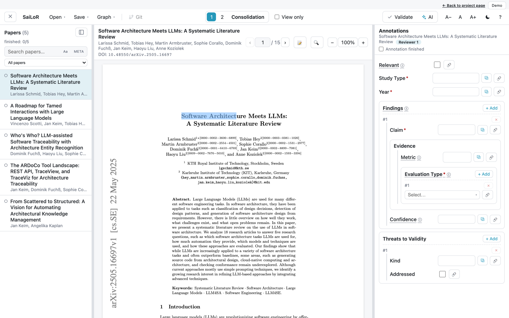
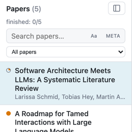
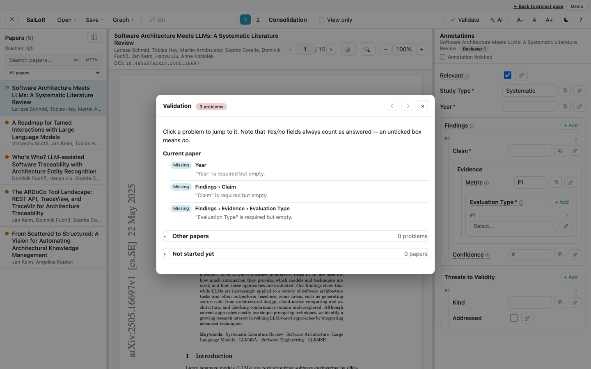
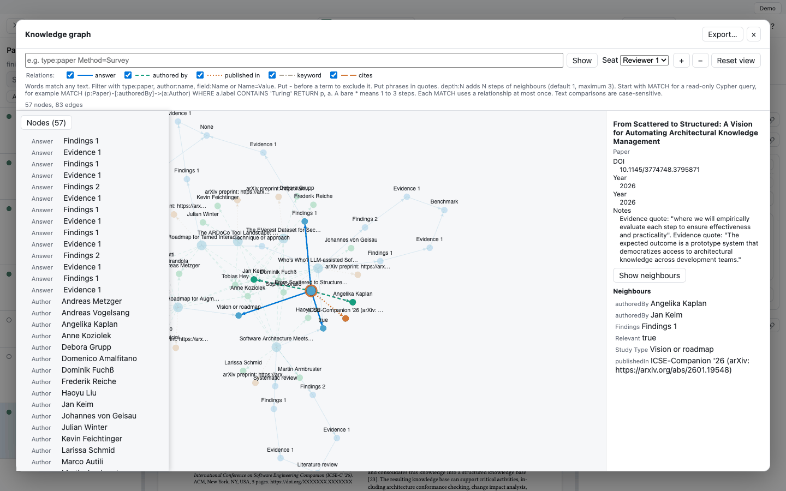
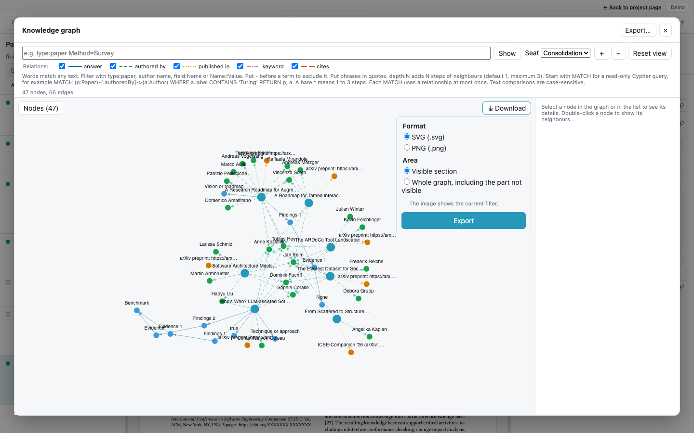
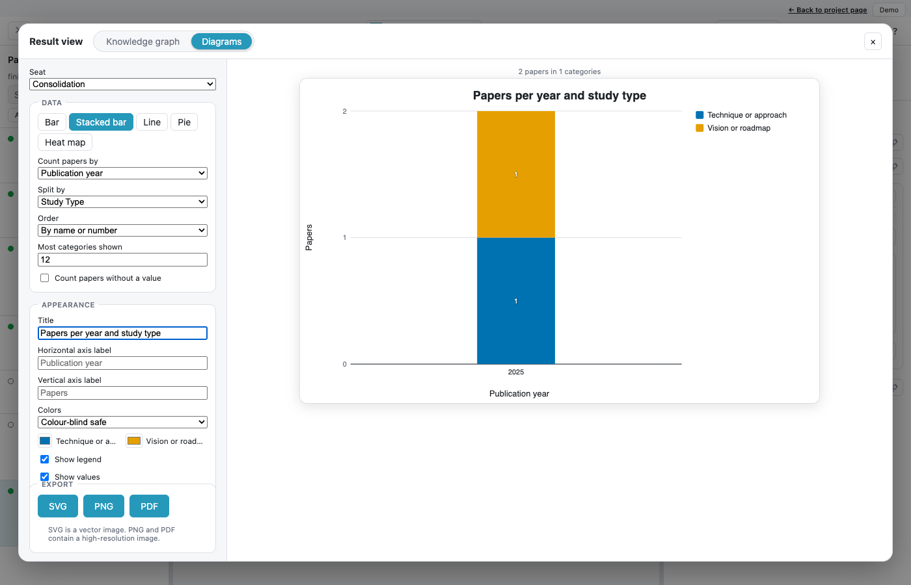
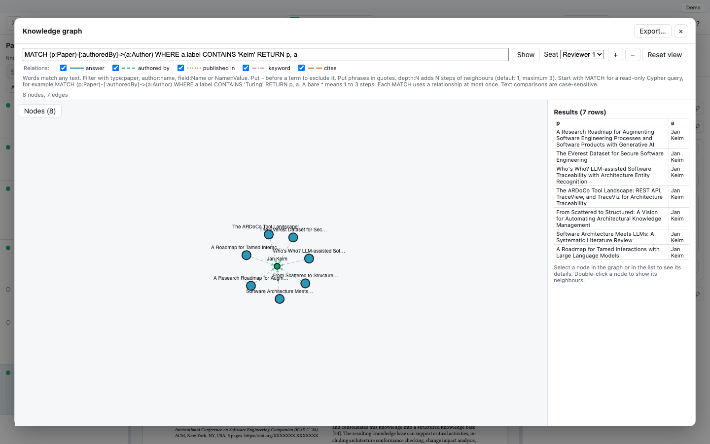
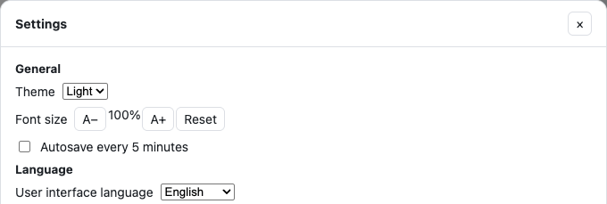

# Getting started

## The three-pane layout

Once a project is open, the screen is three panes: your **papers** on the left, the **PDF** in the
middle, and the **annotation form** on the right, built from the project's schema.

  

- **Pick a paper** from the left list to load its PDF and its form.
- **Read the PDF** in the middle; its text is selectable, and **Ctrl/Cmd+F** searches within it.
- **Fill in the form** on the right. Repeatable fields (like *Findings* above) show **+ Add** and a
  remove (**×**) control for each entry.
- **Save** via the *Save* menu, or **Ctrl/Cmd+S**. *Save as…* writes to a new location and
  re-derives every PDF reference so they keep resolving from there.

If the project is set up for **screening** instead of full annotation, this pane shows a title/abstract
record and an Include/Exclude choice instead — see [Screening](screening.md). If it's set up for
**multiple reviewers**, you'll be asked which seat you are before you can annotate anything — see
[Working with several reviewers](multi-reviewer.md).

Tick **View only** in the toolbar to look at the annotations without the risk of a change.
In view-only mode, SaiLoR does not change the project. Clear the checkbox to edit again.

### Opening a large project

SaiLoR opens a project in two steps. First it shows the paper list with the metadata of all papers.
Then it reads the answers of the papers in batches.
While SaiLoR reads, the paper list shows the progress, for example "Loading papers: 12,000 / 50,000".
You can open and annotate each paper that has loaded.

Some features need all papers. SaiLoR disables them until the last paper has loaded:

- save, save as and autosave
- validation and AI evaluation
- the knowledge graph export, the graph view and the diagrams
- the PDF folder scan and the Git panel
- the consolidation overview, the disagreement lists and the screening summary

The tooltip of each disabled control gives the reason.
If a batch cannot be read, the paper list shows where loading stopped. Click **Retry** to read the batch again.
SaiLoR keeps saving blocked until every paper has loaded.
A project in the old single-file layout opens in one step. Save it once to change it to the split layout.

## Finding a paper

The box above the paper list searches **title, authors, DOI, abstract, the PDF's file name, and the
paper's own id** by default (the **META** trigger on the right edge of the box). Click that trigger to
switch to **TAGS**, which searches the **annotation content** you've already recorded instead — useful
for "which papers did I mark as X".

  

The search above matches `2511.02434` — part of a PDF's *file name*, not its title or authors — and still
finds the right paper. Searching by the paper's own id works the same way; both are useful once a
project has more papers than you can recognize by title alone.

Annotation-content search looks at *your own* current seat's answers, so in a multi-reviewer project
it finds your work, not somebody else's.

## Grabbing text straight from the PDF

Select any text in the PDF, then click the **⧉** button next to a field to insert exactly that
selection into it. Numeric fields pull out the first number in the selection.

  

This is the fastest way to fill in most fields without retyping anything from the paper — select the
sentence that supports a claim, click ⧉ next to *Claim*, done.

## Highlighting and commenting in the PDF

Select text in the PDF and a small color toolbar appears — pick a color to highlight the selection
and open a note box for it right away, or press **a** to use the first color without reaching for the
mouse. A selection that runs onto the next page becomes one continuous highlight instead of stopping
at the page break; a running header or footer caught in that spillover is left out automatically,
though selecting into one yourself still highlights it. Click any existing highlight later to reopen
that box: change its color, edit or clear the note, or delete it. Press **Escape**, click elsewhere, or
scroll the page to close the box without deleting anything.

Hovering a highlight or note (without clicking) shows its comment — or, for a highlight with no
comment, the text it covers — plus any fields it's linked to, in a small tooltip, so you can check
what a mark is without opening it. **Ctrl/Cmd+scroll** zooms the PDF in and out. Click **▯** in the PDF toolbar for the single-page view. It fits one page to the pane, and the mouse wheel flips to the next or previous page. If the page is zoomed in, the wheel scrolls inside the page first. The application remembers the setting. Deleting a highlight
or note that's linked to one or more fields asks you to confirm first, naming which fields would lose
their evidence.

These highlights and notes are your own — in a multi-reviewer project, each reviewer (and
Consolidation) sees only their own marks, just like annotation answers. They're saved with the
project like everything else, but on their own file per paper per reviewer, so two people marking up
the same PDF never conflict in git.

**More annotation tools.** The 📝 button in the PDF header opens a row of annotation tools below it:

- A post-it button for dropping a sticky note anywhere on the page — click the button, then click
  the spot in the PDF, and the note's comment box opens right away.
- ‹ › buttons to step through every highlight and note on the paper, in reading order, jumping
  straight to each one's exact spot on the page (not just the top of the page it's on).
- A 📤 button (enabled once you have at least one highlight or note) that exports the PDF with your
  marks burned in as real PDF annotation objects any PDF reader can show — for sharing outside
  SaiLoR. Choose to save it as a new file (the default) or overwrite the paper's own PDF in place;
  the app warns before the second option, since that file is shared with every other reviewer and
  overwriting it is likely to cause a git conflict.

**Linking a highlight or note to a field.** Next to every annotation field is a small 🔗 button —
click it to record why you picked this value. It opens a box showing what's already linked (or "No
links yet"); click **+ Link a highlight or note** to fold out a scrollable list of the paper's other
highlights and notes, with a search box at the bottom if there are a lot of them. That list is sorted
with up to 3 highlights/notes you made *this session* first, most recent first (a little extra space
marks where that group ends), then everything else in reading order down the paper — a highlight
that's simply been in the file since a previous sitting is never pinned there, however new its own
timestamp looks. Clicking a highlight/note's own text — in
either list — jumps to it in the PDF so you can see which one it is, without closing the box or
changing anything; click **Link** to attach it — its button flips to **×** right there without the row
jumping anywhere, and it moves up into the linked list above the next time you open the box. The 🔗
button shows a count once you've linked one or more (`🔗 2`). A highlight or note can be linked to any
number of fields, and a field can have any number linked to it.

If you highlight or note something and then open a field's 🔗 box right away, that highlight/note links
itself automatically — no need to find and click it. Typing the value into that same field first still
counts as "right away" and links it too. Doing anything else first — editing a different field, adding
or removing an entry, undoing, touching another mark — cancels the offer, and you pick it from the list
by hand instead.

To remove a link, click its × — either in the field's own box, or by opening the highlight/note itself
in the PDF, where its box lists every field it's linked to.

## The completeness dot

Each paper in the list carries a status dot on its left. In an ordinary (non-screening) project, it
fills in proportionally as fields are completed:

  

- If the schema marks any fields **required**, the dot's denominator is those required fields only.
- If nothing is marked required, it's a fraction of *all* fields instead — better than nothing rather
  than staying permanently empty.
- Hover a dot (or check its accessible label) for the actual numbers: "3 of 12 fields filled".

The **fill** is always progress; the **color** says whose move it is:

| Dot | State | Meaning |
| --- | --- | --- |
| empty | *Not started* | nothing filled in yet |
| amber slice | *In progress* | partly filled |
| solid amber | *Ready to finish* | every counted field is filled, but nobody has said it's done |
| solid green | *Finished* | you ticked **Annotation finished** and it still holds |
| red | *Finished, required fields missing* | ticked while a **required** field is empty — see below |

The dot always tracks **your own seat**: as a numbered reviewer it's your progress and your sign-off,
and in **Consolidation** it's the consolidated record's progress and *your* sign-off on it. Whether
every reviewer has answered a paper yet — the thing that decides if it's workable at all — is in that
dot's tooltip in the Consolidation seat, and counted in the line under "Papers" (`… · 3/10 ready`).
In a **screening** project the dot becomes the tri-state include/exclude/undecided marker described in
[Screening](screening.md) instead.

## Marking a paper finished

A completely filled form is not the same as a finished paper, so SaiLoR does not decide that for
you. The **Annotation finished** checkbox sits at the top of the annotation panel, under the paper's
title, and is always there — tick it when you're done with the paper. Only then does its dot turn
green.

### When red appears

Red means one specific thing: **a field that had to be filled is empty on a paper you called
finished.** "Had to be filled" is the schema's own `required` flag — the same rule
[Validate](#validating) uses — so the red dot and the Validate dialog can never disagree.

- If your schema marks **nothing** required, no paper ever turns red. An unanswered question is
  often the right record of a paper that doesn't address it, and ticking the box says so.
- A **Yes/No** field is never a hole. Unticking it records *no*, which is an answer — it can't turn
  a finished paper red even if the field is marked required. (Same reason Validate never reports a
  Yes/No field as missing.)
- Ticking early — before a required field is filled — is allowed rather than blocked. Sometimes a
  paper genuinely can't be filled in further; the app marks the disagreement instead of hiding it.

The mark is re-evaluated from the current data, live, as you type: **it is not tied to saving.**
Empty a required field on a finished paper and it turns red at once; refill it and it goes green
again. Nothing is ever silently un-ticked — the declaration is yours to withdraw by unticking the
box.

The tick is yours alone: in a multi-reviewer project each reviewer — and Consolidation — has their
own checkbox and their own green dot, saved in their own file. In the Consolidation seat the box reads
**Consolidation finished**, since what you're signing off there is the reconciled record rather than
your own extraction; it is stored with the consolidated result, and says nothing about whether the
reviewers have all answered the paper.

### Turning the checkbox off

If you'd rather not sign papers off by hand, put `"finishCheckbox": false` in the project file's
`config`. Papers then count as finished the moment their schema is fulfilled — all required fields
filled, or all fields where the schema requires nothing — and the checkbox disappears. Nothing can
be red in that mode (there is no declaration left to contradict the data), so the filter drops its
*With issues* option too.

The default is `true`. Ticks recorded before you turned it off stay in the file untouched, so
turning it back on picks up exactly where you left off.

### Where a project opens

Opening a project puts you on the **first paper that isn't finished** — including one showing red —
rather than on paper 1, which on a review you've been working through is something you already
signed off. If every paper is finished, it opens on the first one as before. Screening projects, and
a multi-reviewer project where you haven't picked a seat yet, also open on the first paper: neither
has a per-seat "finished" to go by.

## Filtering by annotation state

The dropdown under the search box narrows the list to one of these buckets:

- **Open** — every paper you have *not* ticked as finished, whatever its dot shows: untouched,
  part-filled, and filled-but-not-yet-signed-off alike. Undo some annotations, or untick the box on a
  paper you had finished, and it comes back here.
- **In progress** — the papers you have actually *started*: those with at least one annotation
  recorded, still not signed off. This is **Open** minus the papers you have not touched yet, so it
  answers "what have I begun and not finished". (A paper whose only entry is a Yes/No answer counts as
  started even though its dot still reads empty — the fill ignores Yes/No fields.)
- **Finished** — ticked and still holding.
- **With issues** — ticked while a required field is empty (the red dots).

The five dot colors are unchanged; the filter is just coarser than they are, since "what still needs
work" is the question you actually ask a list.

The line under "Papers" counts whichever bucket is selected, across the whole project regardless of
the search box: `finished: 5/100`. With no filter set it counts *finished*, the headline number.
Screening projects keep their own include/exclude/undecided filter instead. The Consolidation seat has
the same dropdown and the same counter as any other, plus a second number for how many papers every
reviewer has answered: `finished: 5/100 · 82/100 ready`.

## Validating

**Validate** (in the toolbar) checks every annotated paper against the schema: required fields that
are still empty, values of the wrong type, and enum values outside a dropdown's allowed choices.

  

Click a problem to jump straight to that field. Papers with **no annotations at all** are listed
separately under *Not annotated yet* rather than reported field by field — an untouched paper would
otherwise fail every required field at once and bury the problems that are actually worth looking at.

Note the reminder at the top of the dialog: a *Yes/No* field is never reported as missing, even if
it's marked required — see [Things to know](things-to-know.md#a-smaller-one-a-yesno-field-can-never-be-reported-as-missing).

## Correcting paper metadata

If the project allows metadata corrections, the toolbar shows a **Metadata** button.
The project editor sets this option. See [Project settings](project-editor.md#project-settings).
The button needs a human reviewer seat or the Consolidation seat.

To correct the metadata of a paper:

1. Select the paper.
2. Click **Metadata**. The dialog shows the title, authors, year and DOI of the current paper.
3. Change the values. The year must be between 1000 and 2100, or empty.
4. Click **Save**.

SaiLoR stores the correction in the annotation file of your seat. The project file does not change.
The paper list and the panel header show the corrected title and authors of your seat.
A badge in the paper list names the corrected fields.

Click **Check PDFs** to read the title, authors and DOI from each PDF file.
The dialog then shows one entry for each proposed correction. For each entry, do one of these:

| Button | Result |
| --- | --- |
| **Save** | Stores the values as a correction in your annotation file. |
| **Save all** | Stores every shown proposal in one undo step. |
| **Skip** | Hides the entry until the dialog opens again. |
| **Ignore** | SaiLoR does not propose these values again. |

Nothing changes until you confirm an entry. Each confirmation is one undo step.
The correction goes into the project file only in a separate step in the Consolidation seat.
See [Metadata corrections in Consolidation](multi-reviewer.md#metadata-corrections-in-consolidation).

## Adding new PDFs from a folder

If the project sets a PDF folder, SaiLoR scans the folder for new PDF files.
SaiLoR scans when the project opens, when the window gets the focus, and when you click **Rescan**.
The toolbar button shows the count of new files, for example "New PDFs (3)".
SaiLoR compares files by their content hash, not by their names. A renamed file is not new.

The **New PDF files** dialog shows one entry for each new file.
Each entry proposes a title, authors, a year and a DOI. A label gives the source of each value:

- **PDF information**: the embedded PDF data and the first page.
- **Crossref**: the Crossref lookup, if the project turns it on.
- **file name**: no other source gave a title. The entry shows "Metadata missing".
- **manual**: you changed the value.

Check and change the values. Then do one of these for each entry:

| Button | Result |
| --- | --- |
| **Add paper** | Adds the file as a new paper. |
| **Add all** | Adds every shown file in one undo step. |
| **Skip** | Does not add the file now. The next scan offers it again. |
| **Ignore** | SaiLoR never offers the file again. |

SaiLoR adds only the files that you confirm. The paper list marks a paper whose PDF file is missing.
SaiLoR does not send PDF files or text to Crossref. With the lookup on, it sends only the DOI.

## Annotating with AI

Caution: AI support is a preview feature. Check every AI proposal yourself before you apply it.

If the project allows AI, the toolbar shows an **AI** button.
The project editor sets this option. See [Project settings](project-editor.md#project-settings).
Without an AI seat, the AI button is not available in the Consolidation seat.

Before the first run, add a model:

1. Open **Settings** and go to the **AI** section.
2. Click **AI models…**.
3. Add a provider and a model. Enter the API key if the provider needs one.

SaiLoR stores the API keys in the keychain of your operating system, not in the project.

To annotate with AI:

1. Select a paper and click **AI**. The **Annotate with AI** dialog opens.
2. Select a mode:

   | Mode | Behaviour |
   | --- | --- |
   | **Prompt** | One request per paper. The model reads the paper once and proposes values. |
   | **Agent** | The model searches and re-reads the paper with tools. A second model, the **Judge**, checks each value. |
   | **Classify** | A fast System One model answers yes/no and single-choice fields. It gives no quotes. |

3. Select the **Annotator** model. Optionally, select a **Judge** and a **Cross-check** model.
4. Read the consent text. It names the provider and the data that leaves your computer.
5. Click **Start**.
6. Check the proposals. Tick the rows that you accept.
7. Click **Apply**.

Nothing goes into the project until you click **Apply**.
The AI proposes values only for empty fields, unless you turn on the re-check of filled fields.
A row starts unticked if its confidence is low, the judge flags it, or the cross-check disagrees.

**Options** has more settings:

- **Annotate all papers** runs the AI on every paper. A warning shows the number of requests and the cost.
- **Papers at once** sets how many papers run in parallel.
- **Stop when spent exceeds $** stops the run at a cost limit. This needs model prices.
- **Show the AI my finished papers as examples** sends some of your finished papers as examples.

If the project has an AI seat, the AI writes into that seat.
See [AI evaluation](multi-reviewer.md#ai-evaluation) to compare the AI seat with the consolidated answers.

## Exploring the knowledge graph

The knowledge graph shows papers, authors, venues, keywords and answers as nodes.
Edges connect each paper to its authors, venue, keywords, answers and cited papers.

To open the graph view, click **Result view ▾** and then **Explore knowledge graph**.
The result view has the tabs **Knowledge graph** and **Diagrams**. Click a tab to switch.
The **Save ▾** menu has the item **Knowledge graph**, which exports the graph as a file.

  

Use the view like this:

- Drag the background to move the graph. Turn the mouse wheel to zoom.
- Click a node to select it. The side panel shows its details and its neighbours.
- Double-click a node, or click **Show neighbours**, to add its neighbours to the view.
- Clear a checkbox under **Relations:** to hide the edges of that type.
- Clear a checkbox under **Node types:** to hide the nodes of that type and their edges.
- Open **Statistics** to see the number of nodes and edges, the average degree, the components and the five nodes with most edges. Click a listed node to select it.
- If the selected node is a paper, click **Open paper** to select it in the annotation view.
- If a Cypher query shows a table, click **Save table as CSV** to save it.
- If the project has more than one reviewer, select the seat above the graph. Select **Consolidation** to see the consolidated answers. The list has **Consolidation** only after you save one. The view selects it at first.
- Click **⤓ Download** at the top right of the graph area to save the graph as an image. Select **SVG** or **PNG**. Select **Visible section** to save what you see, or **Whole graph, including the part not visible**. The image shows the current filter, or the whole graph if there is no filter.
- Click **Nodes** to open the node list. The list is closed when the view opens.
  The list is a keyboard alternative to the canvas. It shows 200 nodes; **Show more** adds 200 more.
- Click **Export…** in the graph toolbar to save the graph as JSON-LD, RDF Turtle, GraphML or CSV.
- Press Escape or click × to close the view.

The view uses the consolidated answers if they exist.
The view keeps the **Relations:** and **Node types:** filters when you close and open the application.

## Creating diagrams

Diagrams show how many papers have an answer, for example the papers of each method per year.

1. Click **Result view ▾** and then **Create diagrams**.
2. Under **Diagram type**, select Bar, Stacked bar, Line, Pie or Heat map.
3. Under **Count papers by**, select the year, venue, author, keyword or a field of your schema.
4. To compare groups, select a second dimension under **Split by**.
5. Under **Appearance**, set the title, the axis labels, the colours, the legend and the size.
6. To count only some papers, select a dimension under **Only papers where** and enter a text under **Value contains**.
7. For bar types, select **Horizontal bars**. For stacked bars, select **Show shares of 100 %**.
8. Click **SVG**, **PNG** or **PDF** to save the diagram. Click **CSV** to save the counts.

  

The diagram updates after each change. The window stays usable while it is made.
The PDF has vector graphics and selectable text. If the diagram has characters that PDF fonts lack, such as Chinese or Persian, the PDF has an image.
Select **Show data table** to see the counts.
The view keeps all settings when you switch tabs or close the application.
If the project has more than one reviewer, select the seat above the settings.
If no paper has a value, the view shows a message and you cannot save.

Use **Count papers without a value** to count papers without an answer as "(none)".
If a dimension has many values, set **Most categories shown**. The rest merge into "Other".
The SVG file is a vector image. Use it for papers and slides. The PDF file has one page with a raster image.
Click **Reset settings** to go back to the defaults.
If no consolidated answers exist and the project has several reviewers, select the **Seat** in the view.

### Graph queries

Type a query into the query box. Then press Enter or click **Show**.

| Query | Shows |
| --- | --- |
| `turing` | Nodes that contain the word, and their neighbours. |
| `type:paper Method=Survey` | Papers with the answer *Survey* in the field *Method*. |
| `author:smith` | Author nodes that contain *smith*, and their papers. |
| `turing -type:author` | Nodes that contain *turing*, but no author nodes. A `-` removes the matches of a term. |
| `type:paper depth:2` | Papers and the nodes up to 2 steps away. The default depth is 1. The maximum is 3. |

A query that starts with `MATCH` is a read-only Cypher query:

  

The side panel shows the result rows. The graph marks the returned nodes.
If the query has an error, the view shows the reason and the position.
SaiLoR stops a query after 20 seconds.
For the full query syntax, see [Knowledge graph](../README.md#knowledge-graph) in the main README.

## Keyboard shortcuts

Press **F1** at any time for the full, current list for whichever screen you're on — it differs
between the start screen, annotating, screening, and the project editor. The most common ones while
annotating:

| Shortcut | Action |
| --- | --- |
| Ctrl/Cmd+O | Open a project file |
| Ctrl/Cmd+S | Save |
| Ctrl/Cmd+Shift+S | Save as… |
| Ctrl/Cmd+Z / Shift+Z | Undo / redo an annotation change |
| Ctrl/Cmd+F | Search within the PDF |
| Ctrl/Cmd+scroll | Zoom the PDF |
| a | Highlight the current PDF selection with the first color |
| Alt+↓ / `]` | Next paper |
| Alt+↑ / `[` | Previous paper |
| F1 | Open help |

Focus stays inside an open dialog:

- Tab on the last control moves to the first control.
- Shift+Tab on the first control moves to the last control.
- Most dialogs close with Escape or with a click outside the dialog.
- A click inside the dialog does not close it.

The knowledge graph view does not close on a click outside it. Use Escape or the × button.

## Settings

Open **Settings** with Ctrl/Cmd+, or click the SaiLoR title in the toolbar.

  

| Section | Content |
| --- | --- |
| **General** | Theme, app font size and **Autosave every 5 minutes**. |
| **Language** | The language of the user interface. |
| **AI** | **AI models…** opens the AI model library. SaiLoR shows this section only if the open project allows AI. |
| **Git** | The git version that SaiLoR found, or the reason that git is not available. |

SaiLoR stores these settings for your user account. Project settings stay in the project file.

## Changing the language

SaiLoR is available in these languages:

- English
- German (Deutsch)
- Chinese, Simplified (中文)
- Persian (فارسی)
- Spanish (Español)
- French (Français)
- Italian (Italiano)
- Portuguese (Português)
- Japanese (日本語)

On the first start, SaiLoR uses the language of your system if it is available.
In all other cases, SaiLoR starts in English.

To change the language:

1. Open **Settings** with Ctrl/Cmd+, or click the SaiLoR title in the toolbar.
2. Go to the **Language** section.
3. Select a language in **User interface language**.

You can also open **Settings** from the **Help** menu.
In the help window, click **Open settings**.

The window and the native menus change at once. You do not have to restart SaiLoR.
SaiLoR stores the choice for your user account, not in the project.
The language does not change project data, schema field names or AI prompts.
Persian is written from right to left. In Persian, SaiLoR mirrors the layout.
Code, keyboard keys and PDF pages stay left to right.
The Chinese, Persian, Spanish, French, Italian, Portuguese and Japanese texts are machine translations.
These texts can contain errors.
Some messages from git and from the operating system stay in their own language.
